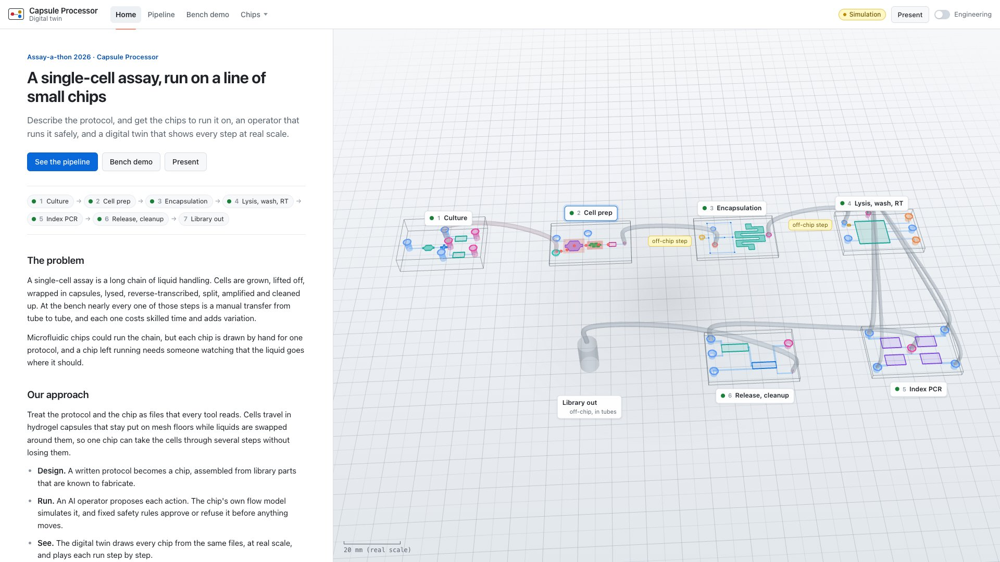
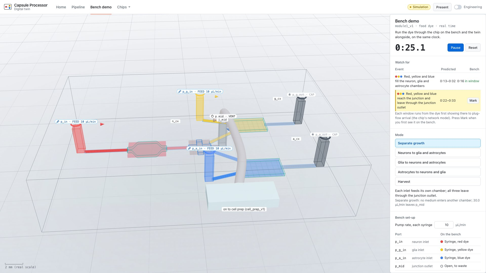

# assay-a-thon_hack: capsule processor

Describe a single-cell assay protocol; AI designs a microfluidic **capsule processor**
chip for it, and an AI operator runs the protocol on that chip, shown live as a 3D
digital twin. Cells sit in capsules that stay put on mesh floors while liquids are
exchanged around them, split into chambers and pooled back together.

**Why "single-cell" is earned, not assumed.** Each capsule holds one cell, and each capsule
is re-injected into its own oil droplet where a single barcode molecule from a pool of
4.3 × 10⁹ is clonally amplified *in that droplet* and joined onto that cell's cDNA, so every
cell carries its own clonal barcode (the AmpliDrop idea applied to semipermeable capsules,
[10.1101/2024.08.13.607508](https://doi.org/10.1101/2024.08.13.607508); design in
[protocols/sctip_spc_design.md](protocols/sctip_spc_design.md)). The ~12 groups you get from
three lanes × four sublibrary indices are a **demultiplexing** convenience on top — they are
not the resolution of the data. The barcoding chemistry is ours; the droplet hardware it
needs is below our 200 µm in-plane floor and is bought.

This weekend
there are no pumps, cameras or wet-lab data: everything runs in software, with
resin-printed, hot-embossed parts for the physical chip (30 × 20 mm, 0.3 mm deep, one
fluidic layer). Retention features cannot be printed at this floor, so capsule
retention needs a bought mesh insert or sedimentation. Stage map: [protocols/pipeline_status.md](protocols/pipeline_status.md). Closed-loop runs use a
**virtual chip** and are labelled **SIMULATED HARDWARE** everywhere; what to buy to
run them for real is in [docs/hardware_roadmap.md](docs/hardware_roadmap.md).

## Sunday demo: one command

```
python tools/demo.py          # serves the repo, opens http://localhost:8000/twin/?present
python tools/demo.py --bench  # the bench demo: Module 1 in real time beside the food-dye run
python tools/demo.py --twin   # the twin itself, opening on its home page
```

The **presenter view**: a guided sequence with big Next / Back buttons (a clicker, the arrow
keys or Space work too; F for full screen), fully offline. If the laptop misbehaves, play the
backup video [docs/demo/presenter_backup.webm](docs/demo/presenter_backup.webm). Details and
screenshots: [docs/demo/README.md](docs/demo/README.md).

## Pipeline

```
 protocols/              chip/                     cad/
 MJ + Kilian             Yuvraj + Szonja           Ayrton
 protocol.json           NL prompt                 CAD
 (steps + physics)          │                       │
       │                    ▼                       ▼
       │              chip_spec.json  ──────▶  exports/<part_id>.stl
       │                    │                       │
       └─────────┬──────────┘                       │
                 ▼                                  │
           operator/  (Bruno)                       │
   optimizer ─▶ safety ─▶ closed-loop controller    │
   driven by the planner, Claude (llm_operator.py)  │
   or a replayed transcript; scenarios/ inject      │
   faults on the virtual chip                       │
                 │                                  │
                 ▼                                  │
  runs/<protocol>__<chip>[__<scenario>].json        │
                 │                                  │
                 └────────────────┬─────────────────┘
                                  ▼
                            twin/  (Bruno)
                  3D replay in the browser (three.js)
```

The **contracts** (`contracts/`) are the shared file formats between these steps.
Each pair works against placeholder files until the real ones are ready. Start
with [contracts/README.md](contracts/README.md).

## Who owns what

| Folder | Owner | Produces |
|---|---|---|
| `protocols/` | MJ + Kilian | `protocol.json`: steps and physics numbers |
| `chip/` | Yuvraj + Szonja | `chip_spec.json`: NL → chip geometry |
| `cad/` | Ayrton | STL per part, named by chamber ID |
| `operator/` | Bruno | run files: planner + LLM operator |
| `twin/` | Bruno | the 3D digital twin |
| `contracts/`, `tools/`, integration | Bruno | schemas, validator, CI |

## Quickstart

Needs Python 3.10+.

```bash
git clone https://github.com/brunohawkins/assay-a-thon_hack.git
cd assay-a-thon_hack
python -m venv .venv
source .venv/bin/activate          # Windows: .venv\Scripts\activate
pip install -r requirements.txt     # just jsonschema

python tools/validate.py            # 1. check every file against the contracts
python tools/check_chip_spec.py     #    and every chip design against the capsule rules
python operator/run.py --all        # 2. regenerate every run (simple + closed-loop scenarios)
python operator/run.py --scenario scenarios/m3_wash_clog.json   #    or one closed-loop scenario
python -m http.server 8000          # 3. serve the repo root...
# ...and open http://localhost:8000/twin/
```

The twin's header has four views and two switches:

- **Home** (where it opens): the project on one page (the problem, our approach, what we built
  this weekend and why, what is new, and where it stands) beside the pipeline playing on a loop.
  
- **Pipeline**: every chip of the pipeline at real scale (30 × 20 mm each) in a
  two-row snake, with 1/16 inch tubes between the hand-off ports. Play follows the sample port
  to port through each chip's channels and along the tubes (cells, then capsules, then library).
  The stages, in order (from `protocols/pipeline_mvp.json`): Module 1 v1 (culture) → cell prep →
  Module 2 (encapsulation, `spc_demo_v1`) → Module 3 (load, lysis, wash, RT; translated from the
  project's geometry requirements sheet) → **single-cell barcoding** → Module 4 (sublibrary split
  + index PCR) → Module 5 (release + cleanup) → SPRI and QC (off-chip) → library out.
  Barcoding is a real stage, and the one that makes this a single-cell assay, but it is **our
  chemistry on bought hardware**: its droplet features are below the 200 µm in-plane floor, so it
  has a chip spec and a protocol and no printable chip of ours, and both the scene and the
  sidebar label it that way rather than letting it read as a chip we make.
  The sidebar lists every stage in order with its status from `protocols/pipeline_status.md`
  ("Designed" means a spec and a protocol exist, not that the chip is printed), the off-chip
  steps between stages, and a switch between **CapSeq** RNA (the plan: MJ's six-chip chain, with
  no barcoding stage of its own) and **TIP-seq** chromatin DNA (an alternative kept for comparison;
  `tools/choose_assay.py` sets which one is the plan). A stage with no chip is a dashed outline. Click a
  stage or a chip to open it.
- **Bench demo**: Module 1 in real time beside the food-dye run on the bench (`#view=bench`, or
  `python tools/demo.py --bench`). Pick the mode and the pump rate; the sidebar says what goes on
  each port (which dye syringe, open, plugged). Start the timer with the pumps and the twin's dye
  moves on the same clock. **Watch for** lists what should happen and when: a window from the dye
  first showing there to plug-flow arrival, from the same network model as `operator/network.py`.
  **Mark** records when you first see it on the bench and says whether it landed in the window.
  
- **Chips**: each chip's own view, playing its protocol, with a card saying what the chip does.
  Chambers whose spec names a Flowmatter block are drawn from Yuvraj's block STLs
  (`cad/library/`, from his paper-to-chip tool); everything else is drawn from the export folder
  that **belongs to that chip** (`cad/exports/<chip_id>/`, which records its owner), with every
  file checked against the box its spec says it should be — a part at another chip's coordinates
  is refused, not displayed, and the CAD badge says what was drawn and what was not.
  Modules 4 and 5 add a design-note panel. The header badge beside it reports whether the run on
  screen was recorded against **simulated** hardware, **real** hardware, or does not say.
- **Present** opens the presenter view. **Engineering** (remembered per browser) adds the run
  picker, Module 1's flow panel (every port, the solver, the operator's decisions), chip sizing
  and generator parameters, **Real scale / Display model** (the printed show piece), part IDs,
  and **Old drafts**: superseded drafts and the duplicates the status file retires.

Playback: Play/Pause (Space), Step (→), speed 1x/5x/20x (keys 1/2/3), click the timeline to
jump, drag to orbit. `#run=<file>` in the URL opens a specific run.
Closed-loop runs add the **control loop** panel in engineering mode (believed vs true state, prediction vs
measurement charts with model-update markers, the optimizer's choices, the event log
with safety tags), an alert banner, and an **Open loop / Closed loop** toggle that
replays the same protocol and faults the other way. How the closed loop works:
[operator/README.md](operator/README.md).

Other tools: `python operator/sizing.py mvp cells:100000` (chip sizing, port of the
project's geometry requirements sheet), `python cad/export_display_model.py cad/m3_wash_spec.json` (printable display model),
`python -m unittest discover -s tests` (tests).

The physical food-dye demo (one pump, one chip at a time): [docs/demo.md](docs/demo.md), derived from the chip specs by `python tools/demo_plan.py --write`.

The twin only reads run files, so a recorded run always works offline. That's the
demo fallback: if the live LLM run misbehaves, play the committed run.

## Swapping a placeholder for real work

Every placeholder file says `"placeholder": true`. To replace one:

| You have | Do this |
|---|---|
| A real protocol | New file in `protocols/` (copy a placeholder), new `id`, fill in steps → `python tools/validate.py` → `python operator/run.py --protocol protocols/<file>.json --chip chip/<spec>.json`. MJ reviews it first. |
| A real chip spec | New file in `chip/`, new `id`, **keep the IDs** (`exchange_1`, `split_1`…) → validate → `python operator/run.py --all --chip chip/<file>.json` |
| CAD parts | `cad/exports/<id>.stl` in mm, same origin as the chip spec → reload the twin; matching parts replace the boxes |
| An LLM run | `export ANTHROPIC_API_KEY=...` then `python operator/run.py --scenario scenarios/m3_wash_clog.json --operator llm`; commit the run and its transcript |
| Real hardware | See [docs/hardware_roadmap.md](docs/hardware_roadmap.md); pick an adapter with `--adapter` (`dryrun` prints what the hardware would do) |

Set `"placeholder": false` only when a file is real. Read [CONFIDENTIALITY.md](CONFIDENTIALITY.md)
before committing anything real, and [CONTRIBUTING.md](CONTRIBUTING.md) for how we work.

## Repo layout

```
contracts/          the shared formats: plain-English README + JSON Schemas
protocols/          protocol.json files (MJ + Kilian)
chip/               chip specs + nl_to_spec/ (Yuvraj + Szonja)
cad/exports/        STL per part, named by ID (Ayrton)
operator/           model, optimizer, safety, closed-loop controller, operators, adapters, run.py (Bruno)
scenarios/          closed-loop test scenarios: sensors on/off, model-vs-reality gaps, injected faults
runs/               generated run files, audit reports, operator transcripts + index.json (the twin reads these)
twin/               three.js digital twin, no build step (Bruno)
tools/validate.py   validates everything and checks IDs line up (also runs in CI)
tools/check_chip_spec.py  real-scale design checks: trap gaps, channel widths, heights, temperatures
tests/              unit tests (sizing, design checks, safety rules, operators)
docs/               hardware roadmap
```

Rules: Python 3.10+ with the standard library plus `jsonschema` only. The twin is
plain HTML + ES modules with three.js pinned from a CDN: no build step, no npm.
