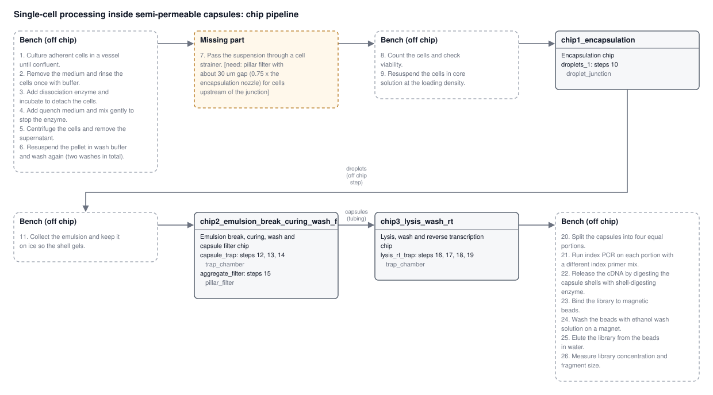

# autochip report: Single-cell processing inside semi-permeable capsules

> **Agent:** replay of /tmp/agent_paper_assayathon_demo

**26** protocol steps · **3** chips · **4** modules · **9 / 16 / 1** on chip / bench / missing · **2** layout errors · **0 / 0** flow-check errors / warnings

3 chip(s) do 9 of the 26 protocol steps; 16 stay at the bench and 1 need a part the library doesn't have. Everything here is generated: flows, volumes and times the source did not give are placeholders.

## Open problems

- **chip2_emulsion_break_curing_wash_filter** (layout): chamber 'capsule_trap' retains with pillars 25 um apart, below the 60 um smallest gap this process makes. This process has one fluidic layer, so a bought mesh floor has nothing to clamp it either. Needs a bought mesh held by a second layer (another process), finer features, or the retention step off-chip.
- **chip3_lysis_wash_rt** (layout): chamber 'lysis_rt_trap' retains with pillars 25 um apart, below the 60 um smallest gap this process makes. This process has one fluidic layer, so a bought mesh floor has nothing to clamp it either. Needs a bought mesh held by a second layer (another process), finer features, or the retention step off-chip.
- step 7: missing part (pillar filter with about 30 um gap (0.75 x the encapsulation nozzle) for cells upstream of the junction); workaround: Strain the cells off chip with a 30-40 um cell strainer before loading chip 1.

## What went in

| | |
|---|---|
| **Source** | paper: Processing single cells inside semi-permeable capsules: a generic microfluidic workflow |
| **File** | autochip/examples/spc_methods_paper.pdf |
| **Citation** | Leonaviciene & Mazutis, Nucleic Acids Research 2023; Baronas et al., Science 2026 |
| **User goal** | - |
| **Protocol goal (as extracted)** | Take adherent cells through dissociation, capsule generation, photocuring, lysis, reverse transcription and index PCR to a cleaned-up, quality-checked sequencing library. |
| **Agent** | replay of /tmp/agent_paper_assayathon_demo |
| **Constraints** | assayathon_demo: Assay-a-thon demo (resin print + hot embossing, 30 x 20 mm) |

## Constraints

- Fabrication: resin_print_hot_emboss on Formlabs Form 3B, material clear resin, sealed by film
- Multilayer: NOT allowed: one fluidic layer
- Channel crossings: NOT allowed (planar layout)
- Thermal zones on one chip: not stated (assume no: clashing temperatures go on different chips)
- On-chip valves: NOT allowed: switch flow off-chip (which pump pushes, which port is capped)
- Max chip footprint: 30 x 20 mm (build area 145 x 145 x 185 mm); edge margin 1 mm; max chips: no limit
- Depth: max 0.3 mm, one depth per layer
- Smallest features: open channel 0.2 mm, enclosed channel 0.5 mm, wall 0.4 mm, gap 0.06 mm
- Ports: max 6 per chip, min diameter 0.8 mm, min pitch 5 mm, connector press_fit_tubing, placed on the top
- Parts: library_and_parametric (library parts may be scaled)
- Off-chip equipment available: syringe_pump, heater, cold_plate, led_405nm, microscope, centrifuge, thermocycler, pipette; pump lines: 4 (0.1-500 µL/min); manual bench steps allowed
- Objective: simplest_to_make
- Note: Flow is switched off-chip by which syringe pushes and which port is capped; no on-chip valves.

## Chips

Why the protocol is split this way: Objective is simplest_to_make. Cell preparation (steps 1-6, 8, 9), cold gelation, split, index PCR, shell digestion and bead clean-up stay at the bench, where the lab has the incubator, centrifuge, cold plate, thermocycler and pipette. Three chips remain. (1) Oil-phase encapsulation, kept apart from everything else. (2) Emulsion breaking, photocuring on the led_405nm, washes and aggregate filtering. (3) Lysis, washes and RT in a trap. Index PCR (up to 95 °C) is above the 50 °C limit of the resin, so split and PCR go off chip to the thermocycler. Shell digestion (step 22) also goes off chip. Re-split fix: both traps now use mesh retention with a 25 um pore, under 0.4 x the 70 um capsule size (28 um), in place of 60 um pillars, which let capsules slip through. The cell filter (step 7) needs about 30 um, below the 60 um process minimum, so it is listed as missing.

| Chip | Purpose | Steps | Modules (part) | Ports | Footprint (mm) | Layers | Constraint findings |
|---|---|---|---|---|---|---|---|
| **chip1_encapsulation** Encapsulation chip | Cells in core solution are pinched into shell-polymer droplets by fluorinated oil at a flow-focusing junction. | 10 | droplets_1 (droplet_junction) | 4 (3 in, 1 out) | 13 x 9.5 | 3 (resin, sealing film) | none |
| **chip2_emulsion_break_curing_wash_filter** Emulsion break, curing, wash and capsule filter chip | Breaks the emulsion, photocures the shells, washes the capsules and removes aggregates. | 12, 13, 14, 15 | capsule_trap (trap_chamber), aggregate_filter (pillar_filter) | 5 (3 in, 2 out) | 27.5 x 19 | 3 (resin, sealing film) | 1 error, 1 warning |
| **chip3_lysis_wash_rt** Lysis, wash and reverse transcription chip | Lyses the cells, washes, and runs reverse transcription inside the capsules held in one trap. | 16, 17, 18, 19 | lysis_rt_trap (trap_chamber) | 4 (2 in, 2 out) | 26.5 x 15.5 | 3 (resin, sealing film) | 1 error |

*chip1_encapsulation is its own chip because:* First chip: the pump-driven cell stream starts the flow. Oil must not reach any other chip, and the gelation that follows is off chip.

### chip2_emulsion_break_curing_wash_filter: constraint findings

- **warning** [layout.reshaped] to fit the chip limit, reshaped parametric parts capsule_trap (same volume / channel length; aspect x0.5).
- **error** [min_feature.gap_mm] chamber 'capsule_trap' retains with pillars 25 um apart, below the 60 um smallest gap this process makes. This process has one fluidic layer, so a bought mesh floor has nothing to clamp it either. Needs a bought mesh held by a second layer (another process), finer features, or the retention step off-chip.

*chip2_emulsion_break_curing_wash_filter is its own chip because:* Oil has to be removed before the capsules move on. This chip needs the 405 nm light, and the droplets arrive after the off-chip cold gelation.

### chip3_lysis_wash_rt: constraint findings

- **error** [min_feature.gap_mm] chamber 'lysis_rt_trap' retains with pillars 25 um apart, below the 60 um smallest gap this process makes. This process has one fluidic layer, so a bought mesh floor has nothing to clamp it either. Needs a bought mesh held by a second layer (another process), finer features, or the retention step off-chip.

*chip3_lysis_wash_rt is its own chip because:* New protocol section (Methods 2.3) with warm enzymatic steps, kept clear of the light-curing chip.

## Step coverage

| Step | Action | What | Where | Run steps |
|---|---|---|---|---|
| 1 | culture | Culture adherent cells in a vessel until confluent. | off chip (bench) |  |
| 2 | wash_cells | Remove the medium and rinse the cells once with buffer. | off chip (bench) |  |
| 3 | dissociate | Add dissociation enzyme and incubate to detach the cells. | off chip (bench) |  |
| 4 | quench | Add quench medium and mix gently to stop the enzyme. | off chip (bench) |  |
| 5 | centrifuge | Centrifuge the cells and remove the supernatant. | off chip (bench) |  |
| 6 | wash_cells | Resuspend the pellet in wash buffer and wash again (two washes in total). | off chip (bench) |  |
| 7 | filter | Pass the suspension through a cell strainer. | missing: pillar filter with about 30 um gap (0.75 x the encapsulation nozzle) for cells upstream of the junction |  |
| 8 | count | Count the cells and check viability. | off chip (bench) |  |
| 9 | resuspend | Resuspend the cells in core solution at the loading density. | off chip (bench) |  |
| 10 | encapsulate | Co-flow the cell/core solution with warm shell polymer solution and focus with fluorinated oil at a flow-focusing junction to make droplets. | chip1_encapsulation.droplets_1 | chip1_encapsulation #1 Encapsulate (co-flow) |
| 11 | incubate | Collect the emulsion and keep it on ice so the shell gels. | off chip (bench) |  |
| 12 | break_emulsion | Add emulsion-breaking agent and remove the oil phase. | chip2_emulsion_break_curing_wash_filter.capsule_trap | chip2_emulsion_break_curing_wash_filter #1 Load droplets from the hand-off from chip1_encapsulation; chip2_emulsion_break_curing_wash_filter #2 Exchange: emulsion_breaking_agent |
| 13 | cure | Photocure the capsule shells with 405 nm light in the presence of photoinitiator. | chip2_emulsion_break_curing_wash_filter.capsule_trap | chip2_emulsion_break_curing_wash_filter #3 Exchange: photoinitiator; chip2_emulsion_break_curing_wash_filter #4 Cure (405 nm) |
| 14 | wash_particles | Wash the capsules in buffer to remove oil and free reagents. | chip2_emulsion_break_curing_wash_filter.capsule_trap | chip2_emulsion_break_curing_wash_filter #5 Exchange: wash_buffer x3 |
| 15 | filter | Filter the capsules through a strainer to remove aggregates. | chip2_emulsion_break_curing_wash_filter.aggregate_filter | chip2_emulsion_break_curing_wash_filter #6 Pass through |
| 16 | lyse | Exchange the buffer for lysis buffer and incubate the capsules. | chip3_lysis_wash_rt.lysis_rt_trap | chip3_lysis_wash_rt #1 Load capsules from the hand-off from chip2_emulsion_break_curing_wash_filter; chip3_lysis_wash_rt #2 Exchange: lysis_buffer; chip3_lysis_wash_rt #3 Incubate |
| 17 | wash_particles | Wash the capsules in wash buffer. | chip3_lysis_wash_rt.lysis_rt_trap | chip3_lysis_wash_rt #4 Exchange: wash_buffer x3 |
| 18 | reverse_transcribe | Exchange the buffer for reverse transcription mix and incubate the capsules. | chip3_lysis_wash_rt.lysis_rt_trap | chip3_lysis_wash_rt #5 Exchange: rt_mix; chip3_lysis_wash_rt #6 Incubate |
| 19 | wash_particles | Wash the capsules twice. | chip3_lysis_wash_rt.lysis_rt_trap | chip3_lysis_wash_rt #7 Exchange: wash_buffer x2; chip3_lysis_wash_rt #8 Collect the capsules (outlet_1) |
| 20 | split | Split the capsules into four equal portions. | off chip (bench) |  |
| 21 | amplify | Run index PCR on each portion with a different index primer mix. | off chip (bench) |  |
| 22 | release | Release the cDNA by digesting the capsule shells with shell-digesting enzyme. | off chip (bench) |  |
| 23 | bind_beads | Bind the library to magnetic beads. | off chip (bench) |  |
| 24 | wash_particles | Wash the beads with ethanol wash solution on a magnet. | off chip (bench) |  |
| 25 | elute | Elute the library from the beads in water. | off chip (bench) |  |
| 26 | measure | Measure library concentration and fragment size. | off chip (bench) |  |

## Off-chip steps

| Steps | Why off chip | Equipment |
|---|---|---|
| 1, 2, 3 | Culture, rinse and enzyme detachment of adherent cells in a vessel, done off chip. | pipette |
| 4, 5, 6 | Quench, centrifuge and wash are done at the bench with the centrifuge. | centrifuge, pipette |
| 8 | Counting and viability check are done at the bench. | microscope |
| 9 | Resuspending in core solution is a pipette step before loading the syringe for chip 1. | pipette |
| 11 | The emulsion is gelled on the cold plate off chip. A 30 min delay line would not fit a 30 x 20 mm chip. | cold_plate, pipette |
| 20, 21 | Index PCR reaches 95 °C, above the 50 °C limit of the printed resin. The capsules are split into four portions by pipette and cycled in the thermocycler, each with its own index primer mix. | thermocycler, pipette |
| 22 | Shell digestion is done at the bench by pipette after PCR. | heater, pipette |
| 23, 24, 25 | Bead binding, ethanol washes and elution are done as a bench kit. The lab has no magnet. | pipette |
| 26 | Library concentration and fragment size are measured on bench instruments. |  |

## Missing parts

| Steps | Need | Why | Workaround |
|---|---|---|---|
| 7 | pillar filter with about 30 um gap (0.75 x the encapsulation nozzle) for cells upstream of the junction | A 30 um gap is below the smallest gap the process makes (60 um). | Strain the cells off chip with a 30-40 um cell strainer before loading chip 1. |

## Hand-offs

| From | To | Carries | How | Via bench steps |
|---|---|---|---|---|
| chip1_encapsulation `outlet_1` | chip2_emulsion_break_curing_wash_filter `inlet_1` | droplets | off chip step | 11 |
| chip2_emulsion_break_curing_wash_filter `outlet_1` | chip3_lysis_wash_rt `inlet_1` | capsules | tubing | - |

## Assumptions

- (extract) Many numeric values (culture time, cell density, flows, cure time, lysis/RT/digestion time and temperature, PCR cycles) are placeholders in the source or not stated; unstated ones are left null.
- (extract) Ice incubation of 15-30 min uses the upper value (1800 s).
- (extract) Medium changes during culture are kept in the culture step note, not as separate feed steps.
- (extract) Cell wash, centrifuge and resuspend clauses are split into separate steps in the most standard reading.
- (extract) Droplet-to-capsule conversion is placed at the emulsion-breaking step, after gelling on ice.
- (extract) Released cDNA is treated as nucleic_acid and bound to beads in the clean-up; no pooling of the four portions is stated.
- (extract) Water for elution is given the generic id elution_buffer.
- (run plan) Exchanges push 3 chamber volumes per wash; bench volumes don't carry over to the chip.
- (run plan) Default flows where the protocol gives none: cells 10, capsules 20, droplets 5, beads 20, gel 5, oil 10, anything else 20 µL/min; lowered automatically when the chamber shear limit (cells 1, capsules 5, droplets 5 dyn/cm2) would be passed.
- (run plan) Encapsulation co-flow when the chip spec has none: core / shell / oil 120 / 120 / 600 µL/h.
- (run plan) No on-chip valves: each step's flow is set by which syringe pushes, which outlet is open and which ports are capped.
- (run plan) Pressures are on-chip only (operator/network.py); tubing adds to what the pump sees.

## Flow-check results

Every step's port states were solved with operator/network.py on the chip spec: does the flow go through the target module, does anything flow back into modules holding other material, pressure against the constraints, shear in cell- and capsule-holding modules, pump range and number of pump lines.

### chip1_encapsulation: Encapsulation chip

| # | IR step | Module | What | Port states | Through target (µL/min) | Max kPa | Shear (dyn/cm2) | Result |
|---|---|---|---|---|---|---|---|---|
| 1 | 10 | droplets_1 | Encapsulate (co-flow) | FEED inlet_1 2 µL/min (cells_in_core_solution); shell_polymer_in 2 µL/min (shell_polymer); fluorinated_oil_in 10 µL/min (fluorinated_oil) / VENT outlet_1 / rest capped | 14 | 0.003 | 0.0415 | OK |

Operator planner: accepted, 1 events in `runs/chip1_encapsulation.twin_run.json`.

### chip2_emulsion_break_curing_wash_filter: Emulsion break, curing, wash and capsule filter chip

| # | IR step | Module | What | Port states | Through target (µL/min) | Max kPa | Shear (dyn/cm2) | Result |
|---|---|---|---|---|---|---|---|---|
| 1 | 12 | capsule_trap | Load droplets from the hand-off from chip1_encapsulation | FEED inlet_1 5 µL/min (droplets_sample) / VENT trap_waste_out / rest capped | 5 | 0.0012 | 0.00344 | OK |
| 2 | 12 | capsule_trap | Exchange: emulsion_breaking_agent | FEED emulsion_breaking_agent_in 5 µL/min (emulsion_breaking_agent) / VENT trap_waste_out / rest capped | 5 | 0.0018 | 0.00344 | OK |
| 3 | 13 | capsule_trap | Exchange: photoinitiator | FEED inlet_1 20 µL/min (photoinitiator) / VENT trap_waste_out / rest capped | 20 | 0.0046 | 0.0138 | OK |
| 4 | 13 | capsule_trap | Cure (405 nm) | all capped |  |  |  | no flow: every port capped |
| 5 | 14 | capsule_trap | Exchange: wash_buffer x3 | FEED inlet_1 20 µL/min (wash_buffer) / VENT trap_waste_out / rest capped | 20 | 0.0046 | 0.0138 | OK |
| 6 | 15 | aggregate_filter | Pass through | FEED inlet_1 20 µL/min (carrier_buffer) / VENT outlet_1 / rest capped | 20 | 0.0027 | 0.0178 | OK |

Operator planner: accepted, 6 events in `runs/chip2_emulsion_break_curing_wash_filter.twin_run.json`.

### chip3_lysis_wash_rt: Lysis, wash and reverse transcription chip

| # | IR step | Module | What | Port states | Through target (µL/min) | Max kPa | Shear (dyn/cm2) | Result |
|---|---|---|---|---|---|---|---|---|
| 1 | 16 | lysis_rt_trap | Load capsules from the hand-off from chip2_emulsion_break_curing_wash_filter | FEED inlet_1 20 µL/min (capsules_sample) / VENT trap_waste_out / rest capped | 20 | 0.005 | 0.0195 | OK |
| 2 | 16 | lysis_rt_trap | Exchange: lysis_buffer | FEED inlet_1 20 µL/min (lysis_buffer) / VENT trap_waste_out / rest capped | 20 | 0.005 | 0.0195 | OK |
| 3 | 16 | lysis_rt_trap | Incubate | all capped |  |  |  | no flow: every port capped |
| 4 | 17 | lysis_rt_trap | Exchange: wash_buffer x3 | FEED inlet_1 20 µL/min (wash_buffer) / VENT trap_waste_out / rest capped | 20 | 0.005 | 0.0195 | OK |
| 5 | 18 | lysis_rt_trap | Exchange: rt_mix | FEED inlet_1 20 µL/min (rt_mix) / VENT trap_waste_out / rest capped | 20 | 0.005 | 0.0195 | OK |
| 6 | 18 | lysis_rt_trap | Incubate | all capped |  |  |  | no flow: every port capped |
| 7 | 19 | lysis_rt_trap | Exchange: wash_buffer x2 | FEED inlet_1 20 µL/min (wash_buffer) / VENT trap_waste_out / rest capped | 20 | 0.005 | 0.0195 | OK |
| 8 | 19 | lysis_rt_trap | Collect the capsules (outlet_1) | FEED reagent_line_in 20 µL/min (collection_buffer) / VENT outlet_1 / rest capped | 20 | 0.0051 | 0.0195 | OK |

Operator planner: accepted, 8 events in `runs/chip3_lysis_wash_rt.twin_run.json`.

## Lab run sheet

The whole protocol as it runs in the lab, step by step across the chips, is in [`runs/pipeline_run_sheet.md`](runs/pipeline_run_sheet.md); each chip's set-up and step table is in `runs/<chip>.run_sheet.md`.

## Files

- `cad/chip1_encapsulation/BUILD.md`: CAD
- `cad/chip1_encapsulation/README.md`: CAD
- `cad/chip1_encapsulation/chip1_encapsulation.dxf`: CAD
- `cad/chip1_encapsulation/chip1_encapsulation.png`: CAD
- `cad/chip1_encapsulation/chip1_encapsulation.stl`: CAD
- `cad/chip1_encapsulation/chip1_encapsulation.svg`: CAD
- `cad/chip1_encapsulation/chip1_encapsulation_fluidic.stl`: CAD
- `cad/chip1_encapsulation/chip1_encapsulation_fusion.py`: CAD
- `cad/chip1_encapsulation/parts/droplets_1.stl`: CAD
- `cad/chip2_emulsion_break_curing_wash_filter/BUILD.md`: CAD
- `cad/chip2_emulsion_break_curing_wash_filter/README.md`: CAD
- `cad/chip2_emulsion_break_curing_wash_filter/chip2_emulsion_break_curing_wash_filter.dxf`: CAD
- `cad/chip2_emulsion_break_curing_wash_filter/chip2_emulsion_break_curing_wash_filter.png`: CAD
- `cad/chip2_emulsion_break_curing_wash_filter/chip2_emulsion_break_curing_wash_filter.stl`: CAD
- `cad/chip2_emulsion_break_curing_wash_filter/chip2_emulsion_break_curing_wash_filter.svg`: CAD
- `cad/chip2_emulsion_break_curing_wash_filter/chip2_emulsion_break_curing_wash_filter_fluidic.stl`: CAD
- `cad/chip2_emulsion_break_curing_wash_filter/chip2_emulsion_break_curing_wash_filter_fusion.py`: CAD
- `cad/chip2_emulsion_break_curing_wash_filter/parts/aggregate_filter.stl`: CAD
- `cad/chip2_emulsion_break_curing_wash_filter/parts/capsule_trap.stl`: CAD
- `cad/chip3_lysis_wash_rt/BUILD.md`: CAD
- `cad/chip3_lysis_wash_rt/README.md`: CAD
- `cad/chip3_lysis_wash_rt/chip3_lysis_wash_rt.dxf`: CAD
- `cad/chip3_lysis_wash_rt/chip3_lysis_wash_rt.png`: CAD
- `cad/chip3_lysis_wash_rt/chip3_lysis_wash_rt.stl`: CAD
- `cad/chip3_lysis_wash_rt/chip3_lysis_wash_rt.svg`: CAD
- `cad/chip3_lysis_wash_rt/chip3_lysis_wash_rt_fluidic.stl`: CAD
- `cad/chip3_lysis_wash_rt/chip3_lysis_wash_rt_fusion.py`: CAD
- `cad/chip3_lysis_wash_rt/parts/lysis_rt_trap.stl`: CAD
- `chip_plan.json`: chip plan: chips, modules, hand-offs, off-chip steps, missing parts
- `chips/chip1_encapsulation.json`: chip spec (contract format)
- `chips/chip2_emulsion_break_curing_wash_filter.json`: chip spec (contract format)
- `chips/chip3_lysis_wash_rt.json`: chip spec (contract format)
- `constraints.json`: the constraints used
- `designs/chip1_encapsulation.json`: chip design file (chip/designs format)
- `designs/chip2_emulsion_break_curing_wash_filter.json`: chip design file (chip/designs format)
- `designs/chip3_lysis_wash_rt.json`: chip design file (chip/designs format)
- `layout_findings.json`: 
- `overview.png`: pipeline overview drawing
- `overview.svg`: pipeline overview drawing
- `pipeline.json`: pipeline (pipeline.schema.json)
- `protocol_ir.json`: protocol IR: typed steps
- `report.html`: this report
- `report.md`: this report
- `run_meta.json`: 
- `runs/chip1_encapsulation.protocol.json`: run protocol (protocol.schema.json)
- `runs/chip1_encapsulation.run.json`: run program: port states per step + flow check
- `runs/chip1_encapsulation.run_sheet.md`: wet-lab run sheet for one chip
- `runs/chip1_encapsulation.twin_run.json`: operator planner run (what the twin replays)
- `runs/chip2_emulsion_break_curing_wash_filter.protocol.json`: run protocol (protocol.schema.json)
- `runs/chip2_emulsion_break_curing_wash_filter.run.json`: run program: port states per step + flow check
- `runs/chip2_emulsion_break_curing_wash_filter.run_sheet.md`: wet-lab run sheet for one chip
- `runs/chip2_emulsion_break_curing_wash_filter.twin_run.json`: operator planner run (what the twin replays)
- `runs/chip3_lysis_wash_rt.protocol.json`: run protocol (protocol.schema.json)
- `runs/chip3_lysis_wash_rt.run.json`: run program: port states per step + flow check
- `runs/chip3_lysis_wash_rt.run_sheet.md`: wet-lab run sheet for one chip
- `runs/chip3_lysis_wash_rt.twin_run.json`: operator planner run (what the twin replays)
- `runs/pipeline_run.json`: the same, as data
- `runs/pipeline_run_sheet.md`: wet-lab run sheet for the whole protocol
- `source.json`: the source text
- `agent/`: 8 agent exchange files
