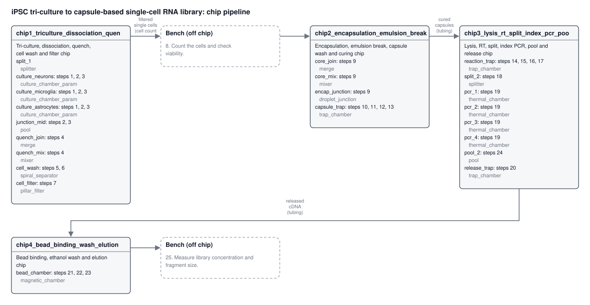

# autochip report: iPSC tri-culture to capsule-based single-cell RNA library

> **Agent:** replay of autochip/examples/live/prompt_unconstrained/agent

**25** protocol steps · **4** chips · **22** modules · **23 / 2 / 0** on chip / bench / missing · **0** layout errors · **0 / 3** flow-check errors / warnings

4 chip(s) do 23 of the 25 protocol steps; 2 stay at the bench and 0 need a part the library doesn't have. Everything here is generated: flows, volumes and times the source did not give are placeholders.

## Open problems

None found: no errors, missing parts or unassigned steps.

## What went in

| | |
|---|---|
| **Source** | prompt: Grow three iPSC-derived cell types (neurons, microglia, astrocytes) side by... |
| **File** | - |
| **Citation** | - |
| **User goal** | Grow three iPSC-derived cell types (neurons, microglia, astrocytes) side by side, first apart and then sharing medium. Then detach the cells, wrap single cells in semi-permeable hydrogel capsules, break the emulsion and cure the capsule shells with light, lyse the cells inside the capsules, wash, and reverse transcribe the RNA. Split the capsules into four sublibraries for index PCR, release the cDNA from the capsules and clean the library up with magnetic beads so it is ready for sequencing. |
| **Protocol goal (as extracted)** | Grow iPSC-derived neurons, microglia and astrocytes side by side (first apart, then sharing medium), then encapsulate single cells in semi-permeable hydrogel capsules, lyse, reverse transcribe, split into four index-PCR sublibraries, release the cDNA and clean up the library with magnetic beads for sequencing. |
| **Agent** | replay of autochip/examples/live/prompt_unconstrained/agent |
| **Constraints** | unconstrained: No limits |

## Constraints

- Fabrication: other
- Multilayer: allowed, vias between layers
- Channel crossings: allowed
- Thermal zones on one chip: not stated (assume no: clashing temperatures go on different chips)
- On-chip valves: allowed, pneumatic_membrane
- Max chip footprint: no limit; edge margin 2 mm; max chips: no limit
- Depth: no maximum
- Smallest features: open channel 0.05 mm, enclosed channel 0.05 mm, wall 0.05 mm, gap 0.01 mm
- Ports: any number per chip, min diameter 0.8 mm, min pitch 3 mm, connector press_fit_tubing, placed on the top
- Parts: library_and_parametric (library parts may be scaled)
- Off-chip equipment available: syringe_pump, pressure_controller, heater, incubator_37c, cold_plate, thermocycler, peltier_stage, led_405nm, magnet, microscope, centrifuge, pipette; pump lines: no limit; manual bench steps allowed
- Objective: most_on_chip

## Chips

Why the protocol is split this way: Four chips. Chip 1 is the 37 °C culture and cell-prep chip. Chip 2 makes the capsules, which brings oil, and cures them. Chip 3 sits on the thermocycler for lysis, RT, index PCR and release. Chip 4 sits over the magnet for bead clean-up. Culture is kept apart from oil. Curing needs the 405 nm LED, the thermal steps need the thermocycler and the clean-up needs the magnet, so the equipment never has to be shared on one chip. All capsule traps use a 10 um mesh, below 0.4 x the 28 um capsule diameter, so capsules cannot slip through. Counting and fluorometer QC are done on the bench. Because the four portions carry different indexes, they are pooled after release and before bead clean-up, so step 24 is carried by the pool part on chip 3.

| Chip | Purpose | Steps | Modules (part) | Ports | Footprint (mm) | Layers | Constraint findings |
|---|---|---|---|---|---|---|---|
| **chip1_triculture_dissociation_quench_cell_wash_filter** Tri-culture, dissociation, quench, cell wash and filter chip | Grows three iPSC-derived populations in separate chambers (apart, then sharing medium through the central junction), detaches them, quenches the enzyme, moves the cells into clean buffer and filters out clumps. | 1, 2, 3, 4, 5, 6, 7 | split_1 (splitter), culture_neurons (culture_chamber_param), culture_microglia (culture_chamber_param), culture_astrocytes (culture_chamber_param), junction_mid (pool), quench_join (merge), quench_mix (mixer), cell_wash (spiral_separator), cell_filter (pillar_filter) | 13 (6 in, 7 out) | 59 x 50 | 3 (unspecified) | 1 warning |
| **chip2_encapsulation_emulsion_break_capsule_wash_curing** Encapsulation, emulsion break, capsule wash and curing chip | Merges cells into core solution, makes single-cell shell/core droplets in fluorinated oil, then breaks the emulsion, washes, cures and washes the capsules in a trap. | 9, 10, 11, 12, 13 | core_join (merge), core_mix (mixer), encap_junction (droplet_junction), capsule_trap (trap_chamber) | 8 (6 in, 2 out) | 27.5 x 20.5 | 3 (unspecified) | none |
| **chip3_lysis_rt_split_index_pcr_pool_release** Lysis, RT, split, index PCR, pool and release chip | Lyses cells in capsules, reverse transcribes, splits into four portions for index PCR, pools them and releases the cDNA. | 14, 15, 16, 17, 18, 19, 20, 24 | reaction_trap (trap_chamber), split_2 (splitter), pcr_1 (thermal_chamber), pcr_2 (thermal_chamber), pcr_3 (thermal_chamber), pcr_4 (thermal_chamber), pool_2 (pool), release_trap (trap_chamber) | 15 (8 in, 7 out) | 55.5 x 45 | 3 (unspecified) | 1 warning |
| **chip4_bead_binding_wash_elution** Bead binding, ethanol wash and elution chip | Binds cDNA to magnetic beads, washes on the magnet and elutes the library. | 21, 22, 23 | bead_chamber (magnetic_chamber) | 6 (4 in, 2 out) | 23 x 14.5 | 3 (unspecified) | none |

### chip1_triculture_dissociation_quench_cell_wash_filter: constraint findings

- **warning** [layout.lane_isolation] lanes culture_neurons, culture_microglia, culture_astrocytes share 'split_1' and 'junction_mid': filling one lane through its own inlet with outlet_1 vented also pushes up to 21% of the flow through the other lanes. To fill one lane alone, feed the lane's inlet and vent its own <lane>_vent_out port with outlet_1 capped: then no liquid enters the other lanes.

*chip1_triculture_dissociation_quench_cell_wash_filter is its own chip because:* First chip: flow starts with cell seeding at inlet_1. It runs at 37 °C for long culture and must stay free of oil.

*chip2_encapsulation_emulsion_break_capsule_wash_curing is its own chip because:* Oil must be kept off the culture chip. Curing needs the 405 nm LED, which differs from the thermocycler chip.

### chip3_lysis_rt_split_index_pcr_pool_release: constraint findings

- **warning** [layout.lane_isolation] lanes pcr_1, pcr_2, pcr_3, pcr_4 share 'split_2' and 'pool_2': filling one lane through its own inlet with outlet_1 vented also pushes up to 38% of the flow through the other lanes. To fill one lane alone, feed the lane's inlet and vent its own <lane>_vent_out port with outlet_1 capped: then no liquid enters the other lanes.

*chip3_lysis_rt_split_index_pcr_pool_release is its own chip because:* Lysis, RT, PCR and release are thermal steps, so the chip sits on the thermocycler. This differs from the LED curing chip and the magnet chip.

*chip4_bead_binding_wash_elution is its own chip because:* It needs the magnet, which cannot share a chip with the thermocycler.

## Step coverage

| Step | Action | What | Where | Run steps |
|---|---|---|---|---|
| 1 | culture | Culture neurons, microglia and astrocytes in separate vessels, side by side, each in its own medium. | chip1_triculture_dissociation_quench_cell_wash_filter.culture_neurons | chip1_triculture_dissociation_quench_cell_wash_filter #1 Load cells from the bench; chip1_triculture_dissociation_quench_cell_wash_filter #2 Load cells from the bench; chip1_triculture_dissociation_quench_cell_wash_filter #3 Load cells from the bench; chip1_triculture_dissociation_quench_cell_wash_filter #4 Culture apart 7 d (3 chambers, own medium each, change every 1 d) |
| 2 | culture | Continue culture of the three cell types sharing medium (co-culture or shared medium flow). | chip1_triculture_dissociation_quench_cell_wash_filter.culture_neurons | chip1_triculture_dissociation_quench_cell_wash_filter #5 Culture apart 1 d (3 chambers, own medium each, change every 12 h); chip1_triculture_dissociation_quench_cell_wash_filter #6 Culture sharing medium 1 d (feed culture_neurons, vent the others) |
| 3 | dissociate | Detach the cells with a dissociation enzyme. | chip1_triculture_dissociation_quench_cell_wash_filter.culture_neurons | chip1_triculture_dissociation_quench_cell_wash_filter #7 Exchange: dissociation_enzyme; chip1_triculture_dissociation_quench_cell_wash_filter #8 Exchange: dissociation_enzyme; chip1_triculture_dissociation_quench_cell_wash_filter #9 Exchange: dissociation_enzyme; chip1_triculture_dissociation_quench_cell_wash_filter #10 Incubate |
| 4 | quench | Quench the dissociation enzyme. | chip1_triculture_dissociation_quench_cell_wash_filter.quench_join | chip1_triculture_dissociation_quench_cell_wash_filter #11 Mix quench_solution into the stream |
| 5 | centrifuge | Centrifuge the cell suspension to pellet the cells. | chip1_triculture_dissociation_quench_cell_wash_filter.cell_wash | chip1_triculture_dissociation_quench_cell_wash_filter #12 Exchange: wash_buffer; chip1_triculture_dissociation_quench_cell_wash_filter #13 Incubate |
| 6 | resuspend | Resuspend the cells in wash buffer. | chip1_triculture_dissociation_quench_cell_wash_filter.cell_wash | chip1_triculture_dissociation_quench_cell_wash_filter #14 Exchange: wash_buffer |
| 7 | filter | Filter the suspension through a cell strainer to remove clumps. | chip1_triculture_dissociation_quench_cell_wash_filter.cell_filter | chip1_triculture_dissociation_quench_cell_wash_filter #15 Pass through |
| 8 | count | Count the cells and check viability. | off chip (bench) |  |
| 9 | encapsulate | Wrap single cells in droplets of shell polymer around an aqueous core, formed in fluorinated oil at a chip junction. | chip2_encapsulation_emulsion_break_capsule_wash_curing.encap_junction | chip2_encapsulation_emulsion_break_capsule_wash_curing #1 Encapsulate (co-flow) |
| 10 | break_emulsion | Break the emulsion with an emulsion-breaking agent and remove the oil phase. | chip2_encapsulation_emulsion_break_capsule_wash_curing.capsule_trap | chip2_encapsulation_emulsion_break_capsule_wash_curing #2 Exchange: emulsion_breaker |
| 11 | wash_particles | Wash the capsules to remove leftover oil. | chip2_encapsulation_emulsion_break_capsule_wash_curing.capsule_trap | chip2_encapsulation_emulsion_break_capsule_wash_curing #3 Exchange: wash_buffer x3 |
| 12 | cure | Cure the capsule shells with light. | chip2_encapsulation_emulsion_break_capsule_wash_curing.capsule_trap | chip2_encapsulation_emulsion_break_capsule_wash_curing #4 Cure (405 nm) |
| 13 | wash_particles | Wash the cured capsules. | chip2_encapsulation_emulsion_break_capsule_wash_curing.capsule_trap | chip2_encapsulation_emulsion_break_capsule_wash_curing #5 Exchange: wash_buffer x2; chip2_encapsulation_emulsion_break_capsule_wash_curing #6 Collect the capsules (outlet_1) |
| 14 | lyse | Lyse the cells inside the capsules (placeholder time and temperature). | chip3_lysis_rt_split_index_pcr_pool_release.reaction_trap | chip3_lysis_rt_split_index_pcr_pool_release #1 Load capsules from the hand-off from chip2_encapsulation_emulsion_break_capsule_wash_curing; chip3_lysis_rt_split_index_pcr_pool_release #2 Exchange: lysis_buffer; chip3_lysis_rt_split_index_pcr_pool_release #3 Incubate |
| 15 | wash_particles | Wash the capsules after lysis. | chip3_lysis_rt_split_index_pcr_pool_release.reaction_trap | chip3_lysis_rt_split_index_pcr_pool_release #4 Exchange: wash_buffer x3 |
| 16 | reverse_transcribe | Reverse transcribe the RNA inside the capsules (placeholder time and temperature). | chip3_lysis_rt_split_index_pcr_pool_release.reaction_trap | chip3_lysis_rt_split_index_pcr_pool_release #5 Exchange: rt_mix; chip3_lysis_rt_split_index_pcr_pool_release #6 Incubate |
| 17 | wash_particles | Wash the capsules after reverse transcription. | chip3_lysis_rt_split_index_pcr_pool_release.reaction_trap | chip3_lysis_rt_split_index_pcr_pool_release #7 Exchange: wash_buffer x2 |
| 18 | split | Split the capsules into four sublibrary portions. | chip3_lysis_rt_split_index_pcr_pool_release.split_2 | chip3_lysis_rt_split_index_pcr_pool_release #8 Split |
| 19 | amplify | Run index PCR on each sublibrary with its own index (placeholder cycles, times and temperatures). | chip3_lysis_rt_split_index_pcr_pool_release.pcr_1 | chip3_lysis_rt_split_index_pcr_pool_release #9 Exchange: index_mix_1; chip3_lysis_rt_split_index_pcr_pool_release #10 Exchange: index_mix_2; chip3_lysis_rt_split_index_pcr_pool_release #11 Exchange: index_mix_3; chip3_lysis_rt_split_index_pcr_pool_release #12 Exchange: index_mix_4; chip3_lysis_rt_split_index_pcr_pool_release #13 Thermal cycling: N cycles |
| 20 | release | Release the cDNA from the capsules by digesting the shell with a shell-digesting enzyme (placeholder time and temperature). | chip3_lysis_rt_split_index_pcr_pool_release.release_trap | chip3_lysis_rt_split_index_pcr_pool_release #14 Move capsules: pcr_1 → release_trap; chip3_lysis_rt_split_index_pcr_pool_release #15 Release with release_enzyme |
| 21 | bind_beads | Bind the released cDNA to magnetic beads. | chip4_bead_binding_wash_elution.bead_chamber | chip4_bead_binding_wash_elution #1 Exchange: magnetic_beads; chip4_bead_binding_wash_elution #2 Load nucleic_acid from the hand-off from chip3_lysis_rt_split_index_pcr_pool_release; chip4_bead_binding_wash_elution #3 Incubate |
| 22 | wash_particles | Wash the beads on a magnet. | chip4_bead_binding_wash_elution.bead_chamber | chip4_bead_binding_wash_elution #4 Exchange: ethanol_wash x2 |
| 23 | elute | Elute the library from the beads. | chip4_bead_binding_wash_elution.bead_chamber | chip4_bead_binding_wash_elution #5 Exchange: elution_buffer; chip4_bead_binding_wash_elution #6 Incubate; chip4_bead_binding_wash_elution #7 Collect the library (outlet_1) |
| 24 | pool | Pool the four cleaned-up sublibraries for sequencing. | chip3_lysis_rt_split_index_pcr_pool_release.pool_2 | chip3_lysis_rt_split_index_pcr_pool_release #16 Pool; chip3_lysis_rt_split_index_pcr_pool_release #17 Collect the library (outlet_1) |
| 25 | measure | Measure library concentration and fragment size. | off chip (bench) |  |

## Off-chip steps

| Steps | Why off chip | Equipment |
|---|---|---|
| 8 | Cell counting and viability check are bench steps; the cell counter is not in the lab equipment list. | pipette, microscope |
| 25 | Library concentration and size measurement are done on the bench (fluorometer is not on the lab list). | pipette |

## Missing parts

None.

## Hand-offs

| From | To | Carries | How | Via bench steps |
|---|---|---|---|---|
| chip1_triculture_dissociation_quench_cell_wash_filter `outlet_1` | chip2_encapsulation_emulsion_break_capsule_wash_curing `inlet_1` | filtered single cells (cell count checked on the bench) | off chip step | 8 |
| chip2_encapsulation_emulsion_break_capsule_wash_curing `outlet_1` | chip3_lysis_rt_split_index_pcr_pool_release `inlet_1` | cured capsules | tubing | - |
| chip3_lysis_rt_split_index_pcr_pool_release `outlet_1` | chip4_bead_binding_wash_elution `inlet_1` | released cDNA | tubing | - |

## Assumptions

- (extract) No written protocol was given; the full step list is expanded from standard published methods.
- (extract) Added steps: separate and shared-medium culture details, quench, centrifuge, resuspend, filter, count, post-emulsion-break oil wash, post-cure wash, post-lysis wash, post-RT wash, pooling and final QC.
- (extract) Culture durations, dissociation time and temperature, centrifuge speed, volumes, curing time, 405 nm curing light and wash repeat counts are typical stand-in values.
- (extract) Lysis, reverse transcription, index PCR and enzymatic release times, temperatures and cycle numbers are left as placeholders for the lab to set.
- (extract) The order break emulsion then cure follows the goal text; the capsules are taken to be collected into aqueous phase after the emulsion is broken.
- (extract) Magnetic bead clean-up is written out as bind, wash on magnet and elute.
- (extract) Reagent identities (shell polymer, oil, enzymes, buffers) are generic assumptions.
- (extract) step 1 was inferred, not stated: Culture neurons, microglia and astrocytes in separate vessels, side by side, each in its own medium.
- (extract) step 2 was inferred, not stated: Continue culture of the three cell types sharing medium (co-culture or shared medium flow).
- (extract) step 3 was inferred, not stated: Detach the cells with a dissociation enzyme.
- (extract) step 4 was inferred, not stated: Quench the dissociation enzyme.
- (extract) step 5 was inferred, not stated: Centrifuge the cell suspension to pellet the cells.
- (extract) step 6 was inferred, not stated: Resuspend the cells in wash buffer.
- (extract) step 7 was inferred, not stated: Filter the suspension through a cell strainer to remove clumps.
- (extract) step 8 was inferred, not stated: Count the cells and check viability.
- (extract) step 11 was inferred, not stated: Wash the capsules to remove leftover oil.
- (extract) step 12 was inferred, not stated: Cure the capsule shells with light.
- (extract) step 13 was inferred, not stated: Wash the cured capsules.
- (extract) step 14 was inferred, not stated: Lyse the cells inside the capsules (placeholder time and temperature).
- (extract) step 15 was inferred, not stated: Wash the capsules after lysis.
- (extract) step 16 was inferred, not stated: Reverse transcribe the RNA inside the capsules (placeholder time and temperature).
- (extract) step 17 was inferred, not stated: Wash the capsules after reverse transcription.
- (extract) step 21 was inferred, not stated: Bind the released cDNA to magnetic beads.
- (extract) step 22 was inferred, not stated: Wash the beads on a magnet.
- (extract) step 23 was inferred, not stated: Elute the library from the beads.
- (extract) step 24 was inferred, not stated: Pool the four cleaned-up sublibraries for sequencing.
- (extract) step 25 was inferred, not stated: Measure library concentration and fragment size.
- (run plan) Exchanges push 3 chamber volumes per wash; bench volumes don't carry over to the chip.
- (run plan) Default flows where the protocol gives none: cells 10, capsules 20, droplets 5, beads 20, gel 5, oil 10, anything else 20 µL/min; lowered automatically when the chamber shear limit (cells 1, capsules 5, droplets 5 dyn/cm2) would be passed.
- (run plan) Encapsulation co-flow when the chip spec has none: core / shell / oil 120 / 120 / 600 µL/h.
- (run plan) No on-chip valves: each step's flow is set by which syringe pushes, which outlet is open and which ports are capped.
- (run plan) Pressures are on-chip only (operator/network.py); tubing adds to what the pump sees.

## Flow-check results

Every step's port states were solved with operator/network.py on the chip spec: does the flow go through the target module, does anything flow back into modules holding other material, pressure against the constraints, shear in cell- and capsule-holding modules, pump range and number of pump lines.

### chip1_triculture_dissociation_quench_cell_wash_filter: Tri-culture, dissociation, quench, cell wash and filter chip

| # | IR step | Module | What | Port states | Through target (µL/min) | Max kPa | Shear (dyn/cm2) | Result |
|---|---|---|---|---|---|---|---|---|
| 1 | 1 | culture_neurons | Load cells from the bench | FEED culture_medium_neurons_in 10 µL/min (cells_for_culture_neurons) / VENT culture_neurons_vent_out / rest capped | 10 | 0.0022 | 0.0032 | OK |
| 2 | 1 | culture_microglia | Load cells from the bench | FEED culture_medium_microglia_in 10 µL/min (cells_for_culture_microglia) / VENT microglia_vent_out / rest capped | 10 | 0.0022 | 0.0032 | OK |
| 3 | 1 | culture_astrocytes | Load cells from the bench | FEED culture_medium_astrocytes_in 10 µL/min (cells_for_culture_astrocytes) / VENT astrocytes_vent_out / rest capped | 10 | 0.0022 | 0.0032 | OK |
| 4 | 1 | culture_neurons | Culture apart 7 d (3 chambers, own medium each, change every 1 d) | FEED culture_medium_neurons_in 10 µL/min (culture_medium_neurons); culture_medium_microglia_in 10 µL/min (culture_medium_microglia); culture_medium_astrocytes_in 10 µL/min (culture_medium_astrocytes) / VENT culture_neurons_vent_out, microglia_vent_out, astrocytes_vent_out / rest capped | 10 | 0.0022 | 0.0032 | OK |
| 5 | 2 | culture_neurons | Culture apart 1 d (3 chambers, own medium each, change every 12 h) | FEED culture_medium_neurons_in 10 µL/min (culture_medium_neurons); culture_medium_microglia_in 10 µL/min (culture_medium_microglia); culture_medium_astrocytes_in 10 µL/min (culture_medium_astrocytes) / VENT culture_neurons_vent_out, microglia_vent_out, astrocytes_vent_out / rest capped | 10 | 0.0022 | 0.0032 | OK |
| 6 | 2 | culture_neurons | Culture sharing medium 1 d (feed culture_neurons, vent the others) | FEED culture_medium_neurons_in 10 µL/min (culture_medium_neurons) / VENT microglia_vent_out, astrocytes_vent_out / rest capped | 10 | 0.0022 | 0.0032 | OK |
| 7 | 3 | culture_neurons | Exchange: dissociation_enzyme | FEED culture_medium_neurons_in 10 µL/min (dissociation_enzyme) / VENT culture_neurons_vent_out / rest capped | 10 | 0.0022 | 0.0032 | OK |
| 8 | 3 | culture_microglia | Exchange: dissociation_enzyme | FEED culture_medium_microglia_in 10 µL/min (dissociation_enzyme) / VENT microglia_vent_out / rest capped | 10 | 0.0022 | 0.0032 | OK |
| 9 | 3 | culture_astrocytes | Exchange: dissociation_enzyme | FEED culture_medium_astrocytes_in 10 µL/min (dissociation_enzyme) / VENT astrocytes_vent_out / rest capped | 10 | 0.0022 | 0.0032 | OK |
| 10 | 3 | culture_astrocytes | Incubate | all capped |  |  |  | no flow: every port capped |
| 11 | 4 | quench_join | Mix quench_solution into the stream | FEED inlet_1 10 µL/min (carrier_buffer); quench_solution_in 10 µL/min (quench_solution) / VENT cell_wash_waste_out / rest capped | 20 | 0.0428 | 0.0988 | OK |
| 12 | 5 | cell_wash | Exchange: wash_buffer | FEED wash_buffer_in 10 µL/min (wash_buffer) / VENT cell_wash_waste_out / rest capped | 10 | 0.0239 | 0.0025 | OK |
| 13 | 5 | cell_wash | Incubate | all capped |  |  |  | no flow: every port capped |
| 14 | 6 | cell_wash | Exchange: wash_buffer | FEED wash_buffer_in 10 µL/min (wash_buffer) / VENT cell_wash_waste_out / rest capped | 10 | 0.0239 | 0.0025 | OK |
| 15 | 7 | cell_filter | Pass through | FEED inlet_1 10 µL/min (carrier_buffer) / VENT outlet_1 / rest capped | 10 | 0.0064 | 0.0444 | OK |

- **warning** step 3: module culture_neurons has no inlet named for dissociation_enzyme; it goes in through culture_medium_neurons_in (swap that syringe and prime the line first)
- **warning** step 3: module culture_microglia has no inlet named for dissociation_enzyme; it goes in through culture_medium_microglia_in (swap that syringe and prime the line first)
- **warning** step 3: module culture_astrocytes has no inlet named for dissociation_enzyme; it goes in through culture_medium_astrocytes_in (swap that syringe and prime the line first)

Operator planner: accepted, 15 events in `runs/chip1_triculture_dissociation_quench_cell_wash_filter.twin_run.json`.

### chip2_encapsulation_emulsion_break_capsule_wash_curing: Encapsulation, emulsion break, capsule wash and curing chip

| # | IR step | Module | What | Port states | Through target (µL/min) | Max kPa | Shear (dyn/cm2) | Result |
|---|---|---|---|---|---|---|---|---|
| 1 | 9 | encap_junction | Encapsulate (co-flow) | FEED inlet_1 1 µL/min (cells_suspension); core_solution_in 1 µL/min (core_solution); shell_polymer_in 2 µL/min (shell_polymer); fluorinated_oil_in 10 µL/min (fluorinated_oil) / VENT capsule_trap_waste_out / rest capped | 14 | 0.0045 | 0.0415 | OK |
| 2 | 10 | capsule_trap | Exchange: emulsion_breaker | FEED emulsion_breaker_in 5 µL/min (emulsion_breaker) / VENT capsule_trap_waste_out / rest capped | 5 | 0.0011 | 0.00226 | OK |
| 3 | 11 | capsule_trap | Exchange: wash_buffer x3 | FEED wash_buffer_in 20 µL/min (wash_buffer) / VENT capsule_trap_waste_out / rest capped | 20 | 0.0044 | 0.00905 | OK |
| 4 | 12 | capsule_trap | Cure (405 nm) | all capped |  |  |  | no flow: every port capped |
| 5 | 13 | capsule_trap | Exchange: wash_buffer x2 | FEED wash_buffer_in 20 µL/min (wash_buffer) / VENT capsule_trap_waste_out / rest capped | 20 | 0.0044 | 0.00905 | OK |
| 6 | 13 | capsule_trap | Collect the capsules (outlet_1) | FEED wash_buffer_in 20 µL/min (collection_buffer) / VENT outlet_1 / rest capped | 20 | 0.0033 | 0.00905 | OK |

Operator planner: accepted, 6 events in `runs/chip2_encapsulation_emulsion_break_capsule_wash_curing.twin_run.json`.

### chip3_lysis_rt_split_index_pcr_pool_release: Lysis, RT, split, index PCR, pool and release chip

| # | IR step | Module | What | Port states | Through target (µL/min) | Max kPa | Shear (dyn/cm2) | Result |
|---|---|---|---|---|---|---|---|---|
| 1 | 14 | reaction_trap | Load capsules from the hand-off from chip2_encapsulation_emulsion_break_capsule_wash_curing | FEED inlet_1 20 µL/min (capsules_sample) / VENT reaction_trap_waste_out / rest capped | 20 | 0.0254 | 0.00905 | OK |
| 2 | 14 | reaction_trap | Exchange: lysis_buffer | FEED wash_buffer_in 20 µL/min (lysis_buffer) / VENT reaction_trap_waste_out / rest capped | 20 | 0.0488 | 0.00905 | OK |
| 3 | 14 | reaction_trap | Incubate | all capped |  |  |  | no flow: every port capped |
| 4 | 15 | reaction_trap | Exchange: wash_buffer x3 | FEED wash_buffer_in 20 µL/min (wash_buffer) / VENT reaction_trap_waste_out / rest capped | 20 | 0.0488 | 0.00905 | OK |
| 5 | 16 | reaction_trap | Exchange: rt_mix | FEED inlet_1 20 µL/min (rt_mix) / VENT reaction_trap_waste_out / rest capped | 20 | 0.0254 | 0.00905 | OK |
| 6 | 16 | reaction_trap | Incubate | all capped |  |  |  | no flow: every port capped |
| 7 | 17 | reaction_trap | Exchange: wash_buffer x2 | FEED wash_buffer_in 20 µL/min (wash_buffer) / VENT reaction_trap_waste_out / rest capped | 20 | 0.0488 | 0.00905 | OK |
| 8 | 18 | split_2 | Split | FEED inlet_1 20 µL/min (carrier_buffer) / VENT pcr_1_vent_out, pcr_2_vent_out, pcr_3_vent_out, pcr_4_vent_out / rest capped | 20 | 0.002 | 0.00209 | OK |
| 9 | 19 | pcr_1 | Exchange: index_mix_1 | FEED index_mix_1_in 20 µL/min (index_mix_1) / VENT pcr_1_vent_out / rest capped | 20 | 0.0043 | 0.0128 | OK |
| 10 | 19 | pcr_2 | Exchange: index_mix_2 | FEED index_mix_2_in 20 µL/min (index_mix_2) / VENT pcr_2_vent_out / rest capped | 20 | 0.0043 | 0.0128 | OK |
| 11 | 19 | pcr_3 | Exchange: index_mix_3 | FEED index_mix_3_in 20 µL/min (index_mix_3) / VENT pcr_3_vent_out / rest capped | 20 | 0.0043 | 0.0128 | OK |
| 12 | 19 | pcr_4 | Exchange: index_mix_4 | FEED index_mix_4_in 20 µL/min (index_mix_4) / VENT pcr_4_vent_out / rest capped | 20 | 0.0043 | 0.0128 | OK |
| 13 | 19 | pcr_4 | Thermal cycling: N cycles | all capped |  |  |  | no flow: every port capped |
| 14 | 20 | release_trap | Move capsules: pcr_1 → release_trap | FEED inlet_1 20 µL/min (carrier_buffer) / VENT release_trap_waste_out / rest capped | 20 | 0.0283 | 0.00905 | OK |
| 15 | 20 | release_trap | Release with release_enzyme | FEED release_enzyme_in 20 µL/min (release_enzyme) / VENT outlet_1 / rest capped | 20 | 0.0283 | 0.00905 | OK |
| 16 | 24 | pool_2 | Pool | FEED inlet_1 20 µL/min (library_suspension) / VENT outlet_1 / rest capped | 20 | 0.0079 | 0.00209 | OK |
| 17 | 24 | pool_2 | Collect the library (outlet_1) | FEED inlet_1 20 µL/min (collection_buffer) / VENT outlet_1 / rest capped | 20 | 0.0079 | 0.00209 | OK |

Operator planner: accepted, 17 events in `runs/chip3_lysis_rt_split_index_pcr_pool_release.twin_run.json`.

### chip4_bead_binding_wash_elution: Bead binding, ethanol wash and elution chip

| # | IR step | Module | What | Port states | Through target (µL/min) | Max kPa | Shear (dyn/cm2) | Result |
|---|---|---|---|---|---|---|---|---|
| 1 | 21 | bead_chamber | Exchange: magnetic_beads | FEED magnetic_beads_in 20 µL/min (magnetic_beads) / VENT bead_waste_out / rest capped | 20 | 0.0049 | 0.00905 | OK |
| 2 | 21 | bead_chamber | Load nucleic_acid from the hand-off from chip3_lysis_rt_split_index_pcr_pool_release | FEED inlet_1 20 µL/min (nucleic_acid_sample) / VENT bead_waste_out / rest capped | 20 | 0.0057 | 0.00905 | OK |
| 3 | 21 | bead_chamber | Incubate | all capped |  |  |  | no flow: every port capped |
| 4 | 22 | bead_chamber | Exchange: ethanol_wash x2 | FEED ethanol_wash_in 20 µL/min (ethanol_wash) / VENT bead_waste_out / rest capped | 20 | 0.0049 | 0.00905 | OK |
| 5 | 23 | bead_chamber | Exchange: elution_buffer | FEED elution_buffer_in 20 µL/min (elution_buffer) / VENT bead_waste_out / rest capped | 20 | 0.0049 | 0.00905 | OK |
| 6 | 23 | bead_chamber | Incubate | all capped |  |  |  | no flow: every port capped |
| 7 | 23 | bead_chamber | Collect the library (outlet_1) | FEED elution_buffer_in 20 µL/min (collection_buffer) / VENT outlet_1 / rest capped | 20 | 0.0063 | 0.00905 | OK |

Operator planner: accepted, 7 events in `runs/chip4_bead_binding_wash_elution.twin_run.json`.

## Lab run sheet

The whole protocol as it runs in the lab, step by step across the chips, is in [`runs/pipeline_run_sheet.md`](runs/pipeline_run_sheet.md); each chip's set-up and step table is in `runs/<chip>.run_sheet.md`.

## Files

- `agent/extract.json`: agent exchanges (prompts, answers)
- `agent/extract.log.json`: agent exchanges (prompts, answers)
- `agent/partition.json`: agent exchanges (prompts, answers)
- `agent/partition.log.json`: agent exchanges (prompts, answers)
- `agent/partition__resplit_5dd39539.json`: agent exchanges (prompts, answers)
- `agent/partition__resplit_5dd39539.log.json`: agent exchanges (prompts, answers)
- `cad/chip1_triculture_dissociation_quench_cell_wash_filter/BUILD.md`: CAD
- `cad/chip1_triculture_dissociation_quench_cell_wash_filter/README.md`: CAD
- `cad/chip1_triculture_dissociation_quench_cell_wash_filter/chip1_triculture_dissociation_quench_cell_wash_filter.dxf`: CAD
- `cad/chip1_triculture_dissociation_quench_cell_wash_filter/chip1_triculture_dissociation_quench_cell_wash_filter.png`: CAD
- `cad/chip1_triculture_dissociation_quench_cell_wash_filter/chip1_triculture_dissociation_quench_cell_wash_filter.stl`: CAD
- `cad/chip1_triculture_dissociation_quench_cell_wash_filter/chip1_triculture_dissociation_quench_cell_wash_filter.svg`: CAD
- `cad/chip1_triculture_dissociation_quench_cell_wash_filter/chip1_triculture_dissociation_quench_cell_wash_filter_fluidic.stl`: CAD
- `cad/chip1_triculture_dissociation_quench_cell_wash_filter/chip1_triculture_dissociation_quench_cell_wash_filter_fusion.py`: CAD
- `cad/chip1_triculture_dissociation_quench_cell_wash_filter/parts/cell_filter.stl`: CAD
- `cad/chip1_triculture_dissociation_quench_cell_wash_filter/parts/cell_wash.stl`: CAD
- `cad/chip1_triculture_dissociation_quench_cell_wash_filter/parts/culture_astrocytes.stl`: CAD
- `cad/chip1_triculture_dissociation_quench_cell_wash_filter/parts/culture_microglia.stl`: CAD
- `cad/chip1_triculture_dissociation_quench_cell_wash_filter/parts/culture_neurons.stl`: CAD
- `cad/chip1_triculture_dissociation_quench_cell_wash_filter/parts/junction_mid.stl`: CAD
- `cad/chip1_triculture_dissociation_quench_cell_wash_filter/parts/quench_join.stl`: CAD
- `cad/chip1_triculture_dissociation_quench_cell_wash_filter/parts/quench_mix.stl`: CAD
- `cad/chip1_triculture_dissociation_quench_cell_wash_filter/parts/split_1.stl`: CAD
- `cad/chip2_encapsulation_emulsion_break_capsule_wash_curing/BUILD.md`: CAD
- `cad/chip2_encapsulation_emulsion_break_capsule_wash_curing/README.md`: CAD
- `cad/chip2_encapsulation_emulsion_break_capsule_wash_curing/chip2_encapsulation_emulsion_break_capsule_wash_curing.dxf`: CAD
- `cad/chip2_encapsulation_emulsion_break_capsule_wash_curing/chip2_encapsulation_emulsion_break_capsule_wash_curing.png`: CAD
- `cad/chip2_encapsulation_emulsion_break_capsule_wash_curing/chip2_encapsulation_emulsion_break_capsule_wash_curing.stl`: CAD
- `cad/chip2_encapsulation_emulsion_break_capsule_wash_curing/chip2_encapsulation_emulsion_break_capsule_wash_curing.svg`: CAD
- `cad/chip2_encapsulation_emulsion_break_capsule_wash_curing/chip2_encapsulation_emulsion_break_capsule_wash_curing_fluidic.stl`: CAD
- `cad/chip2_encapsulation_emulsion_break_capsule_wash_curing/chip2_encapsulation_emulsion_break_capsule_wash_curing_fusion.py`: CAD
- `cad/chip2_encapsulation_emulsion_break_capsule_wash_curing/parts/capsule_trap.stl`: CAD
- `cad/chip2_encapsulation_emulsion_break_capsule_wash_curing/parts/core_join.stl`: CAD
- `cad/chip2_encapsulation_emulsion_break_capsule_wash_curing/parts/core_mix.stl`: CAD
- `cad/chip2_encapsulation_emulsion_break_capsule_wash_curing/parts/encap_junction.stl`: CAD
- `cad/chip3_lysis_rt_split_index_pcr_pool_release/BUILD.md`: CAD
- `cad/chip3_lysis_rt_split_index_pcr_pool_release/README.md`: CAD
- `cad/chip3_lysis_rt_split_index_pcr_pool_release/chip3_lysis_rt_split_index_pcr_pool_release.dxf`: CAD
- `cad/chip3_lysis_rt_split_index_pcr_pool_release/chip3_lysis_rt_split_index_pcr_pool_release.png`: CAD
- `cad/chip3_lysis_rt_split_index_pcr_pool_release/chip3_lysis_rt_split_index_pcr_pool_release.stl`: CAD
- `cad/chip3_lysis_rt_split_index_pcr_pool_release/chip3_lysis_rt_split_index_pcr_pool_release.svg`: CAD
- `cad/chip3_lysis_rt_split_index_pcr_pool_release/chip3_lysis_rt_split_index_pcr_pool_release_fluidic.stl`: CAD
- `cad/chip3_lysis_rt_split_index_pcr_pool_release/chip3_lysis_rt_split_index_pcr_pool_release_fusion.py`: CAD
- `cad/chip3_lysis_rt_split_index_pcr_pool_release/parts/pcr_1.stl`: CAD
- `cad/chip3_lysis_rt_split_index_pcr_pool_release/parts/pcr_2.stl`: CAD
- `cad/chip3_lysis_rt_split_index_pcr_pool_release/parts/pcr_3.stl`: CAD
- `cad/chip3_lysis_rt_split_index_pcr_pool_release/parts/pcr_4.stl`: CAD
- `cad/chip3_lysis_rt_split_index_pcr_pool_release/parts/pool_2.stl`: CAD
- `cad/chip3_lysis_rt_split_index_pcr_pool_release/parts/reaction_trap.stl`: CAD
- `cad/chip3_lysis_rt_split_index_pcr_pool_release/parts/release_trap.stl`: CAD
- `cad/chip3_lysis_rt_split_index_pcr_pool_release/parts/split_2.stl`: CAD
- `cad/chip4_bead_binding_wash_elution/BUILD.md`: CAD
- `cad/chip4_bead_binding_wash_elution/README.md`: CAD
- `cad/chip4_bead_binding_wash_elution/chip4_bead_binding_wash_elution.dxf`: CAD
- `cad/chip4_bead_binding_wash_elution/chip4_bead_binding_wash_elution.png`: CAD
- `cad/chip4_bead_binding_wash_elution/chip4_bead_binding_wash_elution.stl`: CAD
- `cad/chip4_bead_binding_wash_elution/chip4_bead_binding_wash_elution.svg`: CAD
- `cad/chip4_bead_binding_wash_elution/chip4_bead_binding_wash_elution_fluidic.stl`: CAD
- `cad/chip4_bead_binding_wash_elution/chip4_bead_binding_wash_elution_fusion.py`: CAD
- `cad/chip4_bead_binding_wash_elution/parts/bead_chamber.stl`: CAD
- `chip_plan.json`: chip plan: chips, modules, hand-offs, off-chip steps, missing parts
- `chips/chip1_triculture_dissociation_quench_cell_wash_filter.json`: chip spec (contract format)
- `chips/chip2_encapsulation_emulsion_break_capsule_wash_curing.json`: chip spec (contract format)
- `chips/chip3_lysis_rt_split_index_pcr_pool_release.json`: chip spec (contract format)
- `chips/chip4_bead_binding_wash_elution.json`: chip spec (contract format)
- `constraints.json`: the constraints used
- `designs/chip1_triculture_dissociation_quench_cell_wash_filter.json`: chip design file (chip/designs format)
- `designs/chip2_encapsulation_emulsion_break_capsule_wash_curing.json`: chip design file (chip/designs format)
- `designs/chip3_lysis_rt_split_index_pcr_pool_release.json`: chip design file (chip/designs format)
- `designs/chip4_bead_binding_wash_elution.json`: chip design file (chip/designs format)
- `layout_findings.json`: 
- `overview.png`: pipeline overview drawing
- `overview.svg`: pipeline overview drawing
- `pipeline.json`: pipeline (pipeline.schema.json)
- `protocol_ir.json`: protocol IR: typed steps
- `report.html`: this report
- `report.md`: this report
- `run_meta.json`: 
- `runs/chip1_triculture_dissociation_quench_cell_wash_filter.protocol.json`: run protocol (protocol.schema.json)
- `runs/chip1_triculture_dissociation_quench_cell_wash_filter.run.json`: run program: port states per step + flow check
- `runs/chip1_triculture_dissociation_quench_cell_wash_filter.run_sheet.md`: wet-lab run sheet for one chip
- `runs/chip1_triculture_dissociation_quench_cell_wash_filter.twin_run.json`: operator planner run (what the twin replays)
- `runs/chip2_encapsulation_emulsion_break_capsule_wash_curing.protocol.json`: run protocol (protocol.schema.json)
- `runs/chip2_encapsulation_emulsion_break_capsule_wash_curing.run.json`: run program: port states per step + flow check
- `runs/chip2_encapsulation_emulsion_break_capsule_wash_curing.run_sheet.md`: wet-lab run sheet for one chip
- `runs/chip2_encapsulation_emulsion_break_capsule_wash_curing.twin_run.json`: operator planner run (what the twin replays)
- `runs/chip3_lysis_rt_split_index_pcr_pool_release.protocol.json`: run protocol (protocol.schema.json)
- `runs/chip3_lysis_rt_split_index_pcr_pool_release.run.json`: run program: port states per step + flow check
- `runs/chip3_lysis_rt_split_index_pcr_pool_release.run_sheet.md`: wet-lab run sheet for one chip
- `runs/chip3_lysis_rt_split_index_pcr_pool_release.twin_run.json`: operator planner run (what the twin replays)
- `runs/chip4_bead_binding_wash_elution.protocol.json`: run protocol (protocol.schema.json)
- `runs/chip4_bead_binding_wash_elution.run.json`: run program: port states per step + flow check
- `runs/chip4_bead_binding_wash_elution.run_sheet.md`: wet-lab run sheet for one chip
- `runs/chip4_bead_binding_wash_elution.twin_run.json`: operator planner run (what the twin replays)
- `runs/pipeline_run.json`: the same, as data
- `runs/pipeline_run_sheet.md`: wet-lab run sheet for the whole protocol
- `source.json`: the source text
