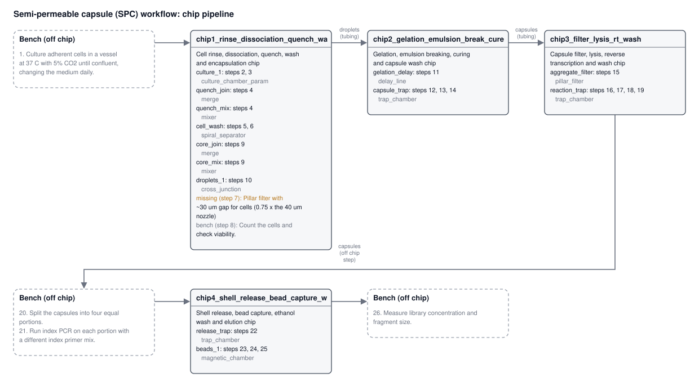

# autochip report: Semi-permeable capsule (SPC) workflow

> **Agent:** replay of /tmp/agent_protocol_resin_multilayer

**26** protocol steps · **4** chips · **13** modules · **20 / 5 / 1** on chip / bench / missing · **0** layout errors · **0 / 4** flow-check errors / warnings

4 chip(s) do 20 of the 26 protocol steps; 5 stay at the bench and 1 need a part the library doesn't have. Everything here is generated: flows, volumes and times the source did not give are placeholders.

## Open problems

- step 7: missing part (Pillar filter with ~30 um gap for cells (0.75 x the 40 um nozzle)); workaround: Strain the cells off chip through a 30-40 um strainer before loading, or place a bought mesh in a trap.

## What went in

| | |
|---|---|
| **Source** | protocol: Semi-permeable capsule (SPC) workflow: generic protocol |
| **File** | autochip/examples/spc_capsule_protocol.md |
| **Citation** | Leonaviciene & Mazutis, Nucleic Acids Research 2023; Baronas et al., Science 2026 |
| **User goal** | - |
| **Protocol goal (as extracted)** | Prepare adherent cells, encapsulate them in semi-permeable capsules, process them inside the capsules (lysis, reverse transcription, indexing PCR), release cDNA and purify and measure a library. |
| **Agent** | replay of /tmp/agent_protocol_resin_multilayer |
| **Constraints** | resin_print_multilayer: Resin print, multilayer (SLA/DLP) |

## Constraints

- Fabrication: resin_print on Formlabs Form 3B, material clear resin, sealed by printed_closed
- Multilayer: allowed (max 3 fluidic layers), vias between layers
- Channel crossings: allowed
- Thermal zones on one chip: not stated (assume no: clashing temperatures go on different chips)
- On-chip valves: NOT allowed: switch flow off-chip (which pump pushes, which port is capped)
- Max chip footprint: 75 x 50 mm (build area 145 x 145 x 185 mm); edge margin 2 mm; max chips: no limit
- Depth: max 2 mm
- Smallest features: open channel 0.2 mm, enclosed channel 0.5 mm, wall 0.4 mm, gap 0.1 mm
- Ports: max 12 per chip, min diameter 0.8 mm, min pitch 4 mm, connector press_fit_tubing, placed on the top
- Parts: library_and_parametric (library parts may be scaled)
- Off-chip equipment available: syringe_pump, heater, cold_plate, led_405nm, microscope, thermocycler, magnet, pipette; pump lines: 6; manual bench steps allowed
- Objective: fewest_chips

## Chips

Why the protocol is split this way: Four chips. Chip 1 (37 °C) covers cell rinse, dissociation, quench, wash, core mixing and droplet formation. Chip 2 is cold (4 °C) for gelation, then oil removal, curing and capsule wash. Chip 3 takes the capsule filter plus lysis, RT and washes. The split from the previous plan fixes the size error: the filter moved off the cold chip. Index PCR reaches 95 °C, above the 50 °C limit of the printed resin, so the split (20) and the index PCR (21) are done off chip in tubes on the thermocycler. The portions are pooled by pipette and returned to chip 4, which digests the shells and does the magnetic bead cleanup. Chip 4 has no thermocycler, so the magnet is the only equipment there. Culture (1), counting (8) and measurement (26) stay on the bench. The 40 um cell strainer (7) has no usable part, because the pillar filter cannot go below 100 um.

| Chip | Purpose | Steps | Modules (part) | Ports | Footprint (mm) | Layers | Constraint findings |
|---|---|---|---|---|---|---|---|
| **chip1_rinse_dissociation_quench_wash_encapsulation** Cell rinse, dissociation, quench, wash and encapsulation chip | Rinses and detaches the cells, quenches the enzyme, washes the cells in a spiral, mixes in core solution and forms ~70 um droplets at the flow-focusing junction. | 2, 3, 4, 5, 6, 9, 10 | culture_1 (culture_chamber_param), quench_join (merge), quench_mix (mixer), cell_wash (spiral_separator), core_join (merge), core_mix (mixer), droplets_1 (cross_junction) | 10 (7 in, 3 out) | 44.5 x 72.5 | 3 (resin) | none |
| **chip2_gelation_emulsion_break_cure_wash** Gelation, emulsion breaking, curing and capsule wash chip | Gels the shells in a cold delay line, then breaks the emulsion, photocures and washes the capsules in a trap. | 11, 12, 13, 14 | gelation_delay (delay_line), capsule_trap (trap_chamber) | 6 (4 in, 2 out) | 57 x 43.5 | 3 (resin) | 1 warning |
| **chip3_filter_lysis_rt_wash** Capsule filter, lysis, reverse transcription and wash chip | Removes aggregates from the capsules, then lyses the cells, washes, reverse transcribes and washes again in a trap. | 15, 16, 17, 18, 19 | aggregate_filter (pillar_filter), reaction_trap (trap_chamber) | 4 (2 in, 2 out) | 30 x 19 | 3 (resin) | 1 warning |
| **chip4_shell_release_bead_capture_wash_elution** Shell release, bead capture, ethanol wash and elution chip | Digests the capsule shells to release cDNA, then binds the library to magnetic beads, washes them with ethanol on the magnet and elutes in water. | 22, 23, 24, 25 | release_trap (trap_chamber), beads_1 (magnetic_chamber) | 8 (5 in, 3 out) | 39 x 16 | 3 (resin) | 1 warning |

*chip1_rinse_dissociation_quench_wash_encapsulation is its own chip because:* First chip: the flow starts with cells loaded into inlet_1 after off-chip culture. Warm (37 °C) cell handling is kept apart from the cold gelation on chip 2, and oil must not reach other cell steps.

### chip2_gelation_emulsion_break_cure_wash: constraint findings

- **warning** [min_feature.gap_mm] chamber 'capsule_trap' needs a 25 um mesh, finer than the 100 um this process can make: it has to be a bought mesh sheet inserted during assembly.

*chip2_gelation_emulsion_break_cure_wash is its own chip because:* Cold (4 °C) gelation clashes with 37 °C cell handling, and the oil must stay off the cell chip.

### chip3_filter_lysis_rt_wash: constraint findings

- **warning** [min_feature.gap_mm] chamber 'reaction_trap' needs a 25 um mesh, finer than the 100 um this process can make: it has to be a bought mesh sheet inserted during assembly.

*chip3_filter_lysis_rt_wash is its own chip because:* Splits the load off the cold chip so each chip fits the 75 x 50 mm limit, and keeps the 4 °C zone apart from the warm lysis and RT steps.

### chip4_shell_release_bead_capture_wash_elution: constraint findings

- **warning** [min_feature.gap_mm] chamber 'release_trap' needs a 25 um mesh, finer than the 100 um this process can make: it has to be a bought mesh sheet inserted during assembly.

*chip4_shell_release_bead_capture_wash_elution is its own chip because:* Index PCR (95 °C) is off chip on a thermocycler, so the capsules come back by pipette. This chip needs only the magnet.

## Step coverage

| Step | Action | What | Where | Run steps |
|---|---|---|---|---|
| 1 | culture | Culture adherent cells in a vessel at 37 °C with 5% CO2 until confluent, changing the medium daily. | off chip (bench) |  |
| 2 | wash_cells | Remove the medium and rinse the cells once with buffer. | chip1_rinse_dissociation_quench_wash_encapsulation.culture_1 | chip1_rinse_dissociation_quench_wash_encapsulation #1 Load cells from the bench; chip1_rinse_dissociation_quench_wash_encapsulation #2 Exchange: wash_buffer |
| 3 | dissociate | Add dissociation enzyme and incubate to detach the cells. | chip1_rinse_dissociation_quench_wash_encapsulation.culture_1 | chip1_rinse_dissociation_quench_wash_encapsulation #3 Exchange: dissociation_enzyme; chip1_rinse_dissociation_quench_wash_encapsulation #4 Incubate |
| 4 | quench | Add quench medium and mix gently to stop the enzyme. | chip1_rinse_dissociation_quench_wash_encapsulation.quench_join | chip1_rinse_dissociation_quench_wash_encapsulation #5 Mix quench_medium into the stream |
| 5 | centrifuge | Centrifuge the cells and remove the supernatant. | chip1_rinse_dissociation_quench_wash_encapsulation.cell_wash | chip1_rinse_dissociation_quench_wash_encapsulation #6 Exchange: wash_buffer; chip1_rinse_dissociation_quench_wash_encapsulation #7 Incubate |
| 6 | resuspend | Resuspend the pellet in wash buffer to wash the cells; repeat the wash once. | chip1_rinse_dissociation_quench_wash_encapsulation.cell_wash | chip1_rinse_dissociation_quench_wash_encapsulation #8 Exchange: wash_buffer x2 |
| 7 | filter | Pass the suspension through a 40 um cell strainer. | missing: Pillar filter with ~30 um gap for cells (0.75 x the 40 um nozzle) |  |
| 8 | count | Count the cells and check viability. | off chip (bench) |  |
| 9 | resuspend | Resuspend the cells in core solution at the loading density. | chip1_rinse_dissociation_quench_wash_encapsulation.core_join | chip1_rinse_dissociation_quench_wash_encapsulation #9 Mix core_solution into the stream |
| 10 | encapsulate | Co-flow the cell/core solution with warm shell polymer solution and focus with fluorinated oil with surfactant at a flow-focusing junction to form droplets of about 70 um. | chip1_rinse_dissociation_quench_wash_encapsulation.droplets_1 | chip1_rinse_dissociation_quench_wash_encapsulation #10 Encapsulate (co-flow) |
| 11 | incubate | Collect the emulsion and keep it on ice so the shell gels. | chip2_gelation_emulsion_break_cure_wash.gelation_delay | chip2_gelation_emulsion_break_cure_wash #1 Load droplets from the hand-off from chip1_rinse_dissociation_quench_wash_encapsulation; chip2_gelation_emulsion_break_cure_wash #2 Hold |
| 12 | break_emulsion | Break the emulsion with an emulsion-breaking agent and remove the oil phase. | chip2_gelation_emulsion_break_cure_wash.capsule_trap | chip2_gelation_emulsion_break_cure_wash #3 Move droplets: gelation_delay → capsule_trap; chip2_gelation_emulsion_break_cure_wash #4 Exchange: emulsion_breaking_agent |
| 13 | cure | Photocure the capsule shells with 405 nm light in the presence of photoinitiator. | chip2_gelation_emulsion_break_cure_wash.capsule_trap | chip2_gelation_emulsion_break_cure_wash #5 Exchange: photoinitiator; chip2_gelation_emulsion_break_cure_wash #6 Cure (405 nm) |
| 14 | wash_particles | Wash the capsules in buffer to remove oil and free reagents. | chip2_gelation_emulsion_break_cure_wash.capsule_trap | chip2_gelation_emulsion_break_cure_wash #7 Exchange: wash_buffer x3; chip2_gelation_emulsion_break_cure_wash #8 Collect the capsules (outlet_1) |
| 15 | filter | Filter the capsules through a 100 um strainer to remove aggregates. | chip3_filter_lysis_rt_wash.aggregate_filter | chip3_filter_lysis_rt_wash #1 Pass through |
| 16 | lyse | Exchange the buffer for lysis buffer and incubate. | chip3_filter_lysis_rt_wash.reaction_trap | chip3_filter_lysis_rt_wash #2 Exchange: lysis_buffer; chip3_filter_lysis_rt_wash #3 Incubate |
| 17 | wash_particles | Wash the capsules in wash buffer. | chip3_filter_lysis_rt_wash.reaction_trap | chip3_filter_lysis_rt_wash #4 Exchange: wash_buffer x3 |
| 18 | reverse_transcribe | Exchange into reverse transcription mix and incubate. | chip3_filter_lysis_rt_wash.reaction_trap | chip3_filter_lysis_rt_wash #5 Exchange: rt_mix; chip3_filter_lysis_rt_wash #6 Incubate |
| 19 | wash_particles | Wash the capsules. | chip3_filter_lysis_rt_wash.reaction_trap | chip3_filter_lysis_rt_wash #7 Exchange: wash_buffer x2; chip3_filter_lysis_rt_wash #8 Collect the capsules (outlet_1) |
| 20 | split | Split the capsules into four equal portions. | off chip (bench) |  |
| 21 | amplify | Run index PCR on each portion with a different index primer mix. | off chip (bench) |  |
| 22 | release | Release the cDNA by digesting the capsule shells with a shell-digesting enzyme. | chip4_shell_release_bead_capture_wash_elution.release_trap | chip4_shell_release_bead_capture_wash_elution #1 Load capsules from the hand-off from chip3_filter_lysis_rt_wash; chip4_shell_release_bead_capture_wash_elution #2 Release with shell_digesting_enzyme |
| 23 | bind_beads | Bind the library to magnetic beads. | chip4_shell_release_bead_capture_wash_elution.beads_1 | chip4_shell_release_bead_capture_wash_elution #3 Exchange: magnetic_beads; chip4_shell_release_bead_capture_wash_elution #4 Load nucleic_acid from the hand-off from chip3_filter_lysis_rt_wash; chip4_shell_release_bead_capture_wash_elution #5 Incubate |
| 24 | wash_particles | Wash the beads with ethanol wash solution on a magnet. | chip4_shell_release_bead_capture_wash_elution.beads_1 | chip4_shell_release_bead_capture_wash_elution #6 Exchange: ethanol_wash x2 |
| 25 | elute | Elute the library from the beads in water. | chip4_shell_release_bead_capture_wash_elution.beads_1 | chip4_shell_release_bead_capture_wash_elution #7 Exchange: elution_buffer; chip4_shell_release_bead_capture_wash_elution #8 Incubate; chip4_shell_release_bead_capture_wash_elution #9 Collect the library (outlet_1) |
| 26 | measure | Measure library concentration and fragment size. | off chip (bench) |  |

## Off-chip steps

| Steps | Why off chip | Equipment |
|---|---|---|
| 1 | Three-day culture of adherent cells in a CO2 incubator is done in a vessel at the bench. | pipette |
| 8 | Cell counting and viability check are done on the bench. | microscope |
| 20, 21 | Index PCR reaches 95 °C, above the 50 °C limit of the printed resin. The capsules are split by pipette into four tubes, each gets its own index primer mix, and they cycle on the thermocycler. They are then pooled and loaded onto chip 4. | pipette, thermocycler |
| 26 | Library concentration and size measurement is done on the bench; the lab has no fluorometer in its list, so it is a manual step on the eluted sample. | pipette |

## Missing parts

| Steps | Need | Why | Workaround |
|---|---|---|---|
| 7 | Pillar filter with ~30 um gap for cells (0.75 x the 40 um nozzle) | The pillar filter cannot go below 100 um gap, and a 100 um gap would not protect the 40 um nozzle from clumps. | Strain the cells off chip through a 30-40 um strainer before loading, or place a bought mesh in a trap. |

## Hand-offs

| From | To | Carries | How | Via bench steps |
|---|---|---|---|---|
| chip1_rinse_dissociation_quench_wash_encapsulation `outlet_1` | chip2_gelation_emulsion_break_cure_wash `inlet_1` | droplets | tubing | - |
| chip2_gelation_emulsion_break_cure_wash `outlet_1` | chip3_filter_lysis_rt_wash `inlet_1` | capsules | tubing | - |
| chip3_filter_lysis_rt_wash `outlet_1` | chip4_shell_release_bead_capture_wash_elution `inlet_1` | capsules | off chip step | 20, 21 |

## Assumptions

- (extract) The source states all values are placeholders for illustration, not a validated recipe.
- (extract) Time ranges use the upper value (15-30 min cold hold taken as 30 min).
- (extract) Step 6 wash is represented as a resuspend step with 2 repeats (initial wash plus one repeat).
- (extract) Lysis, RT, PCR cycles and shell-digestion times and temperatures are not stated and are left null.
- (extract) Emulsion breaking is taken to turn the gelled droplets into capsules.
- (extract) The unspecified 'buffer' used for rinsing and capsule washes is taken to be wash_buffer.
- (extract) Culture medium is assumed as the reagent for culture.
- (extract) Culture duration of 3 days converted to 259200 s.
- (extract) Four index primer mixes are represented by a single generic reagent.
- (run plan) Exchanges push 3 chamber volumes per wash; bench volumes don't carry over to the chip.
- (run plan) Default flows where the protocol gives none: cells 10, capsules 20, droplets 5, beads 20, gel 5, oil 10, anything else 20 µL/min; lowered automatically when the chamber shear limit (cells 1, capsules 5, droplets 5 dyn/cm2) would be passed.
- (run plan) Encapsulation co-flow when the chip spec has none: core / shell / oil 120 / 120 / 600 µL/h.
- (run plan) No on-chip valves: each step's flow is set by which syringe pushes, which outlet is open and which ports are capped.
- (run plan) Pressures are on-chip only (operator/network.py); tubing adds to what the pump sees.

## Flow-check results

Every step's port states were solved with operator/network.py on the chip spec: does the flow go through the target module, does anything flow back into modules holding other material, pressure against the constraints, shear in cell- and capsule-holding modules, pump range and number of pump lines.

### chip1_rinse_dissociation_quench_wash_encapsulation: Cell rinse, dissociation, quench, wash and encapsulation chip

| # | IR step | Module | What | Port states | Through target (µL/min) | Max kPa | Shear (dyn/cm2) | Result |
|---|---|---|---|---|---|---|---|---|
| 1 | 2 | culture_1 | Load cells from the bench | FEED inlet_1 10 µL/min (cells_sample) / VENT culture_1_waste_out / rest capped | 10 | 0.0008 | 0.0032 | OK |
| 2 | 2 | culture_1 | Exchange: wash_buffer | FEED inlet_1 10 µL/min (wash_buffer) / VENT culture_1_waste_out / rest capped | 10 | 0.0008 | 0.0032 | OK |
| 3 | 3 | culture_1 | Exchange: dissociation_enzyme | FEED inlet_1 10 µL/min (dissociation_enzyme) / VENT culture_1_waste_out / rest capped | 10 | 0.0008 | 0.0032 | OK |
| 4 | 3 | culture_1 | Incubate | all capped |  |  |  | no flow: every port capped |
| 5 | 4 | quench_join | Mix quench_medium into the stream | FEED inlet_1 10 µL/min (carrier_buffer); quench_medium_in 10 µL/min (quench_medium) / VENT cell_wash_waste_out / rest capped | 20 | 0.0115 | 0.0593 | OK |
| 6 | 5 | cell_wash | Exchange: wash_buffer | FEED wash_buffer_in 10 µL/min (wash_buffer) / VENT cell_wash_waste_out / rest capped | 10 | 0.0007 | 0.00174 | OK |
| 7 | 5 | cell_wash | Incubate | all capped |  |  |  | no flow: every port capped |
| 8 | 6 | cell_wash | Exchange: wash_buffer x2 | FEED wash_buffer_in 10 µL/min (wash_buffer) / VENT cell_wash_waste_out / rest capped | 10 | 0.0007 | 0.00174 | OK |
| 9 | 9 | core_join | Mix core_solution into the stream | FEED inlet_1 10 µL/min (carrier_buffer); core_solution_in 10 µL/min (core_solution) / VENT outlet_1 / rest capped | 20 | 0.0248 | 0.0593 | OK |
| 10 | 10 | droplets_1 | Encapsulate (co-flow) | FEED inlet_1 2 µL/min (core_solution); shell_polymer_in 2 µL/min (shell_polymer); fluorinated_oil_in 10 µL/min (fluorinated_oil) / VENT outlet_1 / rest capped | 14 | 0.007 | 0.00056 | OK |

Operator planner: accepted, 10 events in `runs/chip1_rinse_dissociation_quench_wash_encapsulation.twin_run.json`.

### chip2_gelation_emulsion_break_cure_wash: Gelation, emulsion breaking, curing and capsule wash chip

| # | IR step | Module | What | Port states | Through target (µL/min) | Max kPa | Shear (dyn/cm2) | Result |
|---|---|---|---|---|---|---|---|---|
| 1 | 11 | gelation_delay | Load droplets from the hand-off from chip1_rinse_dissociation_quench_wash_encapsulation | FEED inlet_1 5 µL/min (droplets_sample) / VENT capsule_trap_waste_out / rest capped | 5 | 0.0019 | 0.00129 | OK |
| 2 | 11 | gelation_delay | Hold | all capped |  |  |  | no flow: every port capped |
| 3 | 12 | capsule_trap | Move droplets: gelation_delay → capsule_trap | FEED inlet_1 5 µL/min (carrier_buffer) / VENT capsule_trap_waste_out / rest capped | 5 | 0.0019 | 0.00226 | OK |
| 4 | 12 | capsule_trap | Exchange: emulsion_breaking_agent | FEED emulsion_breaking_agent_in 5 µL/min (emulsion_breaking_agent) / VENT capsule_trap_waste_out / rest capped | 5 | 0.003 | 0.00226 | OK |
| 5 | 13 | capsule_trap | Exchange: photoinitiator | FEED photoinitiator_in 20 µL/min (photoinitiator) / VENT capsule_trap_waste_out / rest capped | 20 | 0.012 | 0.00905 | OK |
| 6 | 13 | capsule_trap | Cure (405 nm) | all capped |  |  |  | no flow: every port capped |
| 7 | 14 | capsule_trap | Exchange: wash_buffer x3 | FEED wash_buffer_in 20 µL/min (wash_buffer) / VENT capsule_trap_waste_out / rest capped | 20 | 0.012 | 0.00905 | OK |
| 8 | 14 | capsule_trap | Collect the capsules (outlet_1) | FEED wash_buffer_in 20 µL/min (collection_buffer) / VENT outlet_1 / rest capped | 20 | 0.007 | 0.00905 | OK |

Operator planner: accepted, 8 events in `runs/chip2_gelation_emulsion_break_cure_wash.twin_run.json`.

### chip3_filter_lysis_rt_wash: Capsule filter, lysis, reverse transcription and wash chip

| # | IR step | Module | What | Port states | Through target (µL/min) | Max kPa | Shear (dyn/cm2) | Result |
|---|---|---|---|---|---|---|---|---|
| 1 | 15 | aggregate_filter | Pass through | FEED inlet_1 20 µL/min (capsules_suspension) / VENT reaction_trap_waste_out / rest capped | 20 | 0.0027 | 0.0178 | OK |
| 2 | 16 | reaction_trap | Exchange: lysis_buffer | FEED reagent_line_in 20 µL/min (lysis_buffer) / VENT reaction_trap_waste_out / rest capped | 20 | 0.0027 | 0.00905 | OK |
| 3 | 16 | reaction_trap | Incubate | all capped |  |  |  | no flow: every port capped |
| 4 | 17 | reaction_trap | Exchange: wash_buffer x3 | FEED reagent_line_in 20 µL/min (wash_buffer) / VENT reaction_trap_waste_out / rest capped | 20 | 0.0027 | 0.00905 | OK |
| 5 | 18 | reaction_trap | Exchange: rt_mix | FEED reagent_line_in 20 µL/min (rt_mix) / VENT reaction_trap_waste_out / rest capped | 20 | 0.0027 | 0.00905 | OK |
| 6 | 18 | reaction_trap | Incubate | all capped |  |  |  | no flow: every port capped |
| 7 | 19 | reaction_trap | Exchange: wash_buffer x2 | FEED reagent_line_in 20 µL/min (wash_buffer) / VENT reaction_trap_waste_out / rest capped | 20 | 0.0027 | 0.00905 | OK |
| 8 | 19 | reaction_trap | Collect the capsules (outlet_1) | FEED reagent_line_in 20 µL/min (collection_buffer) / VENT outlet_1 / rest capped | 20 | 0.0023 | 0.00905 | OK |

- **warning** step 16: module reaction_trap has no inlet named for lysis_buffer; it goes in through reagent_line_in (swap that syringe and prime the line first)
- **warning** step 17: module reaction_trap has no inlet named for wash_buffer; it goes in through reagent_line_in (swap that syringe and prime the line first)
- **warning** step 18: module reaction_trap has no inlet named for rt_mix; it goes in through reagent_line_in (swap that syringe and prime the line first)
- **warning** step 19: module reaction_trap has no inlet named for wash_buffer; it goes in through reagent_line_in (swap that syringe and prime the line first)

Operator planner: accepted, 8 events in `runs/chip3_filter_lysis_rt_wash.twin_run.json`.

### chip4_shell_release_bead_capture_wash_elution: Shell release, bead capture, ethanol wash and elution chip

| # | IR step | Module | What | Port states | Through target (µL/min) | Max kPa | Shear (dyn/cm2) | Result |
|---|---|---|---|---|---|---|---|---|
| 1 | 22 | release_trap | Load capsules from the hand-off from chip3_filter_lysis_rt_wash | FEED inlet_1 20 µL/min (capsules_sample) / VENT release_trap_waste_out / rest capped | 20 | 0.0016 | 0.00905 | OK |
| 2 | 22 | release_trap | Release with shell_digesting_enzyme | FEED shell_digesting_enzyme_in 20 µL/min (shell_digesting_enzyme) / VENT release_trap_waste_out / rest capped | 20 | 0.0015 | 0.00905 | OK |
| 3 | 23 | beads_1 | Exchange: magnetic_beads | FEED magnetic_beads_in 20 µL/min (magnetic_beads) / VENT beads_1_waste_out / rest capped | 20 | 0.0015 | 0.00905 | OK |
| 4 | 23 | beads_1 | Load nucleic_acid from the hand-off from chip3_filter_lysis_rt_wash | FEED inlet_1 20 µL/min (nucleic_acid_sample) / VENT beads_1_waste_out / rest capped | 20 | 0.0021 | 0.00905 | OK |
| 5 | 23 | beads_1 | Incubate | all capped |  |  |  | no flow: every port capped |
| 6 | 24 | beads_1 | Exchange: ethanol_wash x2 | FEED ethanol_wash_in 20 µL/min (ethanol_wash) / VENT beads_1_waste_out / rest capped | 20 | 0.0015 | 0.00905 | OK |
| 7 | 25 | beads_1 | Exchange: elution_buffer | FEED elution_buffer_in 20 µL/min (elution_buffer) / VENT beads_1_waste_out / rest capped | 20 | 0.0015 | 0.00905 | OK |
| 8 | 25 | beads_1 | Incubate | all capped |  |  |  | no flow: every port capped |
| 9 | 25 | beads_1 | Collect the library (outlet_1) | FEED elution_buffer_in 20 µL/min (collection_buffer) / VENT outlet_1 / rest capped | 20 | 0.0017 | 0.00905 | OK |

Operator planner: accepted, 9 events in `runs/chip4_shell_release_bead_capture_wash_elution.twin_run.json`.

## Lab run sheet

The whole protocol as it runs in the lab, step by step across the chips, is in [`runs/pipeline_run_sheet.md`](runs/pipeline_run_sheet.md); each chip's set-up and step table is in `runs/<chip>.run_sheet.md`.

## Files

- `agent/extract.json`: agent exchanges (prompts, answers)
- `agent/extract.log.json`: agent exchanges (prompts, answers)
- `agent/partition.json`: agent exchanges (prompts, answers)
- `agent/partition.log.json`: agent exchanges (prompts, answers)
- `agent/partition__resplit_b292cae7.json`: agent exchanges (prompts, answers)
- `agent/partition__resplit_b292cae7.log.json`: agent exchanges (prompts, answers)
- `cad/chip1_rinse_dissociation_quench_wash_encapsulation/BUILD.md`: CAD
- `cad/chip1_rinse_dissociation_quench_wash_encapsulation/README.md`: CAD
- `cad/chip1_rinse_dissociation_quench_wash_encapsulation/chip1_rinse_dissociation_quench_wash_encapsulation.dxf`: CAD
- `cad/chip1_rinse_dissociation_quench_wash_encapsulation/chip1_rinse_dissociation_quench_wash_encapsulation.png`: CAD
- `cad/chip1_rinse_dissociation_quench_wash_encapsulation/chip1_rinse_dissociation_quench_wash_encapsulation.stl`: CAD
- `cad/chip1_rinse_dissociation_quench_wash_encapsulation/chip1_rinse_dissociation_quench_wash_encapsulation.svg`: CAD
- `cad/chip1_rinse_dissociation_quench_wash_encapsulation/chip1_rinse_dissociation_quench_wash_encapsulation_fluidic.stl`: CAD
- `cad/chip1_rinse_dissociation_quench_wash_encapsulation/chip1_rinse_dissociation_quench_wash_encapsulation_fusion.py`: CAD
- `cad/chip1_rinse_dissociation_quench_wash_encapsulation/parts/cell_wash.stl`: CAD
- `cad/chip1_rinse_dissociation_quench_wash_encapsulation/parts/core_join.stl`: CAD
- `cad/chip1_rinse_dissociation_quench_wash_encapsulation/parts/core_mix.stl`: CAD
- `cad/chip1_rinse_dissociation_quench_wash_encapsulation/parts/culture_1.stl`: CAD
- `cad/chip1_rinse_dissociation_quench_wash_encapsulation/parts/droplets_1.stl`: CAD
- `cad/chip1_rinse_dissociation_quench_wash_encapsulation/parts/quench_join.stl`: CAD
- `cad/chip1_rinse_dissociation_quench_wash_encapsulation/parts/quench_mix.stl`: CAD
- `cad/chip2_gelation_emulsion_break_cure_wash/BUILD.md`: CAD
- `cad/chip2_gelation_emulsion_break_cure_wash/README.md`: CAD
- `cad/chip2_gelation_emulsion_break_cure_wash/chip2_gelation_emulsion_break_cure_wash.dxf`: CAD
- `cad/chip2_gelation_emulsion_break_cure_wash/chip2_gelation_emulsion_break_cure_wash.png`: CAD
- `cad/chip2_gelation_emulsion_break_cure_wash/chip2_gelation_emulsion_break_cure_wash.stl`: CAD
- `cad/chip2_gelation_emulsion_break_cure_wash/chip2_gelation_emulsion_break_cure_wash.svg`: CAD
- `cad/chip2_gelation_emulsion_break_cure_wash/chip2_gelation_emulsion_break_cure_wash_fluidic.stl`: CAD
- `cad/chip2_gelation_emulsion_break_cure_wash/chip2_gelation_emulsion_break_cure_wash_fusion.py`: CAD
- `cad/chip2_gelation_emulsion_break_cure_wash/parts/capsule_trap.stl`: CAD
- `cad/chip2_gelation_emulsion_break_cure_wash/parts/gelation_delay.stl`: CAD
- `cad/chip3_filter_lysis_rt_wash/BUILD.md`: CAD
- `cad/chip3_filter_lysis_rt_wash/README.md`: CAD
- `cad/chip3_filter_lysis_rt_wash/chip3_filter_lysis_rt_wash.dxf`: CAD
- `cad/chip3_filter_lysis_rt_wash/chip3_filter_lysis_rt_wash.png`: CAD
- `cad/chip3_filter_lysis_rt_wash/chip3_filter_lysis_rt_wash.stl`: CAD
- `cad/chip3_filter_lysis_rt_wash/chip3_filter_lysis_rt_wash.svg`: CAD
- `cad/chip3_filter_lysis_rt_wash/chip3_filter_lysis_rt_wash_fluidic.stl`: CAD
- `cad/chip3_filter_lysis_rt_wash/chip3_filter_lysis_rt_wash_fusion.py`: CAD
- `cad/chip3_filter_lysis_rt_wash/parts/aggregate_filter.stl`: CAD
- `cad/chip3_filter_lysis_rt_wash/parts/reaction_trap.stl`: CAD
- `cad/chip4_shell_release_bead_capture_wash_elution/BUILD.md`: CAD
- `cad/chip4_shell_release_bead_capture_wash_elution/README.md`: CAD
- `cad/chip4_shell_release_bead_capture_wash_elution/chip4_shell_release_bead_capture_wash_elution.dxf`: CAD
- `cad/chip4_shell_release_bead_capture_wash_elution/chip4_shell_release_bead_capture_wash_elution.png`: CAD
- `cad/chip4_shell_release_bead_capture_wash_elution/chip4_shell_release_bead_capture_wash_elution.stl`: CAD
- `cad/chip4_shell_release_bead_capture_wash_elution/chip4_shell_release_bead_capture_wash_elution.svg`: CAD
- `cad/chip4_shell_release_bead_capture_wash_elution/chip4_shell_release_bead_capture_wash_elution_fluidic.stl`: CAD
- `cad/chip4_shell_release_bead_capture_wash_elution/chip4_shell_release_bead_capture_wash_elution_fusion.py`: CAD
- `cad/chip4_shell_release_bead_capture_wash_elution/parts/beads_1.stl`: CAD
- `cad/chip4_shell_release_bead_capture_wash_elution/parts/release_trap.stl`: CAD
- `chip_plan.json`: chip plan: chips, modules, hand-offs, off-chip steps, missing parts
- `chips/chip1_rinse_dissociation_quench_wash_encapsulation.json`: chip spec (contract format)
- `chips/chip2_gelation_emulsion_break_cure_wash.json`: chip spec (contract format)
- `chips/chip3_filter_lysis_rt_wash.json`: chip spec (contract format)
- `chips/chip4_shell_release_bead_capture_wash_elution.json`: chip spec (contract format)
- `constraints.json`: the constraints used
- `designs/chip1_rinse_dissociation_quench_wash_encapsulation.json`: chip design file (chip/designs format)
- `designs/chip2_gelation_emulsion_break_cure_wash.json`: chip design file (chip/designs format)
- `designs/chip3_filter_lysis_rt_wash.json`: chip design file (chip/designs format)
- `designs/chip4_shell_release_bead_capture_wash_elution.json`: chip design file (chip/designs format)
- `layout_findings.json`: 
- `overview.png`: pipeline overview drawing
- `overview.svg`: pipeline overview drawing
- `pipeline.json`: pipeline (pipeline.schema.json)
- `protocol_ir.json`: protocol IR: typed steps
- `report.html`: this report
- `report.md`: this report
- `run_meta.json`: 
- `runs/chip1_rinse_dissociation_quench_wash_encapsulation.protocol.json`: run protocol (protocol.schema.json)
- `runs/chip1_rinse_dissociation_quench_wash_encapsulation.run.json`: run program: port states per step + flow check
- `runs/chip1_rinse_dissociation_quench_wash_encapsulation.run_sheet.md`: wet-lab run sheet for one chip
- `runs/chip1_rinse_dissociation_quench_wash_encapsulation.twin_run.json`: operator planner run (what the twin replays)
- `runs/chip2_gelation_emulsion_break_cure_wash.protocol.json`: run protocol (protocol.schema.json)
- `runs/chip2_gelation_emulsion_break_cure_wash.run.json`: run program: port states per step + flow check
- `runs/chip2_gelation_emulsion_break_cure_wash.run_sheet.md`: wet-lab run sheet for one chip
- `runs/chip2_gelation_emulsion_break_cure_wash.twin_run.json`: operator planner run (what the twin replays)
- `runs/chip3_filter_lysis_rt_wash.protocol.json`: run protocol (protocol.schema.json)
- `runs/chip3_filter_lysis_rt_wash.run.json`: run program: port states per step + flow check
- `runs/chip3_filter_lysis_rt_wash.run_sheet.md`: wet-lab run sheet for one chip
- `runs/chip3_filter_lysis_rt_wash.twin_run.json`: operator planner run (what the twin replays)
- `runs/chip4_shell_release_bead_capture_wash_elution.protocol.json`: run protocol (protocol.schema.json)
- `runs/chip4_shell_release_bead_capture_wash_elution.run.json`: run program: port states per step + flow check
- `runs/chip4_shell_release_bead_capture_wash_elution.run_sheet.md`: wet-lab run sheet for one chip
- `runs/chip4_shell_release_bead_capture_wash_elution.twin_run.json`: operator planner run (what the twin replays)
- `runs/pipeline_run.json`: the same, as data
- `runs/pipeline_run_sheet.md`: wet-lab run sheet for the whole protocol
- `source.json`: the source text
