# Sunday demo: the presenter view

```
python tools/demo.py              # serves the repo and opens http://localhost:8000/twin/?present
python tools/demo.py --step 4     # start at step 4 (Module 1, separate growth)
python tools/demo.py --twin       # the normal twin instead, opening on its home page (below)
python tools/demo.py --bench      # the bench demo, beside the food-dye run (below)
```

Standard library only; if port 8000 is taken it uses the next free one and prints the URL.

**Controls.** Big **Next** / **Back** buttons, or → ← / PageDown PageUp (what a presentation
clicker sends) / Space; Home and End jump to the first and last step; **F** toggles full
screen. The cursor hides after a moment. The twin's own shortcuts are off, so a stray key
can't change anything; every step sets the twin up from scratch, so Back, Next and fast
clicking always land on a clean step.

**Offline.** No network at all: three.js is vendored in `twin/vendor/`, every file comes from
this repo, and the AI operator is the **scripted** one (no API call; a recorded LLM run is
not used here). `tools/record_presenter.py` refuses any request outside the repo, so a clean
recording is also the offline check.

**What is real.** Everything on screen is the digital twin: simulated hardware, flows from the
chip's network model, labelled "Simulation" on every step. Six chips are being printed for the
food-dye demo: Modules 1 to 6, Module 2 being the encapsulation chip (`spc_demo_v1`), each a
resin-printed tool, hot-embossed, not laser-cut from sheet (`cad/fabrication.json`); their
geometry is frozen. Cell prep is not printed. The single-cell barcoding stage between Modules 3
and 4 is our chemistry on **bought** droplet hardware: its features are below the 200 µm in-plane
floor, so there is no printable chip of ours for it. The scale figures in the last step are
targets (a mentor's estimate), not results: nothing has been run.

## The steps

The presenter shows only what the story needs: colour means which medium (red neurons, yellow
microglia, blue astrocytes), **In** and **Out** mark the ports in use, and nothing carries an id.
The normal twin keeps every id, rate and status.

| # | Step | What the audience sees |
|---|---|---|
| 1 | Cellular Perturb-seq on a chip | The idea in three beats on a card at the left (grow neurons, microglia and astrocytes side by side; perturb a cell's neighbours, not its genes; read every cell by single-cell sequencing), with Module 1 behind it going from separate growth to the neuron chamber's medium reaching the other two. 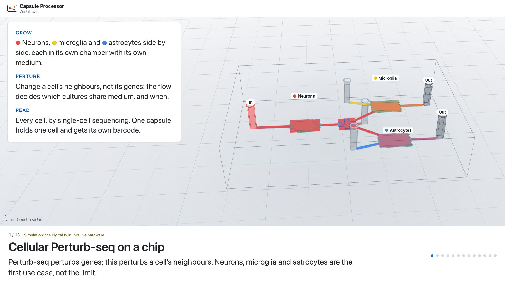 |
| 2 | From a prompt to a chip | A typed prompt, then: Flowmatter parts → chip spec → our checker passes it; the chip appears with its real part shapes. A cached result of Yuvraj's tool (`prompt_to_chip/`), so it runs offline. 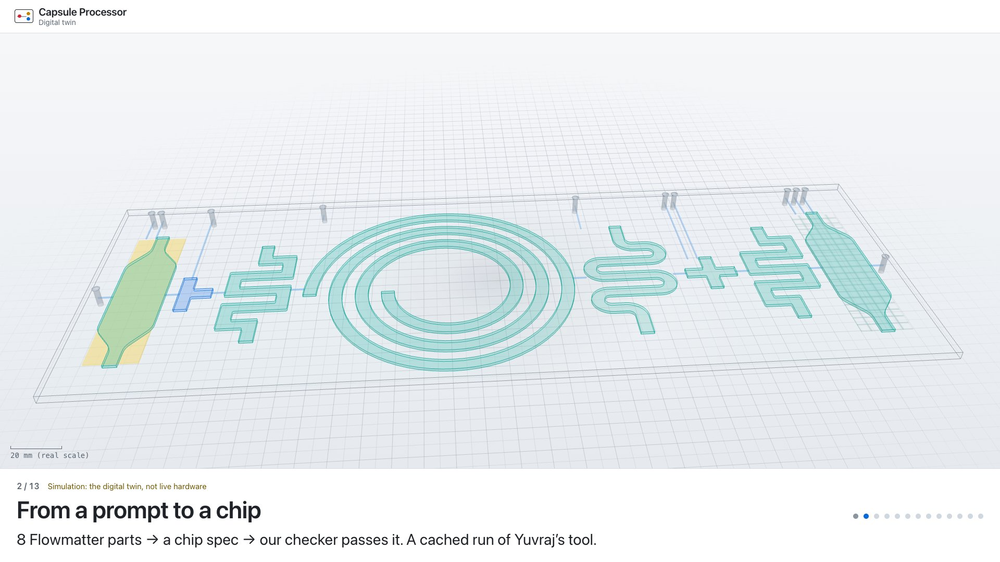 |
| 3 | The whole pipeline, at real scale | The 3D scene: every chip (30 × 20 mm) in a snake, tubes between them, the sample moving chip to chip, from the culture chip to the library out. 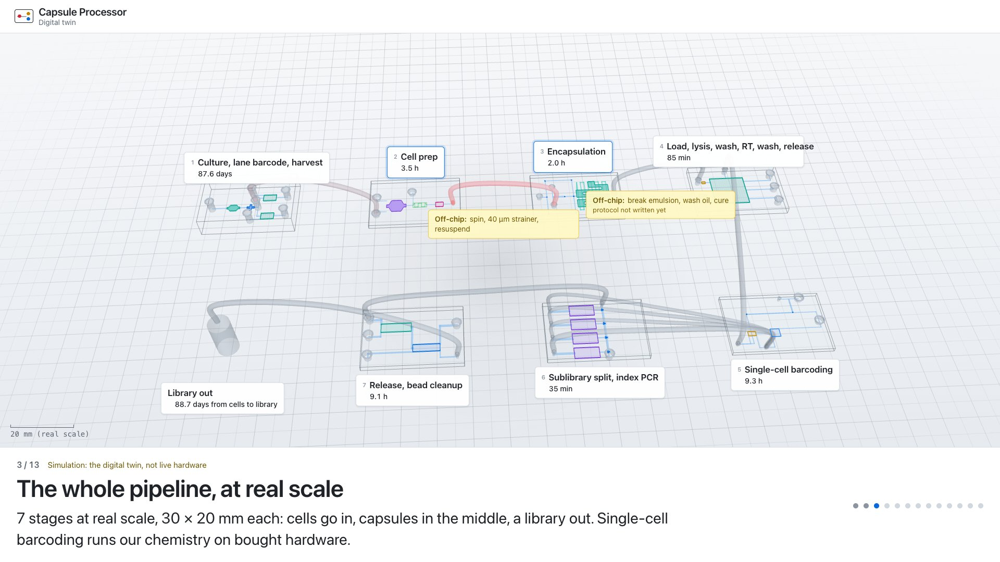 |
| 4 | Module 1: separate growth | Red, yellow and blue medium (neurons, microglia, astrocytes) fill their own chambers and leave by the middle outlet. 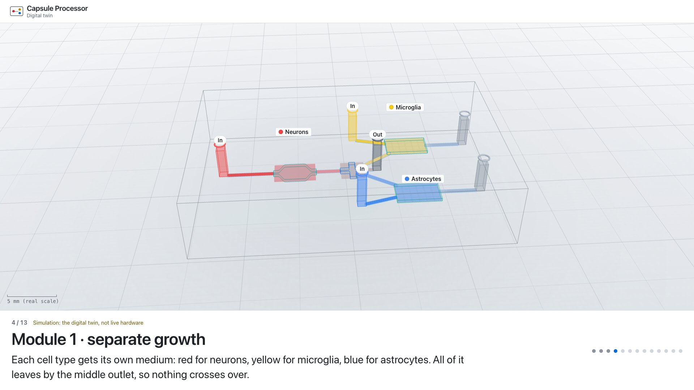 |
| 5 | Module 1: interaction | Only the neurons are fed: red crosses the junction into the microglia and astrocyte chambers. 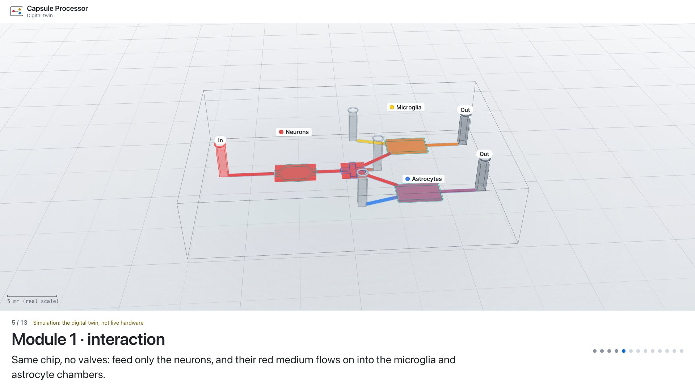 |
| 6 | Unsafe request refused | “Close the middle outlet and open the microglia outlet” is typed; the operator answers in one sentence from the live safety check (the microglia chamber would get 33% neuron and 33% astrocyte medium); blocked, ports unchanged. 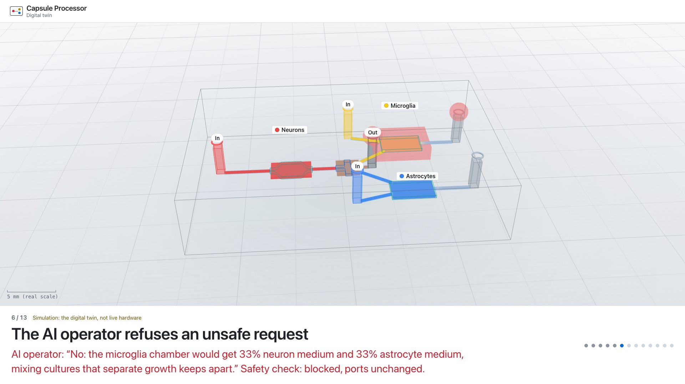 |
| 7 | Harvest, and on down the line | Each chamber's cells pick up that chamber's own label; all three chambers flush out by the middle outlet; then, in the pipeline scene, the cells move on to cell prep and encapsulation. 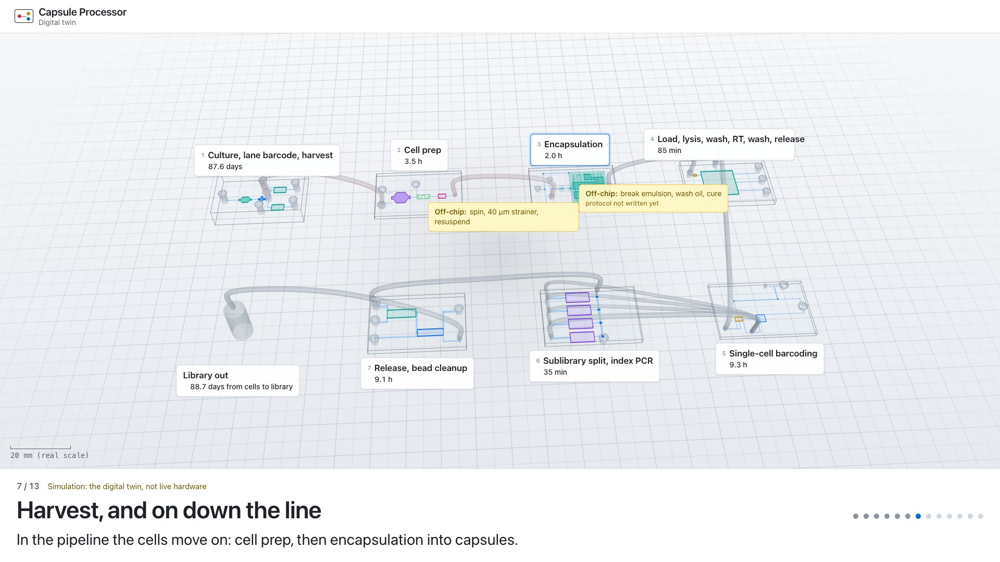 |
| 8 | Module 2: one cell per capsule | The encapsulation chip: oil cuts the cells and the capsule material into droplets that become capsules; most stay empty, so two cells rarely share one. 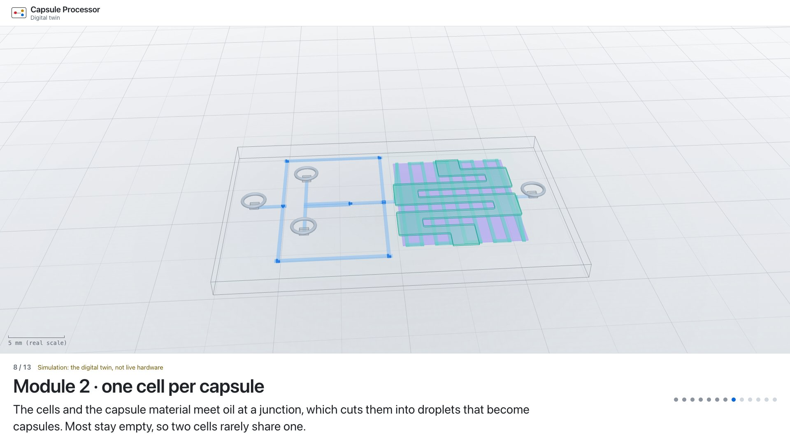 |
| 9 | Module 3: lysis and RT inside each capsule | First the pipeline scene on the tube between Modules 2 and 3, labelled with its off-chip step (break the emulsion, wash off the oil, cure the capsules); then Module 3 traps the capsules, lyses the cells and reverse-transcribes the RNA. 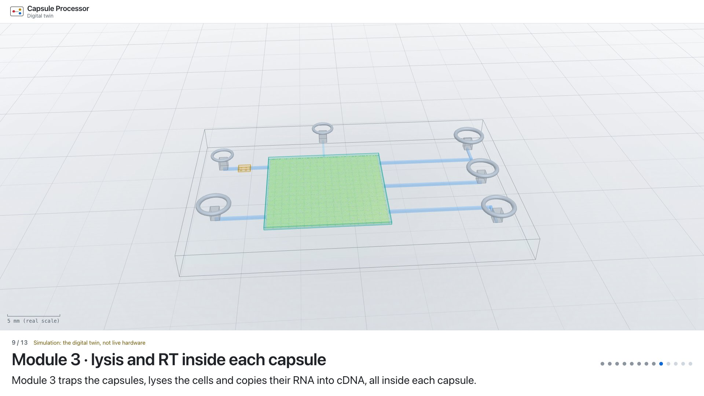 |
| 10 | Single-cell barcoding | Each capsule in its own oil droplet with one random barcode, copied and joined to its cDNA: one barcode per cell. Our chemistry on a bought droplet kit. 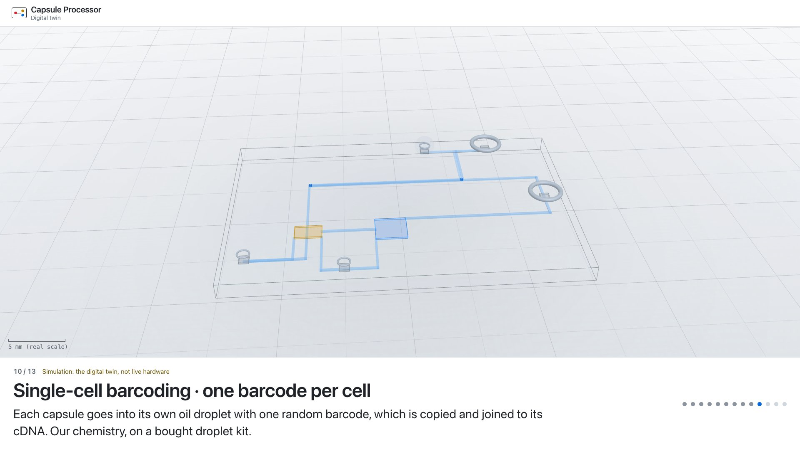 |
| 11 | Module 4 | The capsules are split between four chambers, each with its own index, then the whole chip is thermocycled. 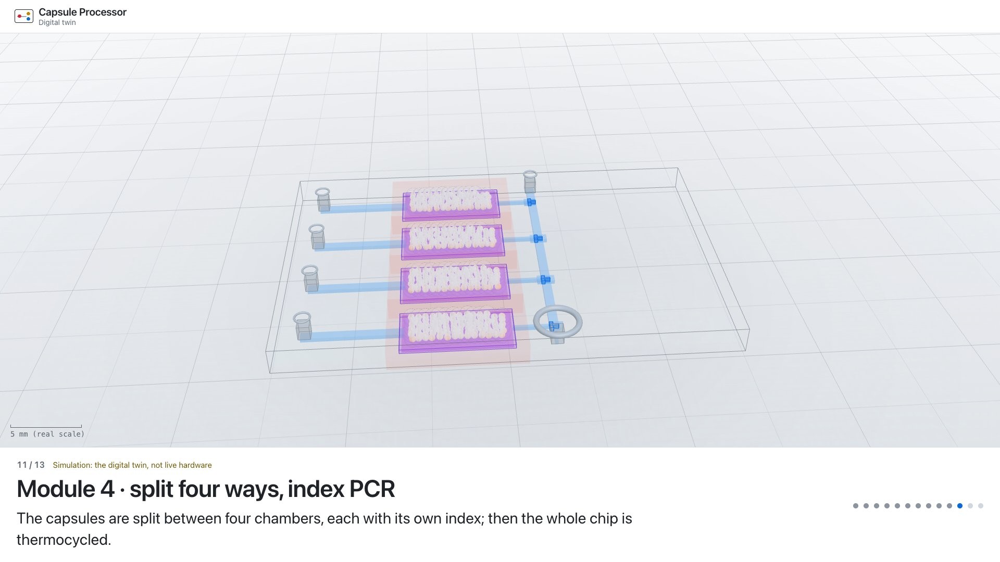 |
| 12 | Module 5 | The capsules are dissolved to free the DNA; magnetic beads catch and clean it, one sublibrary at a time. 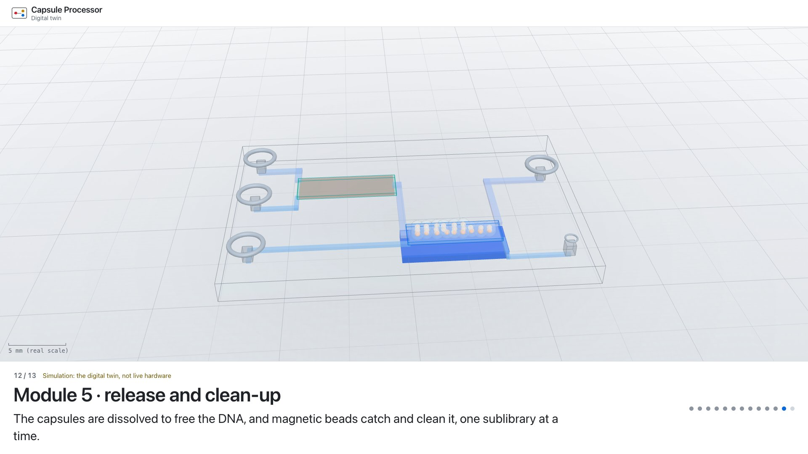 |
| 13 | Scale: many conditions, few cells | A card over the whole line playing: a condition needs a few thousand cells, not a million. One single-cell run reads about 20,000 cells (one well of a 10x Genomics chip, the usual benchmark; our pipeline makes its own library, so this is only the yardstick). Today one Module 1 has three chambers: 3 conditions per run, 24 in eight runs. At about 2,000 cells per condition: 10 per run, 80 in eight. Next: ten or more chambers per chip, more chips in parallel, membrane valves to connect cultures on demand. 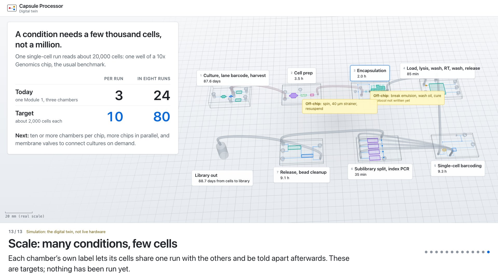 |

Each step is a big title and one short caption at the bottom. The first and last steps add a
card on the left, and the chip or the pipeline is fitted beside it; no other panels.

## Home page

The twin (`--twin`, or http://localhost:8000/twin/) opens on a one-page overview of the project,
beside the pipeline playing on a loop: the idea (cellular Perturb-seq), what the platform does, why
small is the point (the scale figures), the use case and beyond, what we built this weekend and why,
what is new, where it goes next, and where it stands. From there: **See the pipeline**, **Bench demo**, **Present**.


## Bench demo: the twin beside the food-dye run

```
python tools/demo.py --bench      # opens http://localhost:8000/twin/#view=bench
```

For the physical dye demo in [docs/demo.md](../demo.md): printed chips, **one** syringe pump,
food dye in water. The twin runs MJ's procedure for each chip alongside, on one clock.

1. **Chip**: pick it (the pipeline's chips first, in order).
2. **Set up** as the sidebar says: the pump on the feed port at the given rate, the vent open
   to waste, every other port plugged. All of it comes from `docs/demo_plan.json`, the same plans
   as `docs/demo.md`, derived by `tools/demo_plan.py` from the chip spec and contracts.
3. **Start** the timer as the dye reaches the feed port. Module 1 runs through its flow model;
   every other chip colours along the predicted route.
4. **Watch for** lists every part in order of arrival with its predicted window. The bold ones
   colour slowly enough to film; press **Mark** when you first see dye in one, and it says
   whether that landed in the window.


**Then** lists the other vents and inlets to try, and **What this run cannot show** says what a
one-pump dye run says nothing about (retention, streams meeting, heat steps). The twin never
talks to the pump. After changing a chip: `python tools/demo_plan.py --write` and
`python tools/demo_plan.py --json > docs/demo_plan.json`.

## Backup video

[presenter_backup.webm](presenter_backup.webm): the full sequence at 1920×1080, under three minutes.
[presenter_demo.mp4](presenter_demo.mp4) is the same video as H.264, for slides (Keynote, PowerPoint
and Google Slides play it).
Re-record after changing the twin:

```
pip install playwright && python -m playwright install chromium   # once
python tools/record_presenter.py      # video + one screenshot per step, here
```

With ffmpeg installed it trims the loading screen and re-encodes the video small (VP9).
