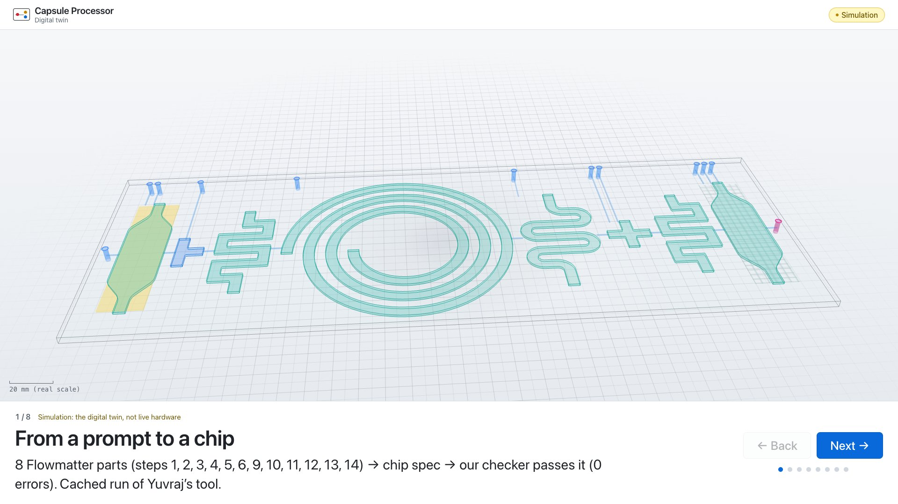
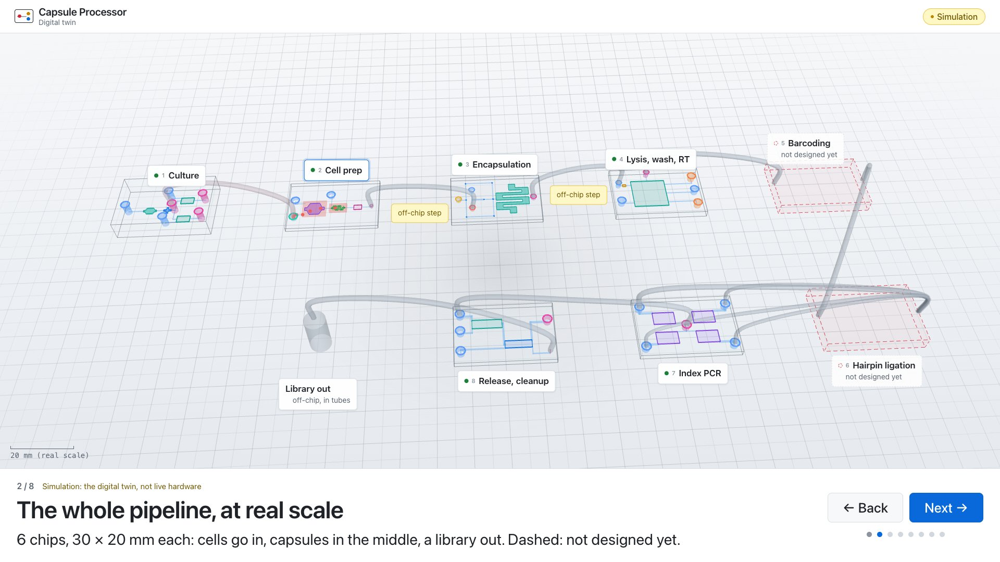
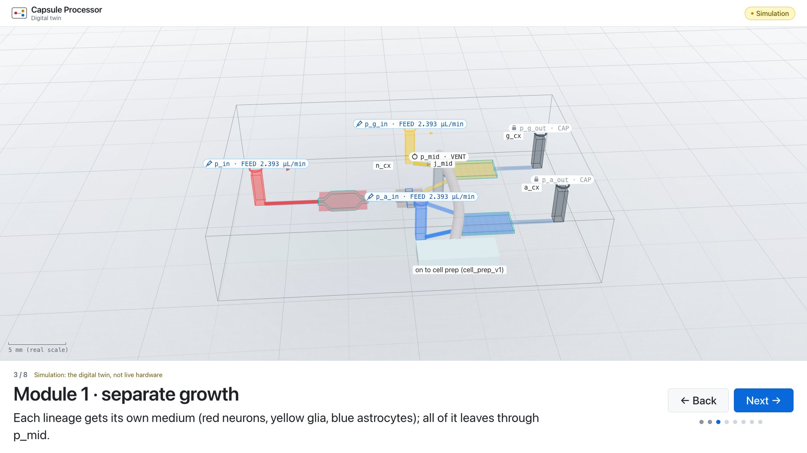
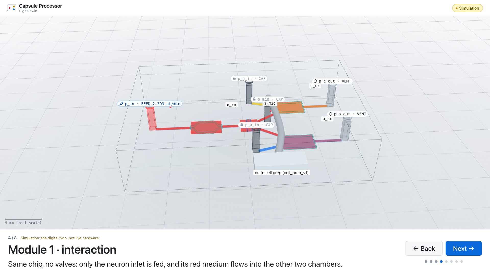
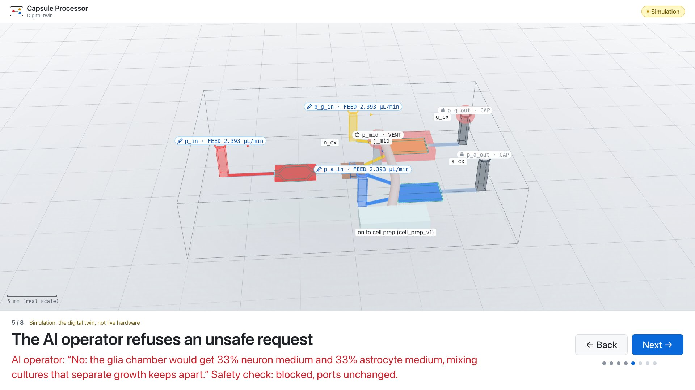
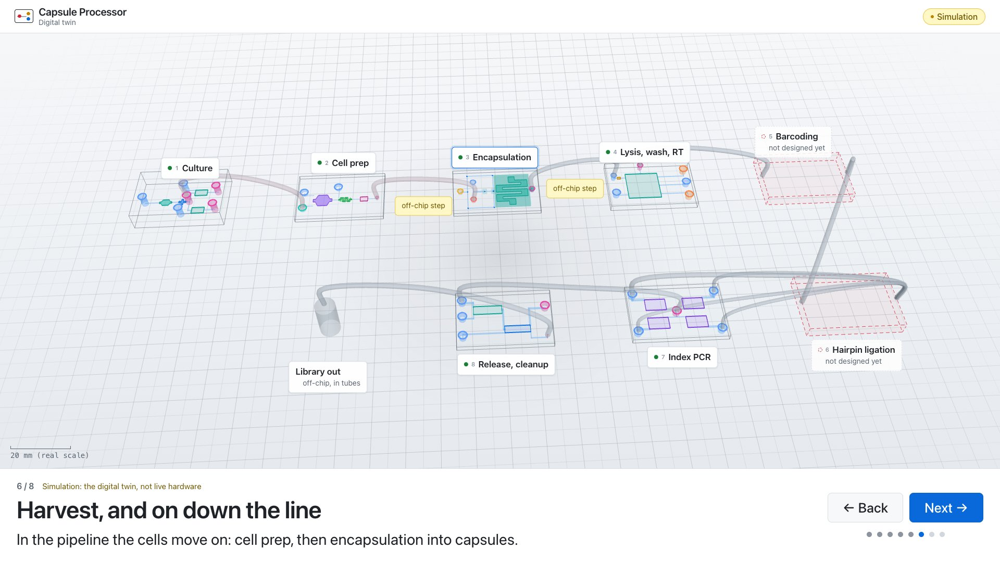
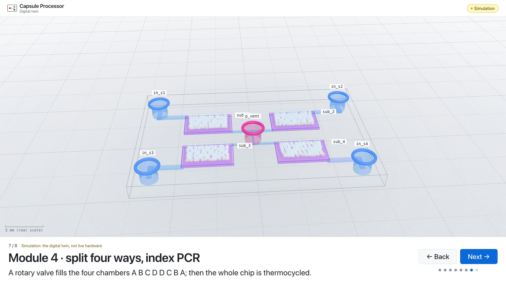
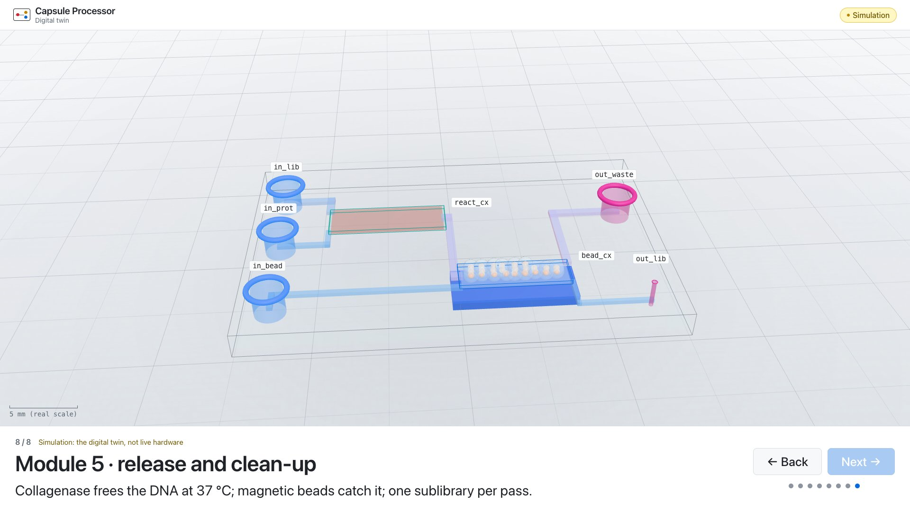
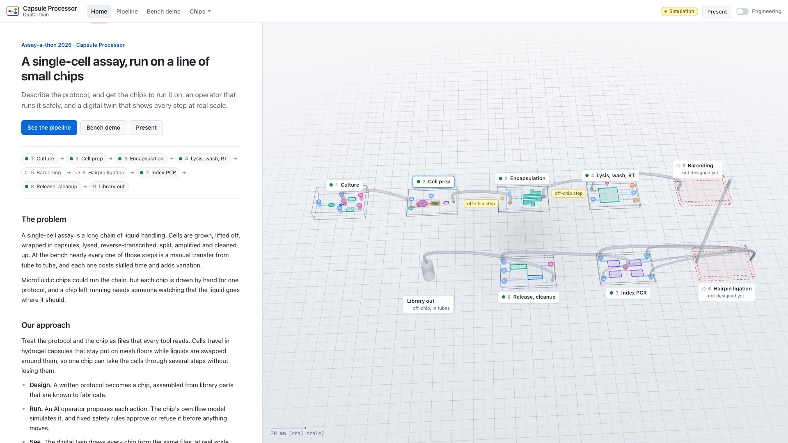
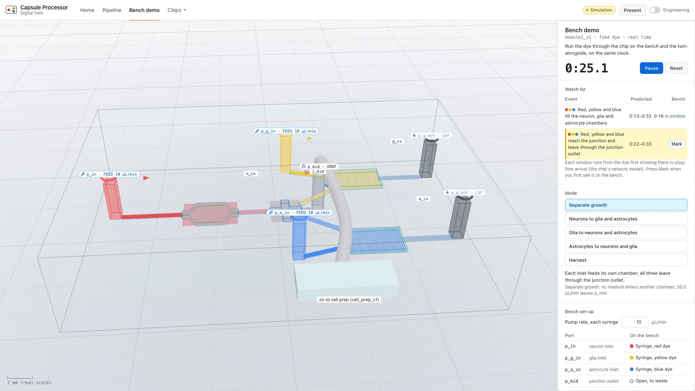

# Sunday demo: the presenter view

```
python tools/demo.py              # serves the repo and opens http://localhost:8000/twin/?present
python tools/demo.py --step 4     # start at step 4
python tools/demo.py --twin       # the normal twin instead, opening on its home page (below)
python tools/demo.py --bench      # the bench demo, beside the food-dye run (below)
```

Standard library only; if port 8000 is taken it uses the next free one and prints the URL.

**Controls.** Big **Next** / **Back** buttons, or → ← / PageDown PageUp (what a presentation
clicker sends) / Space; Home and End jump to the first and last step; **F** toggles full
screen. The cursor hides after a moment. The twin's own shortcuts are off, so a stray key
can't change anything; every step sets the twin up from scratch, so Back, Next and fast
clicking always land on a clean step.

**Offline.** No network at all: three.js is vendored in `twin/vendor/`, every file comes from
this repo, and the AI operator is the **scripted** one (no API call; a recorded LLM run is
not used here). `tools/record_presenter.py` refuses any request outside the repo, so a clean
recording is also the offline check.

**What is real.** Everything on screen is the digital twin: simulated hardware, flows from the
chip's network model, labelled "Simulation" on every step. Module 1 is the chip being
laser-cut for the food-dye demo; the other modules exist in the twin only.

## The steps

| # | Step | What the audience sees |
|---|---|---|
| 1 | From a prompt to a chip | A typed prompt, then: Flowmatter parts → chip spec → our checker passes it; the chip appears with its real part shapes. A cached result of Yuvraj's tool (`prompt_to_chip/`), so it runs offline.  |
| 2 | The whole pipeline, at real scale | The 3D scene: every chip (30 × 20 mm) in a snake, tubes between them, the sample moving chip to chip; dashed outlines, labelled “not designed yet”, for the barcoding and hairpin placeholders.  |
| 3 | Module 1: separate growth | Red, yellow and blue dye (neurons, glia, astrocytes) fill their own chambers and leave through p_mid.  |
| 4 | Module 1: interaction | Only the neuron inlet is fed: red crosses the junction into the other two chambers.  |
| 5 | Unsafe request refused | “Cap p_mid and vent p_g_out” is typed; the operator answers in one sentence from the live safety check (the glia chamber would get 33% neuron and 33% astrocyte medium); blocked, ports unchanged.  |
| 6 | Harvest, and on down the line | All three chambers flush out through p_mid; then, in the pipeline scene, the cells move on to cell prep and encapsulation.  |
| 7 | Module 4 | Rotary-valve fill A B C D D C B A, then thermocycling on all four chambers.  |
| 8 | Module 5 | Collagenase release at 37 °C, magnetic bead capture, one sublibrary per pass.  |

Each step is a big title and one short caption at the bottom; no side panels.

## Home page

The twin (`--twin`, or http://localhost:8000/twin/) opens on a one-page overview of the project:
the problem, our approach, what we built this weekend and why, what is new, and where it stands,
beside the pipeline playing on a loop. From there: **See the pipeline**, **Bench demo**, **Present**.



## Bench demo: the twin beside the food-dye run

```
python tools/demo.py --bench      # opens http://localhost:8000/twin/#view=bench
```

For running the physical Module 1 chip with food dye (red for the neuron chamber, yellow for
glia, blue for astrocytes) while the twin runs alongside:

1. **Mode**: separate growth, one of the three interactions, or harvest.
2. **Bench set-up**: set the pump rate; the table says what goes on each port (which dye
   syringe, open to waste, or plugged). Prime the chip with water first.
3. **Start** the timer with the pumps. The twin's dye moves in real time, on the same clock.
4. **Watch for** lists what should happen and when, each as a window from the dye first
   showing there to plug-flow arrival (the chip's network model, the same as
   `operator/network.py`). Press **Mark** when you first see it on the bench; it says whether
   that landed in the window, or how far off it was.



Changing the mode keeps the dye in the chip and resets the timer; **Reset** clears the dye.
Start the timer as the dye enters the chip, or enter the tubing's volume so the predictions
include it. The twin never talks to the pumps: it is a simulation, and says so on screen.

## Backup video

[presenter_backup.webm](presenter_backup.webm): the full sequence at 1920×1080, about 90 s.
Re-record after changing the twin:

```
pip install playwright && python -m playwright install chromium   # once
python tools/record_presenter.py      # video + one screenshot per step, here
```

With ffmpeg installed it trims the loading screen and re-encodes the video small (VP9).
