# Module 1 v1 twin: screenshots

From the Playwright check of the twin (tab **1 Culture**), at 11 µL/min per feed.

| Mode | Screenshot |
|---|---|
| Separate growth | 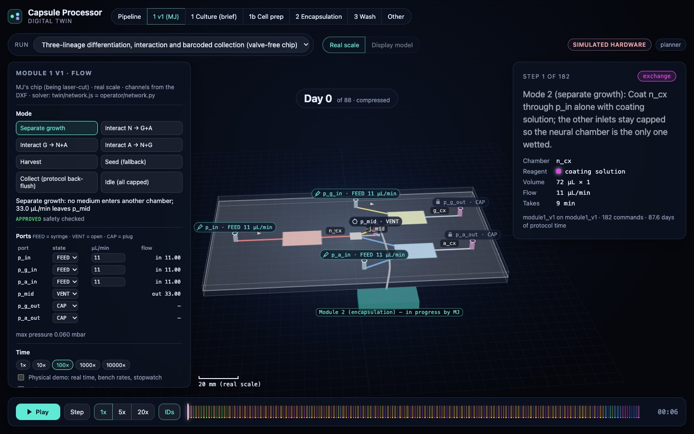 |
| Interact N → G+A |  |
| Interact G → N+A | 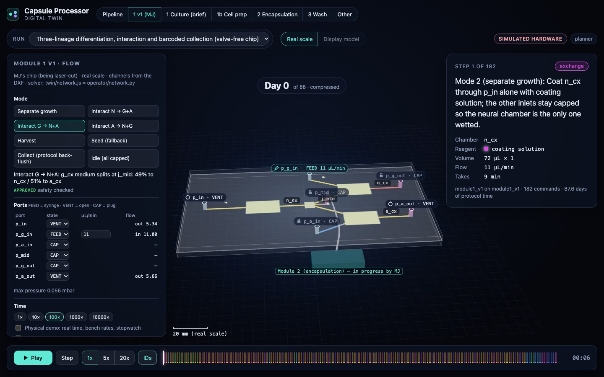 |
| Interact A → N+G | 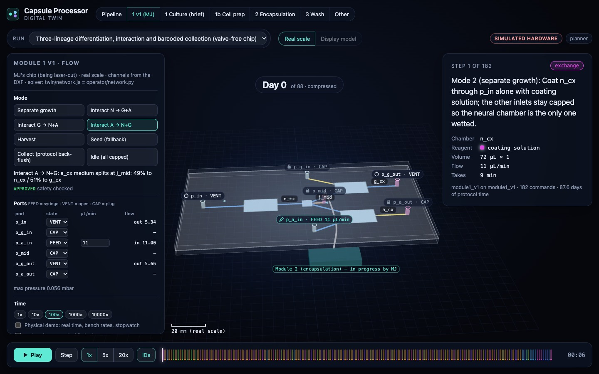 |
| Harvest (design doc) |  |
| Seed (fallback) | 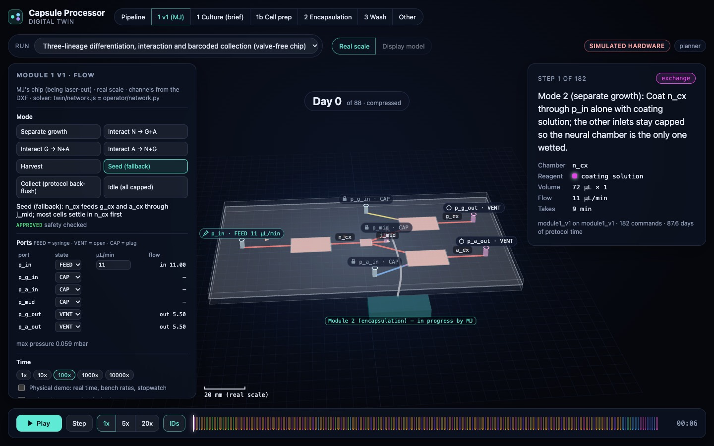 |
| Pumps off: diffusion after 12 h | 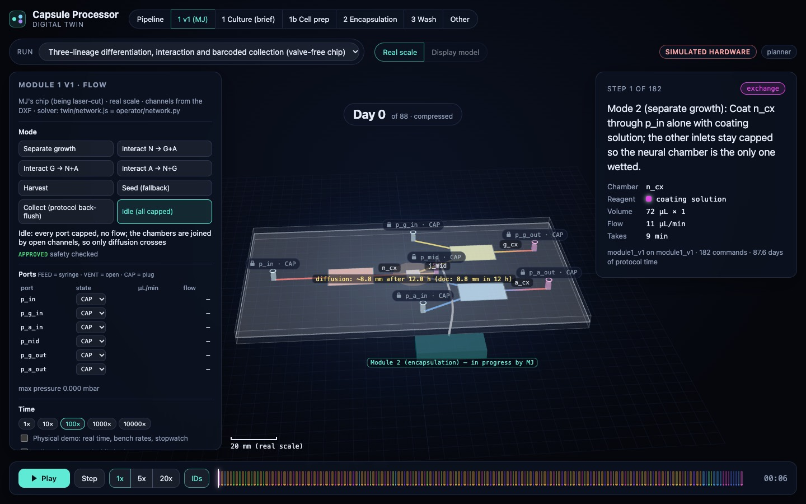 |
| Physical demo (50 µL/min, stopwatch, predicted vs measured) | 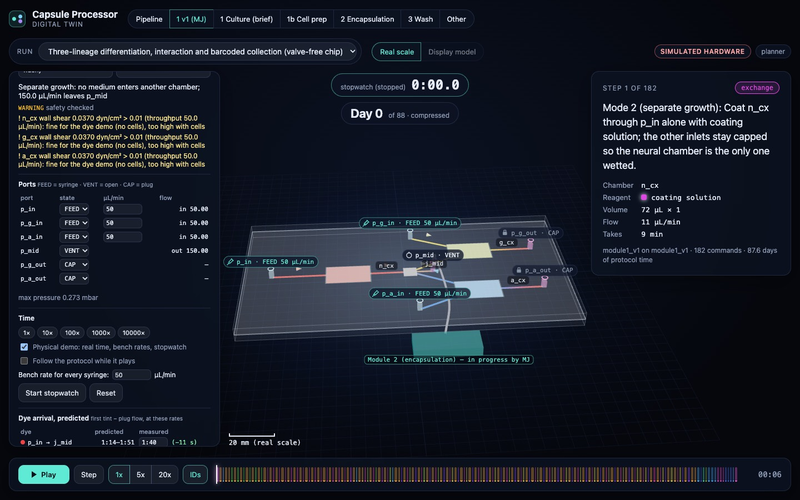 |
| Protocol playback: collect, flow to Module 2 | 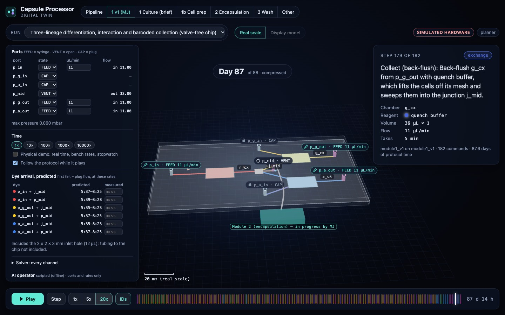 |
| Pipeline view: all current modules, status badges, demo vs twin-only, hand-offs | 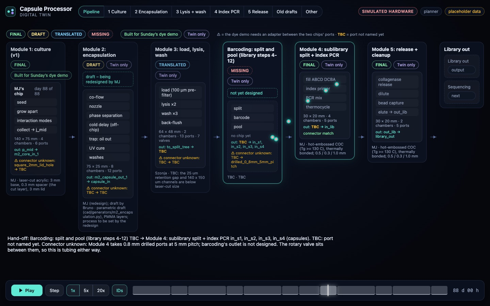 |
| Module 3 (translated): Szonja's workflow, lysis exchange | 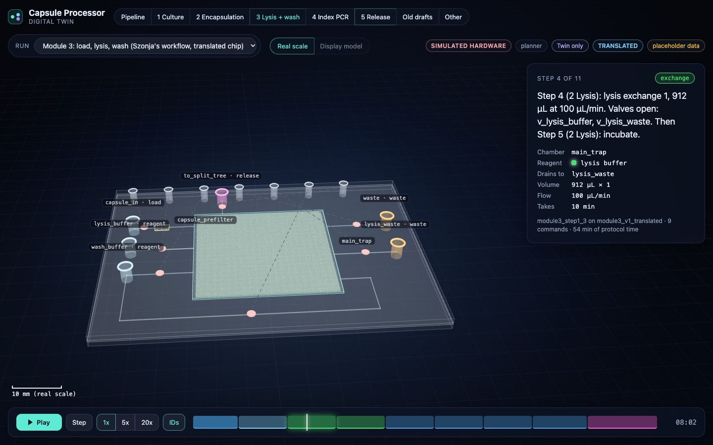 |
| Module 4: thermocycle on all four chambers, fill order ABCD DCBA | 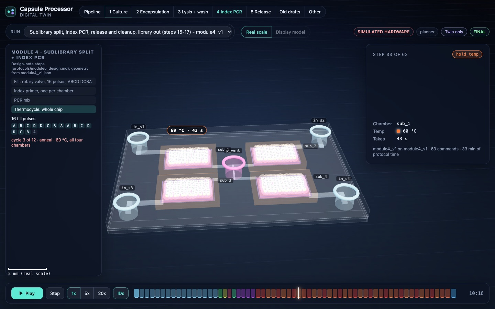 |
| Module 5: pass 2 of 4, magnet on under bead_cx | 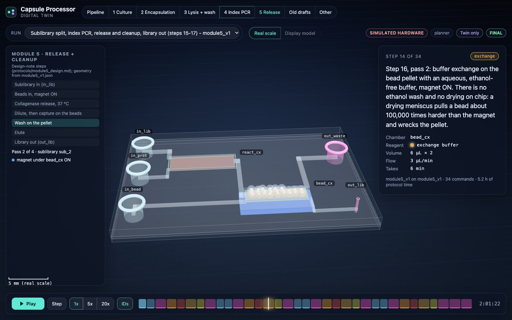 |
