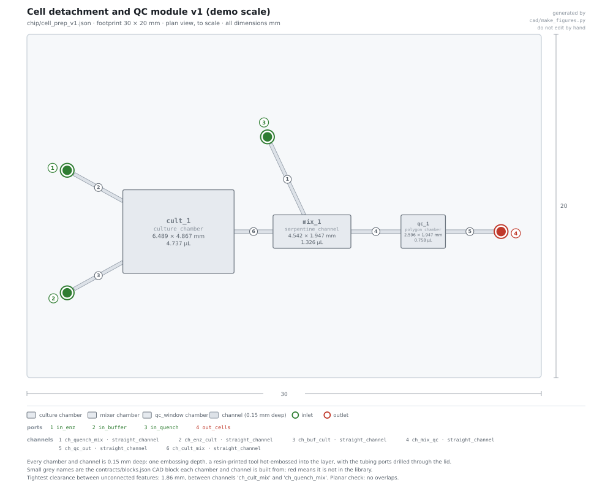

# Cell prep: why four of the six steps are not on the chip

Notes for `cell_prep_v1.json` and `chip/cell_prep_v1.json`.

This module sits between differentiated cells and encapsulation. The obvious version
does six things with no centrifuge and no pipetting: detach, neutralise, wash ×3, remove
clumps, count, concentrate into the viscous encapsulation buffer.

**Four of those six lose to a bench tube** once the feature floor is applied (written at
100 µm; it is now 200 µm, which only strengthens the case). This note is mostly the evidence for that, because it is the useful part. See
[CONFIDENTIALITY.md](../CONFIDENTIALITY.md).



---

## 1. The scorecard

| Step | Where | Why |
|---|---|---|
| Detach | **chip** | The cells are already adherent here. Nothing to gain by moving them first. |
| Neutralise | **chip** | Co-flowing the quench stops the enzyme as cells leave, not minutes later. |
| Wash ×3 | tube | Lateral displacement needs **12–45 µm** gaps. Inertial leaves ~20% carryover per pass. |
| Remove clumps | tube | **No ≥100 µm geometry removes 30–40 µm clumps.** Needs a bought mesh. |
| Count | **chip** | A window is nearly free and it sets the concentration. |
| Concentrate | tube | The viscous buffer drops Reynolds ~75×, so inertial focusing stops working. |

| | Recovery | Time |
|---|---|---|
| All six on chip | **~0.35** | ~50 min |
| These two + tube | **~0.7** | ~30 min |

Building the other four would halve the yield and take longer. So they aren't here.

---

## 2. The three that are actually impossible

**Lateral displacement.** The critical diameter is `Dc = 1.4·G·ε^0.48`. For an 8–15 µm
cutoff that needs gaps of 12–45 µm ([10.1126/science.1094567](https://doi.org/10.1126/science.1094567)).
At a 100 µm gap you would need ~390 rows at 0.15° of tilt, which no printer holds.

**Impedance counting.** Signal scales as cell volume over sensing volume. A 15 µm cell in
a 100 µm aperture gives ~0.3% signal; published devices use 20–50 µm apertures
([10.1039/B103933B](https://doi.org/10.1039/B103933B)). A 100 µm aperture also holds
~1.5 cells at working concentration, so it is permanently in coincidence.

**The clump filter.** This is the one that really blocks a fully on-chip module. A 100 µm
pillar gap passes everything we want to remove. Inertial sorting is the only ≥100 µm
candidate and it is not a hard cutoff — worse, a *string-shaped* triplet migrates like a
single cell ([10.3390/mi14040787](https://doi.org/10.3390/mi14040787)), so shape defeats
size sorting. **A 30–40 µm woven mesh is unavoidable.** Bought and bonded in, it isn't a
fabricated feature, so it doesn't break the rule — but it isn't something we make.

---

## 3. The viscous buffer kills everything upstream of it

The encapsulation buffer carries a viscosity-raising additive that puts it roughly two
orders of magnitude above water. Reynolds scales as 1/µ, so at the same flow it drops by
the same factor and inertial focusing stops
([10.1073/pnas.0704958104](https://doi.org/10.1073/pnas.0704958104)). Restoring it would
need litres per minute and megapascals of pressure.

**So the viscous buffer goes in last, off chip, in the final step.** It also means
centrifugation barely works there either — at the additive loading used, the density
difference between cells and buffer almost vanishes — so that step is a gentle mix-in
however you do it.

---

## 4. The number this module exists to get right

Cells ride in the **core stream only**, which is half the droplet, so the concentration
the nozzle needs falls as the **cube** of capsule diameter.

| Capsule | Core volume | Cells/µL for a mean of 0.2 |
|---|---|---|
| 70 µm | 0.09 nL | 2227 |
| **135 µm** | **0.64 nL** | **310** |
| 150 µm | 0.88 nL | 226 |

Use a concentration quoted for a 70 µm capsule on our 135 µm one and you get a mean of
**1.43 cells per capsule: 42% multiplets instead of 1.8%.** The run would look like it
worked and the data would be unusable.

`build_cell_prep.py --report` prints this table, and `build_sctip_spc.py` now derives the
same figure from capsule geometry, so the two modules cannot drift apart.

This is also why in-line counting isn't worth building: a **20% counting error moves
single occupancy by only ~15%**, so a window, a phone camera and ~400 counted cells are
enough.

---

## 5. Honest limits

- **No cells have been run.** Architecture and a physics budget.
- The recovery figures (0.35 vs 0.7) are **assembled per-step estimates**, not one
  measured end-to-end number. The direction is solid; the magnitude is not.
- **No published on-chip dissociation** gives reagent, concentration, time *and*
  geometry together. The branching-constriction data
  ([10.1039/c4lc01126k](https://doi.org/10.1039/c4lc01126k)) runs at mL/min, far above
  droplet-generator flows, so our serpentine is a scaled-down cousin and unvalidated.
- The serpentine will **not** reach 100% single cells. Published branching gets ~92%.
  The bought mesh downstream is doing the real work.
- **Dissociation at 37 °C induces stress transcripts**
  ([10.1038/nmeth.4437](https://doi.org/10.1038/nmeth.4437)). Everything after detachment
  is held at 4 °C and kept short, but the artefact is already created by then.
- `coc` is not yet in `contracts/materials.json`.

## Rebuilding

```bash
python protocols/build_cell_prep.py --report
python cad/make_figures.py --chip chip/cell_prep_v1.json
python operator/run.py --protocol protocols/cell_prep_v1.json --chip chip/cell_prep_v1.json
python tools/validate.py && python tools/check_chip_spec.py
```
