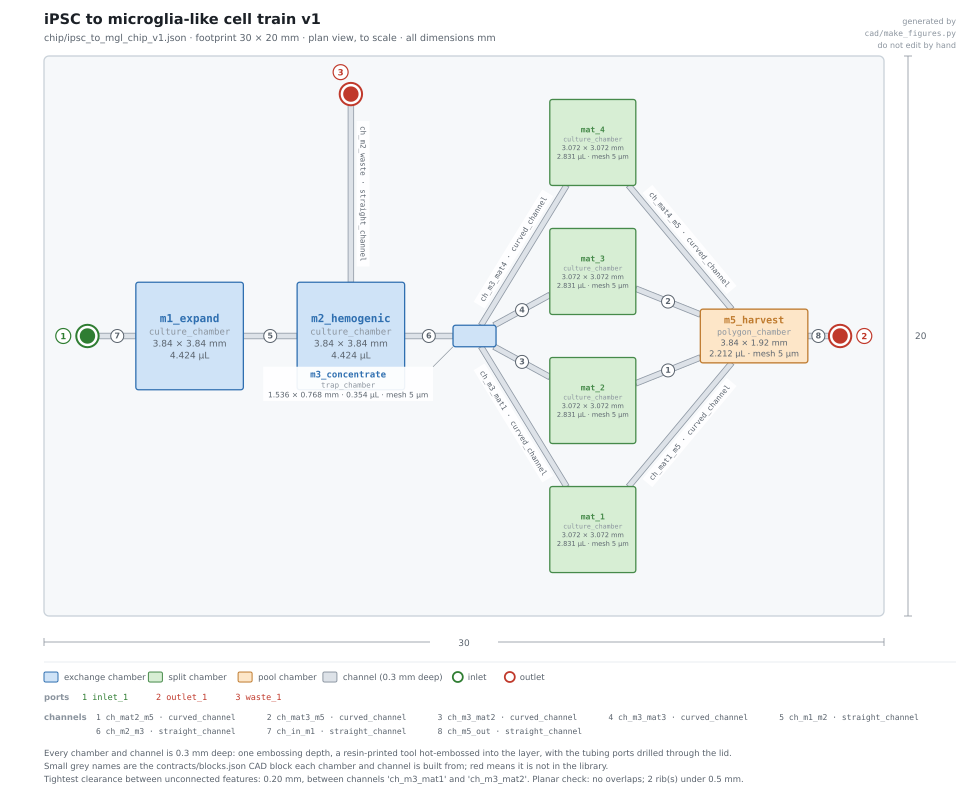

# iPSC to microglia-like cells, end to end on chip

Design notes for `ipsc_to_mgl_v1.json` and `chip/ipsc_to_mgl_chip_v1.json`.

Everything here comes from published papers, cited inline, plus geometry and flow
numbers we derived this weekend. No compositions, concentrations or cell lines: look
them up in the cited sources. See [CONFIDENTIALITY.md](../CONFIDENTIALITY.md).

---



Left to right: expansion, hemogenic endothelium, the concentrator that replaces the
centrifuge, four parallel maturation chambers, and the harvest module. Drawn to scale
by `python cad/make_figures.py`; `cad/figures/` also holds the layer stack and the
feature-size chart for this chip.

## What this is

A differentiation that runs from iPSCs to microglia-like cells with **nothing handled
off-chip**. No pipetting between vessels, no centrifuge, no cell sorter, and no
genetically modified line.

It matters because **nobody has published iPSC differentiation to any myeloid cell
inside a microfluidic device.** On-chip differentiation from the pluripotent stage
exists for liver, heart, gut, placenta and neural tube, but not for this lineage.

## Choosing the protocol

Three constraints, applied in order.

1. **Wild-type iPSCs only**, which rules out every transcription-factor forward-programming
   route, since all of them need an engineered line.
2. **No embryoid bodies**, because forming defined-size aggregates needs centrifugal
   loading, and the classical route then runs a 3–5 week suspension stage in large flasks.
3. **No sorting**, because a FACS or MACS step cannot happen on chip.

| Route | Days | Why not |
|---|---|---|
| Classical embryoid-body route | 60+ | Aggregates plus a multi-week flask stage |
| Abud et al. 2017, doi 10.1016/j.neuron.2017.03.042 | 38 | Needs a CD43 sort and 5% O₂ early |
| Douvaras et al. 2017, doi 10.1016/j.stemcr.2017.04.023 | ≥39 | Needs sorting |
| Guttikonda et al. 2021, doi 10.1038/s41593-020-00796-z | 21–28 | Final step needs co-culture with neurons that take 50–90 days to prepare |
| Takata et al. 2017, doi 10.1016/j.immuni.2017.06.017 | 25 | 8 days of hypoxia; identity rests on neuron co-culture |
| **McQuade et al. 2018, doi 10.1186/s13024-018-0297-x** | **38** | **Chosen.** Monolayer, embryoid-body-free, sorting-free, no hypoxia |

McQuade is the only published wild-type route whose early stage is a flat adherent
monolayer in a single vessel. Its yield is 125 progenitors per input iPSC and its
purity is 90–94%, and it has a cryopreservable intermediate. The simplification over
Abud is precisely the removal of the sort, which the authors validated by RNA-seq.

**38 days, checked in the paper.** The published method calls itself "the complete 38 day
paradigm" and collects at day 28 of microglia medium after the ~10-day progenitor stage.
**38 is the published number; 40 is ours.** Our on-chip schedule holds maturation two days
longer, to day 40, which is where `m5_harvest` sits in the module table below — that extra
window is the adherence modification, not McQuade. ⚠️ `protocols/build_module1.py`,
`protocols/module1_v1.json` and `protocols/ipsc_to_mgl_v1.json` still attribute **40 days**
to McQuade; those files belong to other owners, so this is flagged rather than edited. The
paper says 38.

**One modification.** McQuade's maturation-stage cells "predominantly grow
non-adherently", which a chamber cannot hold. Washer et al. 2022
(doi 10.1038/s41598-022-23477-2) supports adding one more factor, and the specific finding
is worth quoting rather than paraphrasing. Washer is a **subtractive** study — it strips the
maturation medium to a minimum and scores what each component does — but its final
differentiation series adds one factor back: in the section *"Low-dose GM-CSF promotes
cellular retention while maintaining microglial identity"* (differentiation three, Fig. 4a),
a minimal transforming-growth-factor/macrophage-colony-stimulating-factor medium gave "low
survival and adherence", and "when supplemented with GM-CSF the survival and adherence is
improved"; the authors conclude that the GM-CSF-containing medium "is preferable for
experiments requiring consistent adherence". So the granulocyte-macrophage colony-stimulating
factor is the one factor, and the claim is the paper's, not ours. Lanfer et al. 2022
(doi 10.3390/ijms23094526) independently matured progenitors from the same class of
commercial monolayer differentiation system into adherent cells.

What remains **our inference** is that this transfers to a 0.3 mm perfused chamber at all:
Washer scored retention in wells with 50% medium changes, not under flow. The protocol file
follows it, and it is a clean side experiment: with and without, scored on adherent fraction.

## How a flask protocol becomes a chip protocol

McQuade has one vessel transfer and three centrifugation steps. Both exist because a
flask cannot hold cells still while the liquid around them changes. A chip can.

| Bench operation | Why it exists | On chip |
|---|---|---|
| Transfer to a new plate | The maturation surface is a different dish | A channel to the next module |
| Spin and resuspend | Pellet the cells so the medium can be swapped | Retention mesh, liquid flows past |
| Pipette off floating cells | Separate them from the adherent layer | Flow does it; the adherent layer stays |
| Tilt and aspirate from the edge | Remove medium without disturbing cells | Perfusion exchange |
| Pass through a strainer | Remove debris and sheet fragments | Inline filter |

Nothing in the protocol needs a centrifuge, a sorter or a pipette.

## The modules

```
inlet_1 → m1_expand → m2_hemogenic → m3_concentrate → mat_1..mat_4 → m5_harvest → outlet_1
                           ↓
                        waste_1  (spent medium, kept as supernatant samples)
```

| Module | Days | Size | Does |
|---|---|---|---|
| `m1_expand` | −7 to −1 | 4 cm², 120 µL | iPSC expansion; enzyme-free lift as aggregates |
| `m2_hemogenic` | −1 to 12 | 4 cm², 120 µL | Adherent hemogenic endothelium; progenitors float off from day 7 |
| `m3_concentrate` | 10 to 12 | 0.3 cm², 9.6 µL | Concentrator; replaces the spin. Fed through a 30 µm in-line filter |
| `mat_1..mat_4` | 12 to 40 | 2.56 cm² each, 10.2 cm² total | Maturation, four chambers for n = 4 or four conditions |
| `m5_harvest` | 40 | 2 cm², 60 µL | Pool, cool, dissociate, filter, count, deliver |

### Why the areas are what they are

- **`m2_hemogenic` is 4 cm² for statistical reasons, not biological ones.** The published
  method specifies 16–40 colonies per well and plates 5–10 colonies/cm². A 1 cm² chamber
  would hold 5–10 colonies and colony-to-colony scatter would dominate. 4 cm² gives 20–40.
- **The maturation chambers total 10.2 cm².** If the published 125-fold yield holds, 4 cm²
  of hemogenic endothelium produces roughly 900,000 progenitors. At McQuade's sparse
  plating density that would need 90 cm², which no chip holds. Lanfer matured the same
  progenitors at roughly ten times that density, and the kit's own documentation warns
  that plating too sparsely *lowers* the mature marker fraction. The dense end of the
  published range needs **10 cm² instead of 90**.

### Two different openings, which is easy to get wrong

I had these conflated in the first version, and `tools/check_chip_spec.py` caught it.

- **A retention mesh** keeps cells *in* a chamber while liquid drains. It must be well
  below the cell diameter: 5 µm here, against the ~8 µm critical diameter in
  `contracts/parameters.json`. It cannot be printed (floor 200 µm), so it is a bought mesh insert. `m1_expand` and `m2_hemogenic` have none, because their
  cells are attached to the floor.
- **An in-line filter** blocks things that are *too big*. The 30 µm filter on the
  `ch_m2_m3` line stops detached endothelial sheet while passing 10–20 µm progenitors.
  That is `cell_filter.gap_um` in the parameters file, and it is a channel feature, not
  a chamber mesh.

### Why the suspension stage cannot be designed away

Blood cells are born from hemogenic endothelium by the endothelial-to-haematopoietic
transition (EHT). A haematopoietic transcriptional programme switches on in a subset of
endothelial cells, and the cells then round up, break their junctions to their neighbours
and adopt a haematopoietic fate (review: Ottersbach 2019, doi 10.1042/BST20180320, whose
abstract states exactly that sequence). RUNX1 is required for the transition and not
afterwards (Chen et al. 2009, doi 10.1038/nature07619 — primary, not a review). Losing
adhesion and becoming a blood cell are the same event, so **every** wild-type route has a
floating stage.

> **Citation corrected.** This paragraph previously cited doi 10.1182/blood-2016-05-716480
> as a review supporting "RUNX1 switches on, silences the adhesion programme". That DOI is
> Nestorowa et al. 2016, *Blood* — a single-cell expression map of **mouse** haematopoietic
> stem and progenitor cells. It says nothing about RUNX1 or adhesion, and it was the
> load-bearing justification for the whole floating stage. Both replacements above were
> resolved and read before being used. Note that "silences the adhesion programme" as a
> mechanism is still **our wording**: the review supports junction breakdown and rounding
> up, and the *Nature* paper supports RUNX1's requirement, but neither is cited here for a
> specific adhesion-gene repression step. The chip catches
it rather than fighting it: the cells go from flat to floating in two to three hours
(Yoneda 2024, doi 10.2142/biophysico.bppb-v21.s015), so skimming the effluent catches
them within hours of their birth, where a flask collects every two days.

## The physics

`build_ipsc_to_mgl.py` computes every flow rate from chamber geometry. Run
`python protocols/build_ipsc_to_mgl.py --report` to print the table.

**Shear.** Park et al. 2023 (doi 10.1016/j.bpj.2023.03.037) saw this cell type change
migration behaviour and raise inflammatory transcripts at **0.017 dyn/cm²** over six
hours, the lowest activating shear in the literature and far below what most perfusion
chips run at. For a wide shallow chamber, τ = 6μQ/(wh²). Every exchange is held at or
below **0.01 dyn/cm²**:

| Chamber | Width × height | Flow used | Shear | Ceiling |
|---|---|---|---|---|
| `m1_expand`, `m2_hemogenic`, `m5_harvest` | 20 × 0.3 mm | 20 µL/min | 0.0089 | 22.5 µL/min |
| `mat_1..4` | 16 × 0.3 mm | 15 µL/min | 0.0083 | 18.0 µL/min |
| `m3_concentrate` | 8 × 0.3 mm | 6 µL/min | 0.0067 | 9.0 µL/min |

**Oxygen.** Macrophage-lineage consumption is 6–9 amol/cell/s (Wagner 2011,
doi 10.1016/j.freeradbiomed.2011.05.024). A maturation chamber holds ~150,000 cells,
which need about 0.5 mL/day of fully stripped medium against a chamber volume of 77 µL.
**A sealed static chamber is about seven times short.** Recirculating at ~3 µL/min
through a vented reservoir covers it at 0.0017 dyn/cm², ten times below the shear
threshold. Gas exchange therefore happens in the reservoir, not the chambers, which is
why the chambers do not need to be gas-permeable and can be resin-printed.

**Why medium is never fully removed.** The published method tops the well up rather
than exchanging it, because the cells depend on their own secreted factors; removing
them blocks differentiation. A fixed-volume chamber cannot accumulate, so the
recirculating reservoir is how that regime is reproduced. Most exchanges in the
protocol are half-volume for the same reason.

## Harvest and processing

`m5_harvest` has to deliver something the encapsulation chip can use.

| Step | Why |
|---|---|
| Cool to 4 °C | Cold handling limits the activation that warm enzymatic lifting causes in this cell type (Chen et al. 2015, doi 10.1016/j.jim.2015.08.001) |
| Enzyme-free dissociation, 15 min | Matches the published harvest for this cell type |
| Carrier-protein quench | The published method adds it so released cells do not stick to vessel walls |
| Two passes through a 30 µm mesh | Matches the published two-pass strainer |
| Count, concentrate, deliver | Sets the loading density for encapsulation |

**Interface,** matched to `contracts/parameters.json`: roughly 400,000–600,000 cells at
**1,500 cells/µL** (`encapsulation.cell_conc_per_ul`, range 1,000–2,000), so about 400 µL;
**>90% viable** (`qc.viability_min`); no clumps above **30 µm** (`cell_filter.gap_um`,
which must stay at or below the 40 µm encapsulation nozzle); in a carrier-protein buffer
at 4 °C, delivered within minutes.

**Release gate.** Do not encapsulate on a schedule. Encapsulate when imaging
(adherent fraction, ramification, death fraction) and supernatant markers both pass.
If the gate fails, hold and re-test rather than spending an encapsulation run.

## What the chip does that a flask cannot

1. **Gates the most subjective step in the protocol.** Seeding density is critical and
   normally judged by eye across several plated densities. Here, automated colony
   counting at day 0 is a pass/fail gate. The flip side is that you cannot pick the
   best well, so a bad seed aborts the run.
2. **Purifies without sorting.** The 30 µm filter blocks detached endothelial sheet,
   which contaminates the harvest in flasks as the layer ages.
3. **Skims progenitors within hours of their birth** instead of every two days, and an
   off-chip valve makes continuous versus batch harvest a controlled comparison. That experiment
   cannot be run in a plate.
4. **Samples the supernatant for free.** Every exchange leaves through `waste_1`.

## Honest limits

- **No cells have been run.** This is an architecture and a physics budget, not a result.
- **`m5_harvest` is the least supported module.** There is no published on-chip
  dissociation with efficiency figures, and no study of how detachment method affects
  this cell type's transcriptome. It needs its own validation against a hand-harvested
  control.
- **Cytokine loss to device surfaces is unmeasured** for any of the proteins involved.
  A chip has less protein per unit of wetted surface than a plate; a recirculating loop
  roughly halves that penalty, but it needs an ELISA time course to confirm.
- **The run is 47 days**, which the twin will play as 4,064,304 s. The protocol is
  honest rather than shortened for the demo, so the twin may want a larger speed
  multiplier or a day-scale timeline.
- **Two open TODOs from `check_chip_spec.py`,** shared with the other chips: the
  fabrication limits in `cad/fabrication.json` are not filled in yet, and this chip's
  reagent names have no PMMA compatibility entry in `contracts/materials.json`. Both
  need owners' input rather than a guess from me.
- **Call the product "microglia-like cells".** The 2022 field white paper
  (doi 10.1016/j.neuron.2022.10.020) is explicit that marker panels do not make a cell
  bona fide microglia, and no in vitro protocol reproduces the adult homeostatic
  signature.

## Rebuilding the files

```bash
python protocols/build_ipsc_to_mgl.py --report     # protocol + the shear table
python cad/make_train_cad.py                       # STL per part + spacer-layer DXF
python operator/run.py --protocol protocols/ipsc_to_mgl_v1.json \
                       --chip chip/ipsc_to_mgl_chip_v1.json
python tools/validate.py
```
