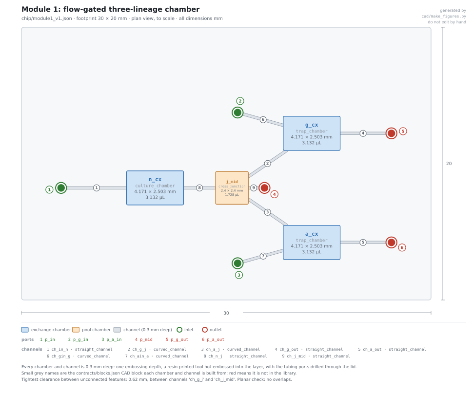
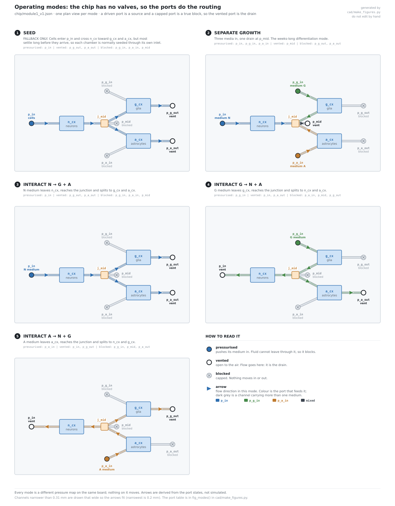

# Module 1: pressure-gated three-lineage chamber

Design note for `chip/module1_v1.json`. Geometry and flow numbers are ours. See
[CONFIDENTIALITY.md](../CONFIDENTIALITY.md).



## What changed

**The microgroove barriers are gone. Routing is now done by pressure, not geometry.**

The previous design put 10 × 3 × 500 µm grooves between the chambers, after Taylor et al.
(doi 10.1021/la026417v, doi 10.1038/nmeth777). We cannot make them: the printable floor
for an open channel is 200 µm.

## The upside

**The whole board is one layer, resin-printed and hot-embossed.** One process. No
photolithography, no cast layer, no PDMS, no SU-8, no on-chip valves (they need a second layer).

Board is 30 × 20 mm (scaled ×0.209 from 140 × 75 mm), 0.3 mm deep. Channels are 0.2 × 0.3 mm
(clamped to the floor). Chambers are 4.2 × 2.5 × 0.3 mm, 3.1 µL. The flow, shear and
diffusion numbers below were worked out for the 140 × 75 mm board and need re-deriving.

## How it works

Four chambers in a Y: `n_cx` (neurons) left, `g_cx` (glia) upper right, `a_cx`
(astrocytes) lower right, all meeting at `j_mid`, which drains to `p_mid`. Six ports.
No valves, no barriers.

`j_mid` is a **junction, not a culture chamber.** It is there so the three lineages meet
*outside* the chambers. An earlier version hung the drain off `n_cx`; two reviews caught
that this forces glial and astrocyte medium to cross the neuron chamber, which makes
separate growth impossible. The junction fixes it.

Three port states, and the distinction matters:

| State | Meaning |
|---|---|
| **FEED** | liquid pushed in. A driven port is a source, **not** a block |
| **VENT** | open; this is where flow drains |
| **CAP** | physically closed. This is the only true block |



| Mode | Feed | Vent | What happens |
|---|---|---|---|
| Separate growth | `p_in`, `p_g_in`, `p_a_in` (three media) | `p_mid` | All three converge on `j_mid` and leave. No medium enters another chamber. The weeks-long mode |
| Interact N → G+A | `p_in` | `p_g_out`, `p_a_out` | `n_cx` medium reaches the junction and splits |
| Interact G → N+A | `p_g_in` | `p_in`, `p_a_out` | `g_cx` medium reaches the junction and splits |
| Interact A → N+G | `p_a_in` | `p_in`, `p_g_out` | `a_cx` medium reaches the junction and splits |
| Harvest | `p_in` | `p_mid` | Every channel points at `j_mid`, so the three pool there |
| Seed (fallback only) | `p_in` (cells) | `p_g_out`, `p_a_out` | See limits — most cells never arrive |

Every port not listed is CAPPED. Each chamber also has its own in/out pair
(`p_in`→`p_mid`, `p_g_in`→`p_g_out`, `p_a_in`→`p_a_out`), which is how one chamber is fed
or harvested without disturbing the other two.

`n_cx` has no retention mesh, because the seeding fallback must pass cells through it.
`g_cx` and `a_cx` are terminal and drained, so they need a 5 µm mesh. It cannot be printed
at this floor: it is a bought mesh insert.

## Drive it with syringe pumps, not pressure

The single most important operational finding. Running pressures are **0.04–0.22 mbar**.
That is below the stability of commercial pressure controllers (typical units want
roughly 7 mbar), smaller than 1 mm of reservoir head (0.098 mbar), and far smaller than a
port meniscus (~1.4 mbar). Pressure control cannot hold these set points.

Fix the **flow** at each inlet instead and the problem disappears: each stream can only
leave by its own route, so no pressure matching is needed. The routing logic above is
unchanged — only the actuator is.

## Honest limits

- **Isolation is maintained flow, not a barrier.** Stop the pumps and the chambers are
  joined by open channels. The groove design at least had a geometric one.
- **Only capped ports block.** A fed port is a pressure source; flow reverses into it the
  moment the node it feeds sits higher. Every mode's isolation rests on the capped lines
  actually being capped, which is a procedural guarantee, not a physical one.
- **Nothing stops whole cells crossing.** The grooves were 3 µm specifically to block cell
  bodies; an open channel blocks nothing. Cross-seeding is **expected**, not
  merely possible, so the per-lane barcode is load-bearing rather than a nice-to-have.
- **Seeding through `n_cx` does not work.** A 12 µm cell settles 0.3 mm in ~43 s against a
  ~14 min residence time, so ≲5% reach the far chambers. Each chamber is seeded through
  its own inlet instead; mode 1 is documented only as a fallback.
- **Interaction is not clean in both directions.** G → A necessarily sends medium to
  `n_cx` as well, because both leave the junction together. "G to A alone" is not
  achievable in this topology.
- **Shear.** The 0.01 dyn/cm² ceiling is met in the chambers up to 13.5 µL/min, which is
  where the cells are. The channels exceed it above 0.9 µL/min; they are transit, not
  culture.
- **Diffusion** crosses whenever flow stops. A small molecule covers ~8.8 mm in 12 h and
  ~33 mm in 7 days, against 36 mm branches, so overnight stops are tolerable and long
  ones are not.
- **No cells have been run.** This is an architecture, not a result.

## Rebuilding the files

```bash
python cad/make_train_cad.py --chip chip/module1_v1.json   # STL per part + spacer-layer DXF
python cad/make_figures.py                                 # layout and modes figures
python tools/validate.py
```
