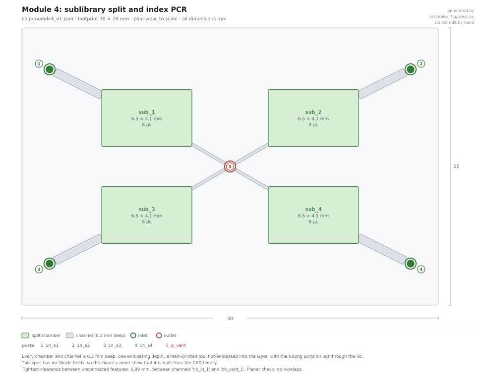
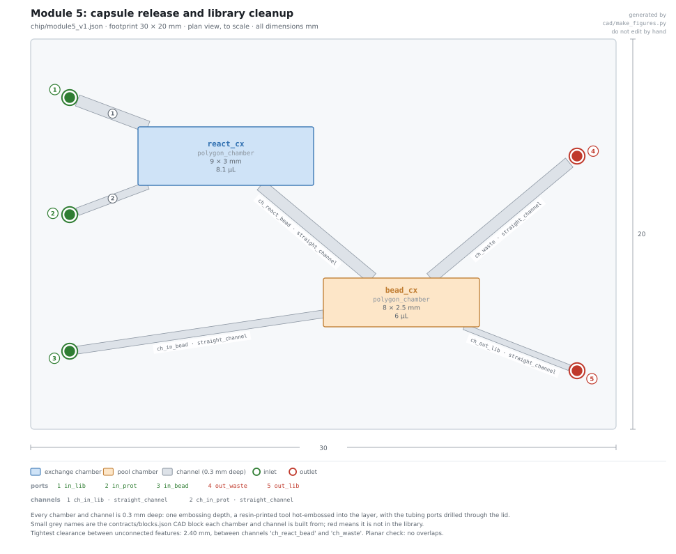
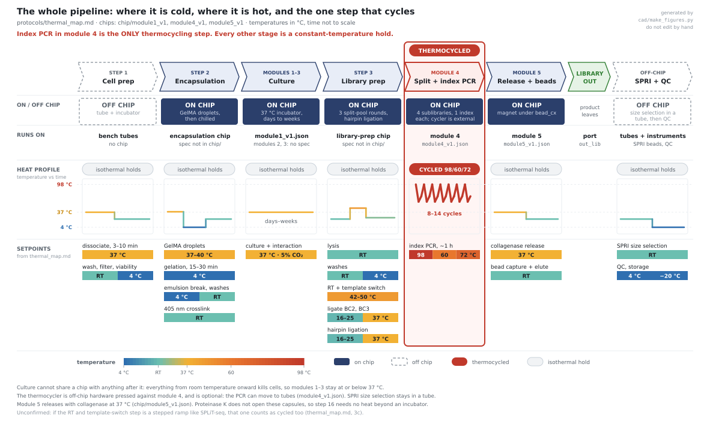

# Modules 4 and 5: sublibrary split, release, cleanup

Design note for `chip/module4_v1.json` and `chip/module5_v1.json` (steps 15–17). One file,
both chips. Numbers are ours. See [CONFIDENTIALITY.md](../CONFIDENTIALITY.md).





## 1. Constraints and design rules

30 × 20 mm per chip, 0.3 mm maximum depth, 3D printing and hot embossing only.

| Rule | Limit |
|---|---|
| Open channel | ≥ 0.2 mm |
| Printed **enclosed** channel | ≥ 0.5 mm. Print open, seal with film |
| Wall between channels | ≥ 0.4 mm |
| Port diameter | ≥ 0.8 mm, drilled |
| Port pitch / count | ≥ 5 mm / ≤ 6 per chip |
| Usable chamber volume | ≤ 85 µL |
| Product-path dead volume | ≤ 1 µL |

## 2. Material is forced

PCR needs 98 °C.

| Material | Verdict |
|---|---|
| PMMA (Tg ~105 °C) | Deforms. Out |
| COP 1060R (Tg ~100 °C) | Deforms. Out |
| Printed resin | Out twice: general-purpose resin softens near 73 °C, and every SLA resin tested inhibited PCR |
| **COC, Tg ≥ 130 °C** (5013/6013 or 1420R) | **Hot-embossed, thermally bonded** |

Module 5 uses the same COC for DNA-handling reasons, though it only needs 37 °C.

## 3. The split is not geometric

A symmetric manifold on a dense capsule suspension gives an estimated **CV of 30–100%**.
Capsules sediment into a bed. The Zweifach-Fung effect sends particles down the
higher-flow daughter, worse as particle nears channel size (140 µm in 300 µm = 0.47).

Instead an **off-chip rotary valve** fills the four chambers one at a time, interleaved
palindromic order (ABCD DCBA, 8–16 cycles). Expected **CV 3–8%**.

- Run the chip **vertical**, flow **downward**: capsules settle along the flow axis.
- Stir the feed syringe.

| Spread between sublibraries | Verdict |
|---|---|
| ±25% | Fine |
| 2-fold | Untidy |
| 4-fold | Redo |

The index only labels the sublibrary. Depth can be normalised afterwards.

## 4. The shared vent

Four chambers, one vent port: the port budget is 6. Each chamber vents through its own
narrow **capillary-stop channel** (0.2 mm). Air escapes while filling. Liquid halts at the
constriction. The four reactions stay isolated through thermocycling despite the shared
vent. This keeps the four indices from mixing.

## 5. Release chemistry correction

| Agent | Effect |
|---|---|
| Proteinase K | **Does not open these capsules.** Published work: intact, DNA kept, after overnight digest |
| Collagenase | Digests gelatin backbone between crosslinks until the network dissolves |
| EDTA | Inhibits collagenase. **Must be absent** |

Bulk GelMA is fully digested in 5–8 h at 37 °C. A 70 µm capsule should be far faster.
So module 5 needs **only 37 °C**.

## 6. Two things that break if ignored

**No ethanol wash or dry on chip.** A drying meniscus pulls on a 1 µm bead about 100,000×
harder than the magnet. It smears the pellet.

| On chip | Off chip |
|---|---|
| Capture, buffer exchange, elution | Ratio-based SPRI size selection (removes primer dimers) |

**Dilute before the beads.** Dissolved shell is roughly 10,000× more polymer than DNA:
about 0.9 mg against about 100 ng for 100,000 capsules. Undiluted, SPRI binding fails.

There is no bead trap. Beads are ~1 µm, the smallest feature 200 µm. Retention is magnetic.

## 7. Contested order: the biggest open question

| | Order |
|---|---|
| Team protocol sheet | index PCR (15), then release (16) |
| Published practice | release **first**, then PCR |

Why: fragments under 300 bp leak out of the shell and can prime neighbouring capsules.
That gives chimeras and a size-biased library.

Module 5 supports either order. With the magnet off, `react_cx` drains through `bead_cx` to
`out_waste`, so it can run before module 4. **Resolve from the CapSeq supplementary methods
before anything is fabricated.**

## 8. What is off chip

- **Thermocycler.** Optional. On-chip PCR is specified, but a tube in a commercial cycler is
  the lower-risk MVP.
- **SPRI size selection.**
- **All QC.** On-chip absorbance is impossible: at 0.5 mm path, 1 ng/µL DNA gives A260
  ≈ 0.001. Use Qubit, TapeStation, qPCR: about 3 µL of a 5–10 µL output. **QC costs a
  third of the product.**

## 9. Honest limits

- Expect **10–50% library loss** to polymer surfaces.
- Realistic output **5–10 µL**.
- **No device has been built.**
- Capsule size at PCR time is **unconfirmed**. If still swollen to 140 µm, packed volume
  is about 15 µL per sublibrary, not 1.8 µL. Four chambers will not fit. PCR moves to tubes.

## Rebuilding the files

```bash
python cad/make_train_cad.py --chip chip/module4_v1.json
python cad/make_train_cad.py --chip chip/module5_v1.json
python cad/make_figures.py
python tools/validate.py
```
