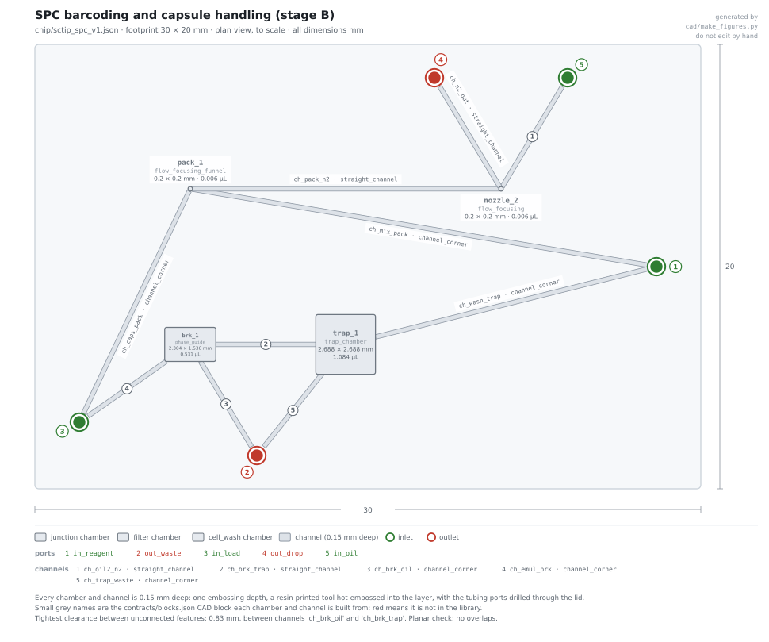
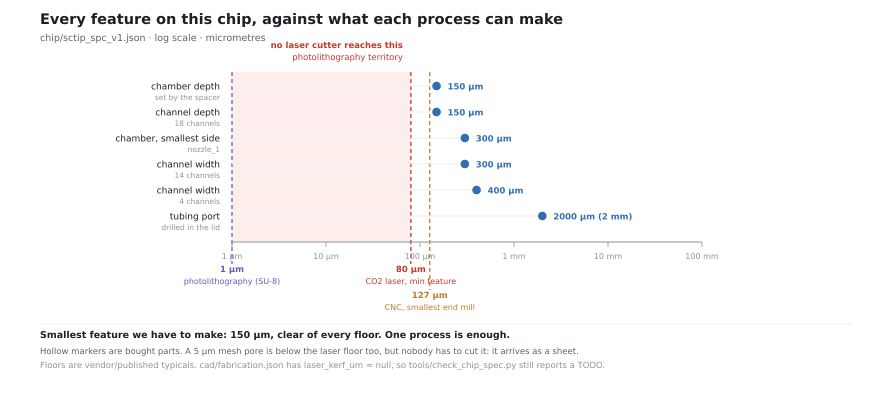
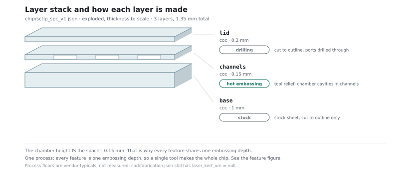

# Single-cell barcoding: the design, and what it fixes

Notes for `sctip_spc_v1.json` and `chip/sctip_spc_v1.json`.

> ## This file is the project's single-cell mechanism
>
> **Stages B and C below are how every cell in this pipeline gets its own barcode.** They are
> not a side experiment and they are not a duplicate of module 3's trap. They are **stage 4b**
> of [pipeline_status.md](pipeline_status.md), sitting between module 3 and module 4:
>
> | | |
> |---|---|
> | **In** | washed capsules from module 3, each holding one cell's cDNA with no barcode on it |
> | **Out** | the same capsules, every molecule carrying one clonal, per-capsule barcode |
>
> Dropping plate-based split-and-pool barcoding did **not** drop per-cell barcoding. The barcode
> is generated inside the capsule's own surrounding **oil droplet** (§1), one capsule holds one
> cell, so the data is single-cell. The per-lane label and the four sublibrary indices — about
> twelve groups — are a **demultiplexing** convenience on top, not the resolution of the data.
>
> **What exists and what does not.** A design and a protocol exist. A printable chip does not.
> Stage A is retired in favour of `chip/spc_demo_v1.json` (encapsulation is off-chip). Stage B
> needs a 115 µm close-packed entrance and stage C needs 100 × 150 µm slots, and our in-plane
> floor is 200 µm — so, exactly as with encapsulation, **the droplet-handling steps cannot be
> resin-printed or hot-embossed and belong on the commercial droplet kit.**
> `chip/sctip_spc_v1.json` is a demo-scale layout only: its `pack_1` is clamped to 200 µm, which
> is wider than a capsule and therefore cannot order capsules single file.
> **The barcoding chemistry is ours and is the single-cell mechanism; the droplet hardware is
> bought.** That is the position, stated as such. The one piece we do fabricate is capsule
> retention, as a depth weir — a 25 µm gap under the lid, crest = the chip's etch depth minus
> the gap, because the 200 µm floor is **in-plane** and z is free (§6, §7). Not a bought mesh
> insert and not sedimentation.
> The honest limits in §7 all still stand, including the Poisson cost: at a mean of 3,
> about **5% of droplets get no barcode and those cells are lost**, and most get several and
> must be merged computationally.

The brief: build our own capsule generator instead of buying one, and replace
plate-based split-and-pool barcoding with a single random barcode per capsule that is
amplified in place — the AmpliDrop idea
([10.1101/2024.08.13.607508](https://doi.org/10.1101/2024.08.13.607508)) applied to
semipermeable capsules, on a chip we can actually make.

The barcoding half of that brief survives intact and is what §1 and §5 describe. The
"instead of buying one" half did not: the droplet hardware is bought (see the box above),
so §2's capsule-size reasoning now reads as *what a chip-made capsule would have had to be*,
and the capsules that actually arrive are the pipeline's, from the kit
(`contracts/parameters.json` → `capsule.diameter_um`).

It works, but not the way it was first drawn. Two things had to change, and both changes
are forced by numbers rather than taste. Everything below is published work, cited
inline, plus geometry we derived. See [CONFIDENTIALITY.md](../CONFIDENTIALITY.md).



---

## 1. The anchor molecule does not work, and is not needed

The original idea was a barcode tethered to a large PEG so it could not escape the
capsule. The problem is that **it protects the wrong molecule.**

The shell retains DNA above about **300 bp** and passes proteins up to about 160 kDa
([10.1093/nar/gkac918](https://doi.org/10.1093/nar/gkac918),
[10.1126/science.ady7227](https://doi.org/10.1126/science.ady7227)). An anchor holds the
one seed molecule. But clonal amplification produces **~10⁶–10⁸ short copies**, none of
them anchored, all of them below the cutoff. Measured leakage for 100–300 bp fragments
is **5.1% per wash**, with amplicons found in the supernatant at every size from 100 to
1500 bp ([10.1101/2025.03.14.643253](https://doi.org/10.1101/2025.03.14.643253)). Every
capsule would seed every other capsule.

The anchor holds one molecule while a million escape.

**What we do instead:** amplify while the capsule is sealed inside an **oil droplet**,
and in the same reaction join the barcode onto the fragment by overlap extension
([10.1016/0378-1119(89)90359-4](https://doi.org/10.1016/0378-1119(89)90359-4)). By the
time the emulsion is broken the barcode is part of a molecule long enough for the shell
to hold. Loose copies wash away harmlessly.

**The emulsion is the containment.** The shell's job is retaining the finished product
for washing and pooling — not retaining the barcode during amplification. No anchor
chemistry, no cleavage step, no protease.

| | Anchor design | Amplify-in-oil |
|---|---|---|
| Holds the seed | yes | yes (oil) |
| Holds the **amplicons** | **no** | **yes (oil)** |
| Extra chemistry | PEG conjugate + cleavage | none |
| Thermal conflict | anchor must survive cycling | none |

---

## 2. The capsules are 135 µm because of the fabrication limit, not the biology

A 40 µm nozzle is **not achievable** with 3D printing and hot embossing. A desktop DLP
printer floors at about 200 µm for open channels and 500 µm for enclosed ones (`contracts/blocks.json`); hot
embossing replicates whatever its master has, and a 40 µm master needs photolithography
or micromilling, both of which are outside the constraint.

So the orifice is **100 µm**, which gives droplets of roughly 1.3× that — about 135 µm.

That turns out to be the right answer anyway, because of the next step. Close-packed
re-injection is what beats Poisson on the capsule side, and it needs an entrance of about
**0.85 × capsule diameter** ([10.1021/acs.analchem.5c05488](https://doi.org/10.1021/acs.analchem.5c05488)).

| Capsule | Entrance needed | Can we make it? |
|---|---|---|
| 70 µm | 60 µm | **no** |
| 120 µm | 102 µm | just |
| **135 µm** | **115 µm** | **yes** |

A 70 µm capsule cannot be re-injected close-packed on a chip we can build. At 135 µm it
works, and published single occupancy is **93–97%**, against about 30% by chance.

The cost is honest: a 135 µm capsule is **9.8× the volume** of a 70 µm one, so reagent
per cell goes up, and throughput is ~140k capsules/h against the ~835k/h of a bought
instrument. `--report` prints both.

---

## 3. Nothing above 72 °C ever touches an intact capsule

This was the biggest worry and it evaporates on reading the published method. In TIP-seq
([10.1083/jcb.202103078](https://doi.org/10.1083/jcb.202103078)):

| Step | Temp | Cells intact? |
|---|---|---|
| Antibody, transposase binding | 4 °C – RT | yes |
| **Tagmentation** | **room temperature** | yes |
| Lysis | 50 °C | no, lysed here |
| Gap-fill | 72 °C | DNA only |
| Linear amplification | 37 °C, overnight | DNA only |
| Library PCR | 98 °C | DNA only, after release |

**Maximum with capsules present: 72 °C for 3 min.** The amplification that matters is
*linear* and runs at 37 °C — chosen in the source method because one transposon insertion
is enough, errors do not propagate and coverage stays even. Capsules are published as
surviving 98 °C cycling anyway, so there is margin either way.

---

## 4. The live-cell conflict dissolves

AmpliDrop needs cells **fixed and permeabilised**, with the enzyme steps done inside the
cell before encapsulation. We have live cells. That looked like a hard conflict.

It isn't, because the chromatin method needs cells that are **permeabilised but not
fixed and not live** — antibody and transposase have to get in, so a live cell is no good
either way. Cells arrive live from culture, are permeabilised in a tube, and go on chip.
Those upstream steps are bulk and gain nothing from being on a chip.

---

## 5. One barcode per droplet is impossible, and that's fine

A free molecule cannot be ordered the way a close-packed bead can, so barcode loading is
Poisson no matter what.

| Mean per droplet | None | Exactly one | Two or more |
|---|---|---|---|
| 1.0 | **36.8%** | 36.8% | 26.4% |
| **3.0** | **5.0%** | 14.9% | 80.1% |

Aiming for exactly one throws away 37% of cells. So we do what the source method does:
run at a mean of **3**, accept that most droplets get several, and resolve them
afterwards by merging barcodes that share fragments. Only 5% of droplets get none.

Pool size is **16 random bases** (4.3 × 10⁹), so fewer than **0.002%** of 50,000 capsules
share a barcode.

---

## 6. The module, stage by stage



Every feature is at or above 100 µm, so on paper the whole board is **one embossing depth,
one process** — compare the three-lineage chip, which needs two. But 100 µm is below the
200 µm in-plane floor in force now, so "one process" is academic for the droplet features:
we cannot cut them at all, and they are bought. What *is* one process is the part we keep —
the trap and its depth weir, where the tight dimension is in z.

| Stage | Does | Key dimension | Can we make it? |
|---|---|---|---|
| **A** generation | shell + core meet at a flow-focusing cross, oil cuts droplets | 100 µm orifice | retired; off-chip, `spc_demo_v1` / bought kit |
| **B** barcoding | capsules re-injected close-packed, meet barcode + mix, cut back into oil | 115 µm entrance | **below the 200 µm in-plane floor → bought droplet kit** |
| **C** trap and wash | phase separation, packed-bed trap, flow-through washes, back-flush | 100 × 150 µm slots | **slots below the floor → bought kit; retention is ours, as a depth weir** |

**Stage C is the one that pays for itself.** The bench workflow runs about twenty
centrifugation steps, and its own notes say most capsules are lost at the
emulsion-breaking step. Buffer exchange here is limited by diffusion into the capsule
(~2–5 min), not by flushing, so there is nothing to gain from a faster pump.

### Which steps are the shared barcoding stage, and which are a variant

`sctip_spc_v1.json` holds two workflows and they are deliberately **not** merged.

| Steps | Belongs to | Runs on the RNA pipeline? |
|---|---|---|
| 1–3 (stage B: re-inject, pair with the barcode pool, cut into oil, thermocycle in a tube) | **shared single-cell barcoding stage** | yes |
| 4–16 (stage C: break the emulsion pass by pass, settle the bed, two flow-through washes) | **shared single-cell barcoding stage** | yes |
| **17–19** (gap-fill at 72 °C, load transcription mix, overnight 37 °C **linear** amplification in the trap) | **chromatin / transposase variant tail** — the DNA flavour, which finishes a transposon-tagmented library in place | **no.** Module 3's reverse transcription already made the template, and module 4's index PCR does the amplifying |
| 20–21 (final wash, back-flush release) | **shared single-cell barcoding stage** | yes |

Steps 17–19 stay in the file, labelled, rather than being folded into the shared stage or
deleted. Module 3 does RNA reverse transcription in its trap; these three steps are the
in-place linear transcription of the DNA flavour. They are not the same operation.



### Two things deliberately left off the chip

- **Curing.** The two aqueous polymers need minutes to demix before the shell is in the
  right place. A serpentine holding minutes at this flow would be metres long, so
  capsules are collected and flood-cured in the tube.
- **Thermocycling.** On-chip cycling is no faster than a tube at this scale and invites
  evaporation and bubbles through a 16-hour run. Only the steps that genuinely need a
  chip are on it.

---

## 7. Honest limits

- **No cells have been run.** This is an architecture and a physics budget.
- **Nobody has published capsule re-injection with a single-copy barcode.** The two halves
  are each published; the combination is not.
- **Capsule retention is unverified.** It is the one part of this stage we *do* fabricate:
  the 200 µm floor is **in-plane** and z is free, so retention is a **depth weir** — a 25 µm
  gap under the lid, crest = this chip's etch depth minus the gap, still one etch depth and
  one fluidic layer. Not a bought mesh insert and not sedimentation. But a liquid-core
  capsule deforms, and z tolerance on a 25 µm gap is roughly ±20 µm, so the gap could close
  or leak outright. **This is the first thing to test on the bench** — a 21 / 24 / 27 µm gap
  coupon and a pressure ramp on real capsules.
- **Poisson costs cells, and the arithmetic is not negotiable.** At a mean of 3 barcode
  molecules per droplet, about **5% of droplets get no barcode at all and those cells are
  simply lost**, and **most droplets get several barcodes**, which have to be merged
  computationally afterwards by spotting barcodes that share fragments. Running at a mean of
  1 instead would lose 37%, which is worse. There is no setting that gives one barcode per
  droplet.
- **Fragments below ~300 bp are lost** even when barcoded, because the shell will not hold
  them. For a mononucleosomal target that is a real fraction.
- **About half the transcribed RNA may lack the barcode**, because the barcode oligo
  carries its own promoter.
- **Cell sedimentation in the core line** will drift the loading within minutes at
  1.5 µL/min. Test with density-matched beads before using cells.
- **Oil supply:** the standard fluorinated oils are affected by an industry-wide PFAS phase-out.
  Alternatives exist but need qualifying.
- **The droplet hardware is bought, so its wetted materials are not ours to check.** `coc`
  *is* in `contracts/materials.json`, so the board we do make is covered; the kit's own
  tubing and cartridge are not.

## Rebuilding

```bash
python protocols/build_sctip_spc.py --report
python cad/make_figures.py --chip chip/sctip_spc_v1.json
python operator/run.py --protocol protocols/sctip_spc_v1.json --chip chip/sctip_spc_v1.json
python tools/validate.py && python tools/check_chip_spec.py
```
