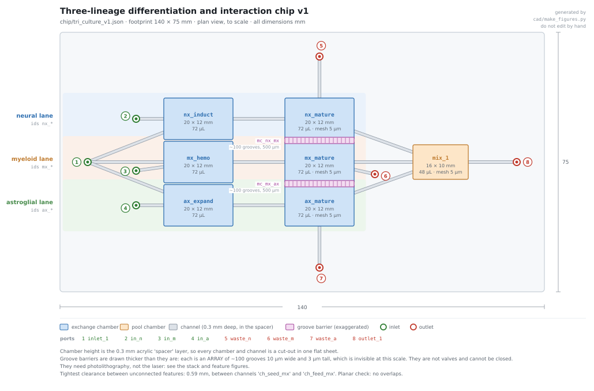
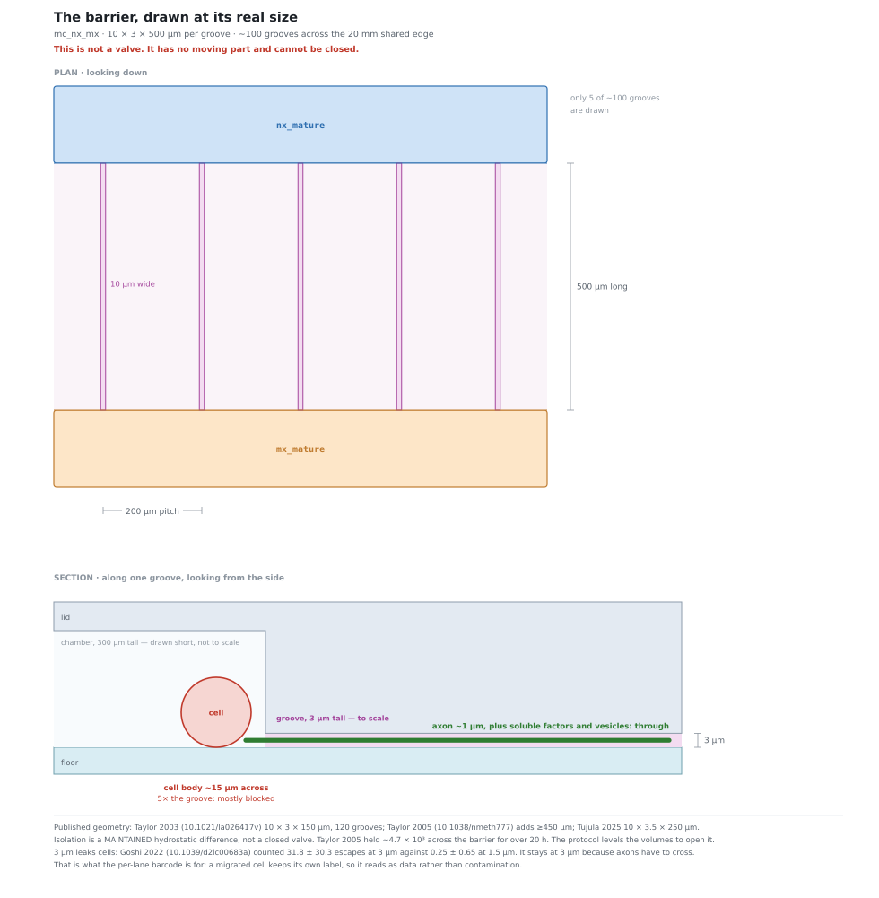
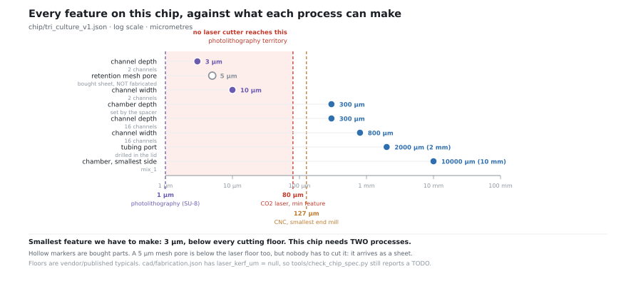
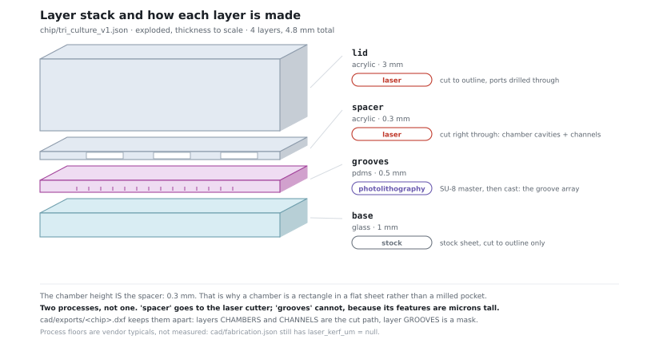
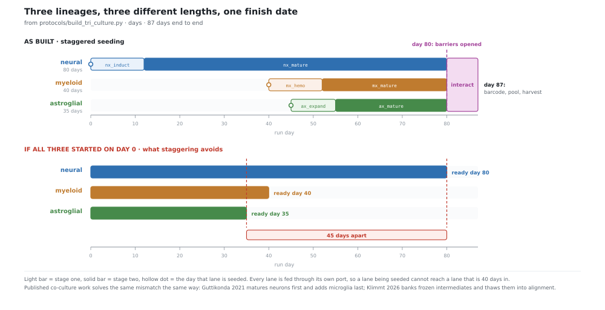

# Three-lineage chip: what changed from the sketch, and why

Design notes for `tri_culture_v1.json` and `chip/tri_culture_v1.json`.

The sketch was: iPSCs in, split three ways through Tesla valves, three different
differentiation media, chambers linked by normally-closed valves that pass soluble
factors and axons but not cells, open them after differentiation, then collect each
chamber separately and barcode.

The architecture holds. Two of the components don't, and both have published
replacements. Everything below is from published work, cited inline, plus geometry we
derived. See [CONFIDENTIALITY.md](../CONFIDENTIALITY.md).



Three lanes, each with its own inlet and its own waste, sharing only `inlet_1` at
seeding and `mix_1` at the end. The pink strips between the three mature chambers are
the groove barriers. Regenerate with `python cad/make_figures.py`.

---

## 1. Tesla valves cannot work here. This is physics, not engineering

A Tesla valve is a passive fluidic diode. Its rectification comes from inertia, so it
needs a Reynolds number high enough for inertia to matter.

**Our Reynolds number is 0.25 to 0.83.** For the 0.8 × 0.3 mm feed channels,
Dh = 4A/P = 0.436 mm, and at 6–20 µL/min:

| Flow | Velocity | Re |
|---|---|---|
| 6 µL/min | 0.42 mm/s | **0.25** |
| 20 µL/min | 1.39 mm/s | **0.83** |

**Published diodicity against Re** (ratio of reverse to forward pressure drop, so 1.0
means no rectification at all):

| Re | Diodicity | Source |
|---|---|---|
| ≪ 1 | **1.0 exactly** | Stokes flow is time-reversible (Nguyen et al. 2021, doi 10.1038/s41467-021-23009-y) |
| 50 | 1.01–1.05 | Liosis et al. 2025, doi 10.3390/mi16121329 |
| 200 | 1.17–1.77 | same |
| ~36 | ~1.8, the best low-Re experiment | Böhm et al. 2022, doi 10.1038/s41378-022-00437-4 |

At Re below 1 the Navier–Stokes equations lose their inertial term, the flow becomes
linear and time-reversible, and **no rigid passive geometry can rectify it.** It is not
that a Tesla valve would be weak here. It is that no shape would work.

We would need about **900 µL/min** to reach the best published low-Re operating point,
which is 45× our flow and would wash the culture out.

### What replaces it

Ranked for reliability (the full comparison is in the research notes):

1. **A dedicated port per lane, with no shared junction.** Isolation by topology. No
   flow physics to go wrong. This is what the chip does.
2. Off-chip active valves. Fine, but a rotary selector connects one line at a time,
   and three media must be present for weeks.
3. Hydraulic resistance isolation: branch resistance ≳ 100× the shared path for 1%
   cross-talk. Useful as a backstop, useless when pumps stop.

**Important caveat that applies to all of them:** none stops diffusion. In stagnant
liquid a small molecule travels about 9 mm in 24 h and 25 mm in a week. Any shared
liquid path of a few millimetres will leak over a 12-week run no matter what valve is
in it. Topological separation is the only thing that survives a stopped pump.

### The honest cost

The Tesla valves were there so one inlet could serve three chambers. Since passive
rectification is impossible, **the cost of real isolation is one port per lane.** The
chip has 8 ports rather than 2: one seeding inlet, three lane inlets, three lane
wastes, one outlet.

It is kept to 8 rather than 14 by one observation: a shared junction only matters
*between* lanes. Inside a lane the stage-1 and stage-2 chambers can share a feed and a
waste, because anything that leaks between them is the same cell type. So each lane's
medium enters through its stage-1 chamber and passes on to stage-2, which is empty
until the passage step.

---

## 2. The "MC valves" are microgrooves, and they are not valves

The requirement — pass soluble factors, vesicles and axons, block cell bodies — is
exactly what compartmentalised neuron devices do, and there is a standard geometry.

| Device | Groove W × H × L | Count |
|---|---|---|
| Taylor et al. 2003, doi 10.1021/la026417v | 10 × 3 × 150 µm | 120 |
| Taylor et al. 2005, doi 10.1038/nmeth777 | 10 × 3 × 150 and ≥450 µm | — |
| Tujula et al. 2025, doi 10.1186/s12964-025-02304-x | 10 × 3.5 × 250 µm | 40 |
| **This chip** | **10 × 3 × 500 µm, ~100 grooves per barrier** | |

`mc_nx_mx` and `mc_mx_ax` each stand for the whole array. The schema can only express
one channel, so `width_mm` and `depth_mm` give the single-groove cross-section.



### Three corrections to the sketch

**They cannot be opened and closed.** A 3 µm groove has no valve in it. What the
published devices actually do is maintain a **hydrostatic pressure difference**: a
30–50 µL volume difference drives a slow counterflow that opposes diffusion. Taylor
2005 measured ³⁵S-methionine at 17,537 cpm on one side and 3.7 cpm on the other, a
ratio of about 4.7 × 10³, holding for over 20 h. Tujula 2025 saw no 15–25 kDa dextran
cross in 24 h and no IL-6 in 7 days.

So the protocol does not "open a valve". It **levels the volumes**, which removes the
counterflow and lets exchange begin. Isolation is a condition you maintain, not a
state you latch.

A true switchable barrier does exist — a PDMS membrane pressed onto a 1–16 µm gap
(Gao et al. 2011, doi 10.1007/s10544-011-9523-9; Majumdar et al. 2011,
doi 10.1016/j.jneumeth.2010.12.024), which held for over a week with hydraulic
actuation and supported neuron–glia co-culture for over 3 weeks. It needs multilayer
PDMS. Worth considering if maintained isolation proves too fragile, but note that
closing a valve on grown axons severs them: above 95 kPa essentially all are
transected (Hosmane et al. 2011, doi 10.1039/c1lc20549h).

**Cell exclusion at 3 µm is leaky, and we should expect migrants.** Goshi et al. 2022
(doi 10.1039/d2lc00683a) counted cells that escaped confinement per device:

| Groove height | Escaped cells (high density) | (low density) |
|---|---|---|
| 1.5 µm | **0.25 ± 0.65** | 0.21 ± 0.44 |
| 3 µm | 31.8 ± 30.3 | 4.3 ± 7.3 |
| 6 µm | 145 ± 162 | 19 ± 24 |

Tujula 2025 specifically watched iPSC microglia migrate through 3.5 µm tunnels, and
microglia sit in the middle lane here. **This is the main reason the per-lane barcode
matters:** it turns migration from a contamination problem into a measurement. A cell
carrying lane 2's barcode found in lane 1's chamber is data.

If cell exclusion matters more than axon crossing, drop to 1.5 µm and accept slower
axon growth. The spec is 3 µm because axon crossing is a stated requirement.

**The groove layer cannot be laser-cut.** A CO₂ laser does about 80 µm minimum with
several µm of roughness, which is larger than the whole groove. CNC tooling stops
around 127 µm. 3 µm features need photolithography: SU-8 on silicon, then PDMS casting
(Taylor 2003 spun SU-8 5 at 4000 rpm for 3 µm).

So **this is a hybrid chip.** `cad/make_train_cad.py` now separates the DXF layers
accordingly, and says so:

- `CHAMBERS` and `CHANNELS` → the 0.3 mm spacer, laser-cut.
- `GROOVES` → a photolithography mask, a different process and a different layer.





Commercial alternatives exist (Xona XonaChips, Merck AXIS, NETRI DuaLink) but they are
complete devices with fixed small chambers, not parts that bond into ours.

---

## 3. The three lineages do not finish together

This is the scheduling problem the sketch doesn't show, and it is the thing most
likely to bite.

| Lane | Published route | Wild-type? | Duration |
|---|---|---|---|
| Neural | Shi, Kirwan & Livesey 2012, doi 10.1038/nprot.2012.116 | Yes | **80 d** |
| Myeloid | McQuade et al. 2018, doi 10.1186/s13024-018-0297-x | Yes | **38–40 d** |
| Astroglial | Schuurmans et al. 2026, doi 10.1002/glia.70202 | Yes | **35 d** |

Start them together and they finish **45 days apart.**

**A warning about the obvious reference.** Guttikonda et al. 2021
(doi 10.1038/s41593-020-00796-z) is the best-known iPSC tri-culture of exactly these
three types, but **its astrocytes are transgenic** — an inducible NFIA lentivirus plus
a CD44⁺ sort. That arm is unusable under a wild-type constraint. Its neurons and
microglia are wild-type.

The wild-type astrocyte options are all slow if they go through a neural progenitor
that must be expanded and passaged: Santos 2017 is ~9–10 weeks, Giordano 2023 ~8 weeks,
Krencik 2011 ~6 months. **Schuurmans 2026 is the exception**: 35 days, straight from
iPSC, no progenitor step, no transgene. It is new (2026) and the cells are
early-to-intermediate maturity, so treat it as the best available rather than settled.

### How the chip handles it: staggered seeding

| Lane | Seeded | Passaged | Mature |
|---|---|---|---|
| Neural | day 0 | day 12 | day 80 |
| Myeloid | day 40 | day 52 | day 80 |
| Astroglial | day 45 | day 55 | day 80 |

Barriers opened day 80, cross-talk to day 87, harvest day 87.



The lower panel is what staggering avoids. The figure is drawn from
`build_tri_culture.py` itself, so it cannot drift from the protocol.

This is what published work does: Guttikonda matures neurons first and adds microglia
last; Klimmt et al. 2026 (doi 10.1038/s41593-026-02367-0), the one wild-type tri-culture
I found, freezes intermediates and thaws them into alignment.

**Staggered seeding is also why per-lane isolation has to be real.** You are seeding
fresh iPSCs into lane 2 on day 40 while lane 1 is 40 days into a neural differentiation
two chambers away. A shared junction would carry iPSC medium straight into it.

---

## 4. Per-lane barcoding, so the lanes can be pooled

Collect separately, label each lane, then pool and build one library.

**Lipid-anchored oligos** (MULTI-seq, McGinnis et al. 2019, doi 10.1038/s41592-019-0433-8)
are the right choice here:

- **No antibody and no epitope dependence.** Antibody hashing relies on surface
  proteins whose levels differ between neurons, astrocytes and microglia, and microglial
  Fc receptors need blocking.
- **Minutes, not half an hour.** Insertion is 5 + 5 min at ~200 nM, against 30 min at
  4 °C for antibody staining.
- **No centrifugation.** The original work labelled adherent cells in the plate during
  dissociation. A buffer flush replaces the wash spins. That is what makes it
  perfusable in a sealed chamber.
- 96-plex demonstrated, ~0.5% misclassification.

Done cold, because the labels swap between cells at room temperature. The wash step
matters more than the labelling step: carryover of unbound oligo is what blurs the
lanes.

---

## 5. Answering "do we need more chips?"

**One new chip, plus one process we do not currently have.**

- `tri_culture_v1` replaces the front of the single-lineage train for this experiment.
  It is one board, not three.
- The grooves need photolithography. That is the real addition: not another chip, but a
  second fabrication route.
- No extra chip is needed for collection. Barcoding is three perfusion steps, and
  pooling is one operation the contract already has.

**What it does not do.** It stops at a barcoded suspension at `outlet_1`. Encapsulation
and library prep are downstream, which matches the sketch's note that this comes before
the wash step.

---

## 6. Drawing it found four short circuits

Worth recording, because it argues for drawing every chip before anyone cuts one.

`cad/make_figures.py` checks the plan as it draws. This chip is a single layer with no
vias, so **two channels that touch in plan view are one channel**, and a port drilled
over a channel it isn't connected to joins two things that should never meet. The JSON
spec cannot show that, and `tools/check_chip_spec.py` doesn't look for it. The first
run reported four errors, all in the middle lane:

| | What |
|---|---|
| `in_m` on `ch_seed_ax` | The myeloid feed port was drilled **through the astroglial seeding line**, 1.37 mm of overlap. Seeding the astroglial lane would have pushed iPSCs out of the myeloid inlet. |
| `ch_feed_mx` on `ch_seed_ax` | Same cause, 0.18 mm. |
| `waste_m` on `ch_pass_mx` | The myeloid waste port sat **on the line that carries progenitors** from `mx_hemo` to `mx_mature`. The passage step would have drained cells to waste. |
| `ch_waste_mx` on `ch_pass_mx` | Same, 0.80 mm. |

All four are the same underlying problem: the middle lane is boxed in on four sides,
so its ports had been tucked into the only gaps left, and those gaps already had
channels in them. Fixed by moving `in_m` to (22, 35), clear of the seeding fan, and
`waste_m` to (91, 34), downstream of `mx_mature` rather than on its feed.

The tightest remaining clearance is **0.59 mm**, between `ch_seed_mx` and `ch_feed_mx`
where both enter `mx_hemo`. That is a real 0.59 mm rib of 0.3 mm acrylic, bonded on
both faces, and it is the tightest non-groove feature on the chip. It cannot be
checked properly until `cad/fabrication.json` has a measured `laser_kerf_um`.

The single-lineage train chip came back clean at 1.29 mm.

## 7. Honest limits

- **No cells have been run.** This is an architecture and a physics budget.
- **No published wild-type iPSC tri-culture of these three types exists in a
  compartmentalised device.** Park et al. 2018 did a 3D microfluidic tri-culture, but
  with immortalised transgenic lines. Tujula 2025 is the closest: human iPSC microglia
  and astrocytes in compartments, no neurons.
- **Chamber size is far outside published practice.** Compartmentalised devices use
  chambers of roughly 2 µL; ours are 72 µL, and the barriers are 20 mm wide against a
  published 1.5 mm. Hydrostatic isolation across a barrier that wide is untested.
- **Three media, one pressure.** A hydrostatic gradient can protect one side of a pair.
  With three lanes in a row, the middle lane cannot be held against both neighbours by
  pressure alone, so isolation leans on per-lane perfusion sweeping the groove mouths.
- **Astrocyte passaging is simplified.** Schuurmans needs about three splits in five
  weeks; the protocol models one, as the stage-1 to stage-2 passage.
- **The run is 87 days**, which the twin plays as 7,569,709 s.

## Rebuilding

```bash
python protocols/build_tri_culture.py --report
python cad/make_train_cad.py --chip chip/tri_culture_v1.json
python cad/make_figures.py --chip chip/tri_culture_v1.json
python operator/run.py --protocol protocols/tri_culture_v1.json --chip chip/tri_culture_v1.json
python tools/validate.py && python tools/check_chip_spec.py
```
